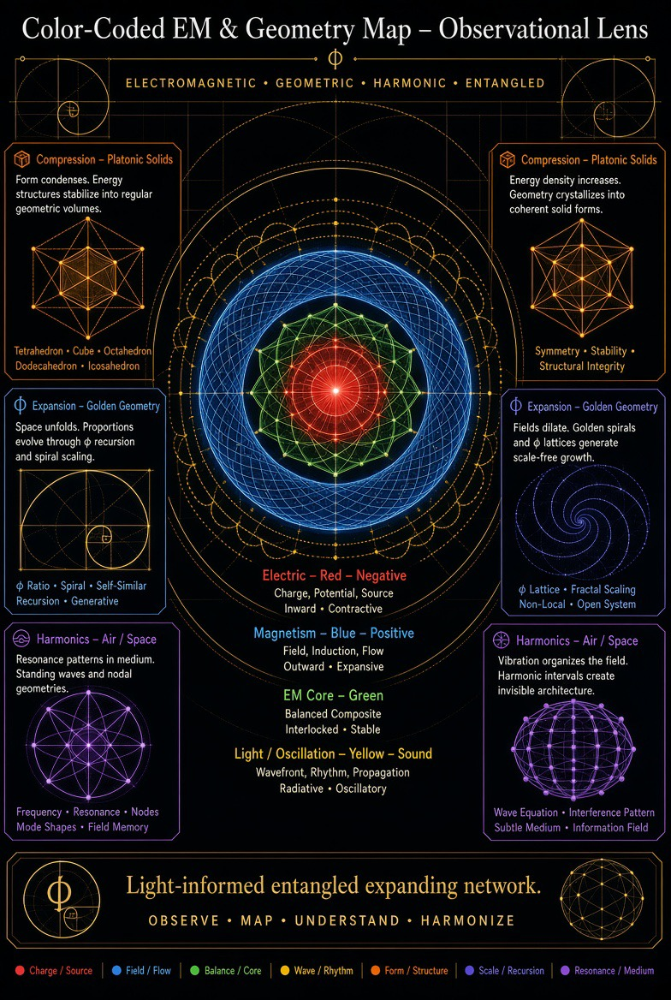

# Color-Coded EM & Geometry Map: Observational Lens
*Electromagnetic • Geometric • Harmonic • Entangled*

License: CC0 1.0. Evidence labels: **Grounded** / **Plausible-untested** / **Speculative**.

> **Status: symbolic / observational lens, not physics.** The map is a way of organising observations and intuitions. Its colour and sign assignments are not physical laws.

## Legend (transcribed)
| Colour / element | Keywords | Character |
|---|---|---|
| **Electric**: Red, Negative | charge, potential, source | inward, contractive |
| **Magnetism**: Blue, Positive | field, induction, flow | outward, expansive |
| **EM Core**: Green | balanced composite, interlocked, stable | |
| **Light / Oscillation**: Yellow, Sound | wavefront, rhythm, propagation | radiative, oscillatory |
| **Compression**: Platonic Solids (orange) | form / structure | |
| **Expansion**: Golden Geometry | phi recursion, spiral scaling, phi lattice, fractal scaling, non-local, open system | scale / recursion |
| **Harmonics**: Air / Space (purple) | resonance in medium, standing waves, nodal geometries, wave equation, interference, subtle medium, information field | |

**Motto:** *"Light-informed entangled expanding network. Observe • Map • Understand • Harmonize."*

## Where the map diverges from physics
- **Charge sign is not tied to E versus B.** Electric charge comes in both signs. "Negative" is a historical convention (Franklin), not a property of the electric field.
- **Magnetism has no "positive".** No magnetic monopoles have been observed (∇·B = 0). Field lines close on themselves, and north/south poles always come in pairs.
- **E and B are frames of one field.** They are components of a single electromagnetic field tensor F^μν. What one observer calls purely electric, a moving observer sees partly as magnetic. "Inward" versus "outward" is not a fixed property of either.
- **Grounded parts:**
  - Standing waves, nodal geometries and interference in a medium follow the wave equation (Chladni plates, acoustic levitation, cavity modes). **Grounded.**
  - Light as a propagating EM oscillation: **Grounded**.
  - "Sound" in the same row as light: an **analogy** only. Sound is a mechanical pressure wave; light needs no medium.
- **Platonic solids / golden geometry:** these appear in crystals, quasicrystals and phyllotaxis. As causes of EM behaviour they are **Speculative** (see README: the phi spiral tested worse in the POL sim).
- **"Subtle medium / information field":** **Speculative.** No luminiferous ether exists (Michelson–Morley, special relativity).

## Informed universe threads
| Thread | What is established | RGRF reading | Label |
|---|---|---|---|
| **Sun's angular momentum along its galactic path** | The Solar System orbits the galactic centre in ~230 Myr at ~829,000 km/h (NASA Science, "Solar System Facts"). The **solar angular momentum problem**: the Sun holds >99.8 % of the system's mass but <1 % of its angular momentum. It is resolved by angular-momentum transport in the protoplanetary disk (magnetised turbulence and disk winds) and magnetic braking of the young Sun (e.g. "Angular Momentum Transport in Protoplanetary Disks", arXiv 2606.17150; Weiss, Bai & Fu, "History of the Solar Nebula from Meteorite Paleomagnetism", *Science Advances* 7(1): eaba5967 (2021), arXiv 2103.02011; verified). | The Sun's spin and path as an "informing" rhythm | Physics Grounded; "informing" Speculative |
| **Informed universe** | Archive: rgrf_framework.md lists "Informed Universe (Kaku/M-theory): Consciousness and geometry co-create reality. RGRF vehicles 'resonate' with the vacuum structure for efficient travel." 15 May 2026 email: "RGRF draws direct inspiration from Prof. Michio Kaku's pioneering work on string/M-theory and the informed universe…" | Inspirational framing | Speculative (string/M-theory itself is untested; "consciousness co-creates" is not a physics claim) |
| **Entanglement** | Real correlations, but the **no-signalling theorem** means entanglement alone cannot transmit information (see `em_topological_gravity_review.md`, quantum thread) | "Entangled network" | Grounded as correlation; Speculative as communication or "network" |
| **Magnetic reading / magnetoreception** | Animals sense Earth's field. In birds the leading hypothesis is radical-pair spin chemistry in cryptochrome (see the quantum biology thread) | Biology "reading" fields | Grounded / Plausible (mechanism still debated) |
| **Neutrinos** | Neutrinos oscillate between flavours, so they have mass. Nobel Prize in Physics 2015 to Takaaki Kajita (Super-Kamiokande) and Arthur B. McDonald (SNO), "for the discovery of neutrino oscillations, which shows that neutrinos have mass" (NobelPrize.org) | Pervasive, barely-interacting flux | Grounded |
| **Colour charge (QCD)** | Quarks and gluons carry "colour" charge (red/green/blue). **The name is a metaphor: it has no relation to visible colour** or to the red/blue/green of this map. | Name coincidence only | Grounded physics; no link to the map |
| **Quantum biology** | Radical-pair magnetoreception, photosynthetic energy transfer, enzyme tunnelling (see the quantum biology thread) | Life using quantum effects | Grounded/Plausible; separate from POL hardware |
| **Neural networks** | Biological and artificial networks learn by weighted connections. Fungal memristors exist (`mycelium_uses.md`). | "Information network" analogy | Grounded (as networks); analogy to cosmos Speculative |
| **Fractals** | Self-similarity occurs in coastlines, turbulence, branching (lungs, mycelium) and the large-scale galaxy distribution over a limited range. Archive: rgrf_framework.md, "Fractal Self-Similarity: Every level (personal → planetary → cosmic) mirrors the same phi-spiral, vortex, and docking logic"; 27 May 2026 email, "phi spirals, fractals, mycelium composites, and informed cosmic structures". | Same logic at every scale | Fractal statistics Grounded; "same logic at every scale" Speculative (physics changes with scale) |

## C1–C12 seed map
The C1–C12 map from Grok chat `68a752c4` (Aug 2026) has been recovered. See [C1-C12_seed_map.md](C1-C12_seed_map.md).
