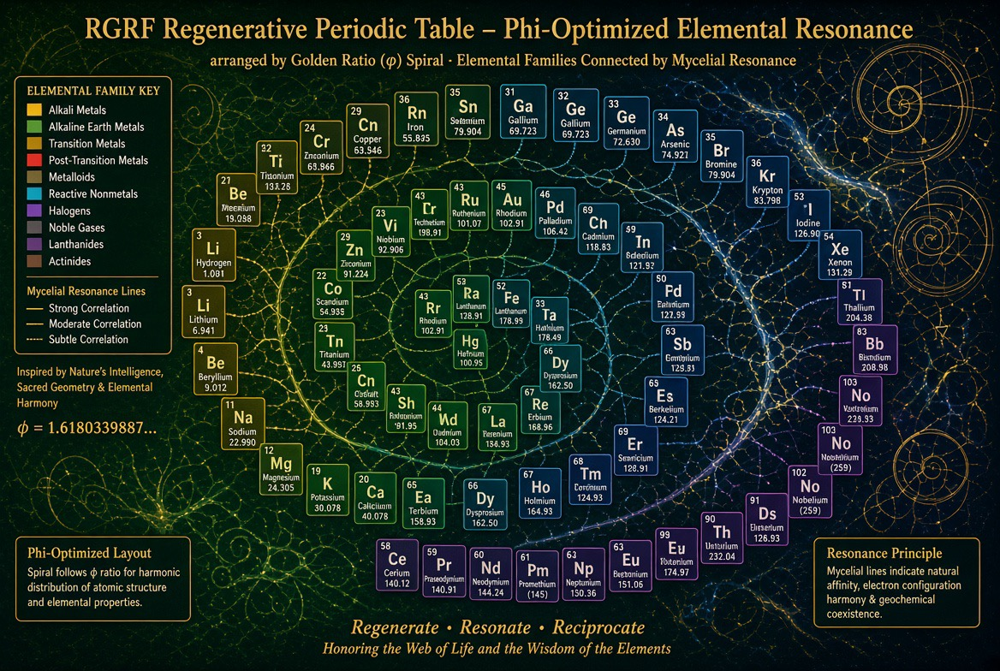

# Helium Octave Table (Russell-inspired)

> **A curiosity, not a replacement for the standard periodic table.** This is a re-reading of the standard element sequence in octaves. It adds no new elements and no new physics. Use the IUPAC table for any real chemistry.

Evidence labels: **Grounded** / **Plausible-untested** / **Speculative**. License CC0.

## Context
- **Walter Russell** drew the elements as octave waves with inert gases as the "seed" or rest points: *The Universal One* (1926; ten octaves, carbon in the 5th) and *A New Concept of the Universe* (1953; revised nine-octave chart, carbon in the 4th). Both are verified as publications. The physics is not accepted by mainstream science.
- **Benfey's spiral periodic table** (the "periodic snail") was first published in the ACS student magazine *Chemistry* in 1964. It is a standard-science spiral layout. See O. T. Benfey, "The biography of a periodic spiral", *Bull. Hist. Chem.* 34(2):141 (2009).

## Transcription (Grok & Channing chat, screenshots 2026-10-12, verbatim structure)

**Helium Octave Seed (root)**
- 2 **He** Helium: octave seed / balance point

**Following tones (unfolding from He)**
- 3 **Li** Lithium · 4 **Be** Beryllium · 5 **B** Boron
- 6 **C** Carbon (high-stability midpoint analog)
- 7 **N** Nitrogen · 8 **O** Oxygen · 9 **F** Fluorine

**Next octave anchor:** 10 **Ne** Neon

**Neon Octave:** 11 **Na** Sodium · 12 **Mg** Magnesium · 13 **Al** Aluminum · 14 **Si** Silicon · 15 **P** Phosphorus · 16 **S** Sulfur · 17 **Cl** Chlorine

**Next octave anchor:** 18 **Ar** Argon

**Argon Octave:** 19 **K** Potassium · 20 **Ca** Calcium · 21 **Sc** Scandium · 22 **Ti** Titanium · 23 **V** Vanadium · 24 **Cr** Chromium · 25 **Mn** Manganese · 26 **Fe** Iron · 27 **Co** Cobalt · 28 **Ni** Nickel · 29 **Cu** Copper · 30 **Zn** Zinc · 31 **Ga** Gallium · 32 **Ge** Germanium · 33 **As** Arsenic · 34 **Se** Selenium · 35 **Br** Bromine

**Next octave anchor:** 36 **Kr** Krypton

*(Pattern continues: each noble gas resets the octave. Heavier elements and f-blocks occupy later octaves. Pre-Helium positions exist in Russell's original as unseen/finer states; we omit them here for the "start at Helium" framing.)*

### Key Differences from the Standard Table
- Noble gases act as octave roots/seeds rather than simple period ends.
- The sequence is read as successive wave cycles of increasing then decreasing density/tone.
- Carbon and iron-group elements are highlighted as stability or resonance nodes.
- Mycelial/regenerative affinity notes remain available for C, O, Si, Fe, Mg, Cu, etc., if we want to layer them back in.

## Mapping to standard physics
| Octave-table idea | Standard counterpart | Tag |
|---|---|---|
| Noble gas "resets the octave" | Closed electron shells (He, Ne, Ar, Kr…) mark the ends of periods. This is the quantum-mechanical source of periodicity. | **Grounded** |
| Iron-group "stability node" | Nuclear binding energy per nucleon peaks near the iron group. ⁶²Ni is the highest, just above ⁵⁸Fe and ⁵⁶Fe; ⁵⁶Fe is the most abundant because of stellar nucleosynthesis (Fewell, *Am. J. Phys.* 63:653–658 (1995), doi 10.1119/1.17828). This is *nuclear* stability, not chemical. | **Grounded** |
| Carbon "high-stability midpoint" | Carbon sits mid-period with four valence electrons, so it forms four stable covalent bonds and has a huge catenation chemistry. "Midpoint of an octave" is a reading, not a law. | **Grounded** chemistry / framing **Plausible** |
| Elements as "tones" / octave density waves | No physical wave or tone underlies the sequence. Period lengths are 2, 8, 8, 18, 18, 32, not a fixed octave. | **Speculative** |
| Mycelial affinity for C, O, Si, Fe, Mg, Cu | Fungi do use and bind these elements (biomass C/O, Mg/Fe/Cu cofactors, biosorption). An "affinity" ordering keyed to octave position has no evidence. | **Speculative** |

**Falsifiable question:** does any measurable property (ionisation energy, binding energy, a biological uptake ratio) follow octave *position* better than the standard group/period description? If not, the octave layer is notation only.

## Concept image

*Concept art only, **not a data reference**. The image's labels are scrambled, for example Rn labeled "Iron", Li labeled "Hydrogen", Ga duplicated, No duplicated, and many wrong masses and names. Do not read element data from it.*
