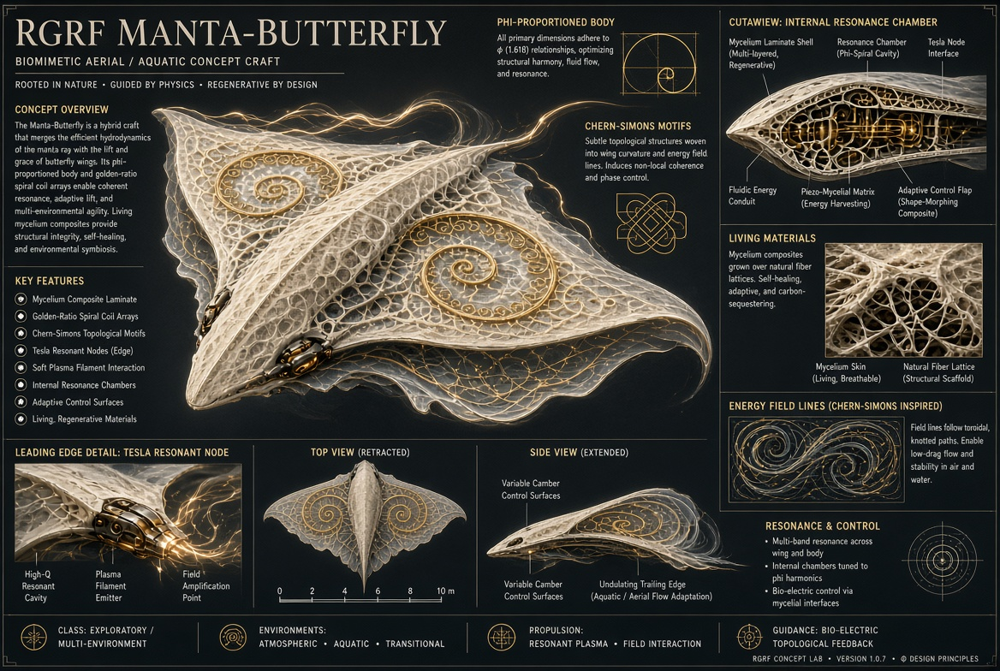

# Manta-Butterfly craft: concept and re-entry charge storage

License: CC0 1.0. Evidence labels: **Grounded** / **Plausible-untested** / **Speculative**.

## Concept as described (Resona note, 11 Oct 2026)
"Hybrid manta-ray / butterfly form with golden-ratio spiral coil arrays, mycelium composite surfaces, Chern-Simons topological motifs in the wing geometry and field lines, Tesla resonant nodes along the leading edges, and soft plasma filament interaction. Includes cutaway of the internal resonance chamber." Described as conceptual (CC0).
- **Label: Speculative** as a vehicle. The note gives no mass, size, propulsion or thermal protection.

## Re-entry energy harvesting and charge storage (overall: Plausible-untested)
Assumptions: ~10 m craft, ~10 t, entry at ~7.5 km/s.
- Kinetic energy ≈ ½·10⁴·(7.5×10³)² ≈ **2.8×10¹¹ J (~280 GJ)**. Almost all of it goes into the air; only a few percent reaches the vehicle as heat.
- So the heat load is **~3–15 GJ** over ~10 minutes, an average of ~5–25 MW.

### 1. Thermoelectric generators (TEGs) under the thermal protection system (Grounded physics)
- TEG conversion is ~5–10 % of the heat *passing through* the device. Hot-side limits are ~500–600 K for Bi₂Te₃/PbTe and ~1,200 K for SiGe, while TPS surfaces reach ~1,500–2,000 K.
- The TPS exists to block heat. Only a small fraction (~1 %) can be let through to a TEG layer without overheating the structure.
- **Estimate:** 1 % of 10 GJ × 5 % ≈ **5 MJ (~1.4 kWh)** per entry, i.e. ~0.05 % of the heat load. Useful for avionics and sensors, not for propulsion.

### 2. MHD generator from the ionised shock layer (Grounded physics)
- Power density (Faraday generator, load factor 0.5) is p = σu²B²/4. Over a ~1 m² × 1 m channel at u = 7 km/s:

| σ (S/m) | B (T) | Ideal P (1 m³) |
|---|---|---|
| 10 | 0.1 | ~1.2 MW |
| 100 | 0.3 | ~110 MW (above the cap) |
| 1,000 | 1 | ~12 GW (above the cap) |

- **Caps:**
  - The available flow kinetic power through 1 m² is ½ρu³A ≈ **~50 MW** at ρ ≈ 3×10⁻⁴ kg/m³ (~60 km altitude).
  - Electrons are strongly magnetised (Hall parameter β_e ~ 10–1,000; see `shifting_phase_order_review.md`). With continuous electrodes the effective power drops by ~1/(1+β²). Segmented electrodes or a Hall-generator geometry are needed.
- **Realistic range: ~kW to low-MW** for seconds to minutes, i.e. **~MJ to ~GJ-scale at best per entry** (upper end only with segmented electrodes and a strong magnet).
- Bonus: extracting power also creates MHD drag (aerobraking assist).

### 3. Plasma-sheath charging (Grounded, negligible energy)
- The vehicle floats a few kT_e/e negative (~ −3 to −5 V at T_e ≈ 1 eV).
- Stored electrostatic energy in the sheath is tiny (body capacitance ~1 nF → µJ). It is not an energy source.

### 4. Storage options and mass for ~5 MJ–1 GJ
| Store | Specific energy (approx.) | Mass for 5 MJ | Mass for 1 GJ | Notes |
|---|---|---|---|---|
| Li-ion battery | ~0.5–0.9 MJ/kg | ~6–10 kg | ~1.1–2 t | Charge-rate limited (C-rate); thermal management |
| Supercapacitors | ~10–30 kJ/kg | ~170–500 kg | impractical | Accept MW pulses |
| SMES (superconducting magnetic) | ~1–10 kJ/kg (system) | 0.5–5 t | impractical | Could share the MHD magnet; needs cryo |

Practical pairing: supercapacitors buffer the MW-scale MHD pulses, and batteries absorb the steady TEG trickle.

See also **[Butterfly-Node](butterfly_node.md)**, the node-scale subsystem concept (living doc).

*See also:* using re-entry as a control method we create (on-demand plasma sheath for braking / steering / transition): [tungsten_bismuth_core.md §7b-reentry](tungsten_bismuth_core.md#7b-reentry-re-entry-as-a-control-method-that-we-create-2026-10-15).

## Falsifiable questions
- In an arc-jet or plasma-wind-tunnel test with a magnet and segmented electrodes, does the measured MHD power density scale as σu²B² with the Hall-parameter correction?
- Does a TEG layer under an ablative or ceramic TPS coupon produce the predicted ~5–10 % of transmitted heat without raising the backface temperature beyond limits?

## Missing pieces
Mass, size and shape; entry trajectory; TPS design; magnet type and mass; electrical architecture; what the stored energy is for.

## See also (2026-10-17)

- [chern_simons_manta_butterfly_review.md](chern_simons_manta_butterfly_review.md): review of Grok share `6b85d507`, covering the Chern–Simons layer, the manta vs Butterfly comparison, the spin-lock → ion-drag → Tesla-valve chain, φ-vase stations (Symbolic) and Gaia mechanisms. None of it changes the power ledger above.
