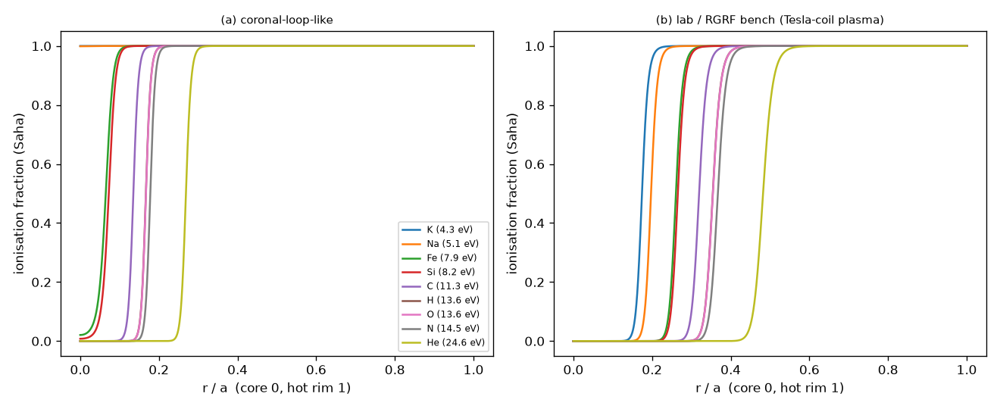
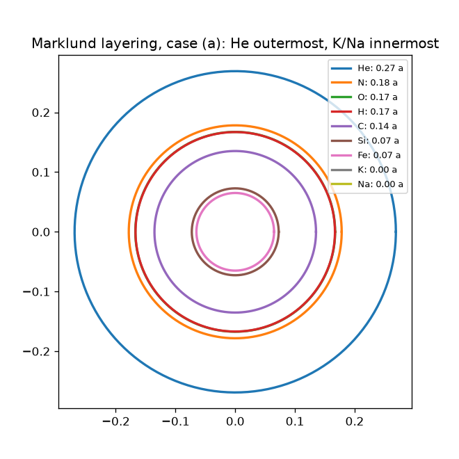

# Marklund convection (element layering in flux tubes) and an archive review of ion wind from jagged surfaces and helium drifting to the centre (2026-10-24)

*License: CC0-1.0. Labels: **Grounded**, **Plausible-untested**, **Speculative**, **Symbolic**. Sim numbers are **model outputs** of [`sims/marklund_convection_sim.py`](../sims/marklund_convection_sim.py) ([output](../sims/marklund_convection_sim_output.txt)) for assumed profiles; Grok numbers are **Grok-reported** unless rerun. Unchecked items are [to verify]; gaps are [Channing to supply]. Channing's words are quoted verbatim.*

Channing: "Yeah, can we do that? Also, we touched on it a little with generated ion wind concepts through jagged surfaces and helium drifting to the center, can we review?" Clarification: "Yes it was in closed loop with water and air".

- **Related:** [em_topological_gravity_review.md](em_topological_gravity_review.md) (radial layering, Marklund citation verified there), [plasma_shielding_patents_review.md](plasma_shielding_patents_review.md) (sheath; Townsend Brown / Biefeld ion wind), [helium_water_circulation.md](helium_water_circulation.md), [lift_and_equilibrium_systems.md §4](lift_and_equilibrium_systems.md) (ionic wind ledger), [alcubierre_plasmoid_turbine_vortex_review.md](alcubierre_plasmoid_turbine_vortex_review.md) (§A2 ionic separation, §B EHD funnel, hourglass chamber), [fuller_tensegrity_vortex_node_review.md §6](fuller_tensegrity_vortex_node_review.md) (He/N₂ loop), [oloid_spine_lorentz_drive.md](oloid_spine_lorentz_drive.md).

## 0. Summary

| Item | Verdict | Label |
|---|---|---|
| Marklund convection: inward E×B drift + Saha recombination gives nested element cylinders | Sound physics idea; layering order follows ionisation potential | Grounded (mechanism) / Plausible (astrophysical occurrence) |
| Layering order | He outermost → N, O ≈ H, C, Si, Fe → Na, K innermost | Grounded (follows from FIPs) |
| Survives at lab / RGRF bench scale? | **No.** Neutrals diffuse ~200× the tube radius before recombining | model output |
| Survives in the coronal-like case? | Washed out too in this crude LTE model | model output; Speculative either way |
| FIP effect, E×B mass filters | Real, measured cousins | Grounded |
| Ion wind from sharp / jagged / barbed edges | Real (corona discharge, EHD); needs neutral gas, none in vacuum | Grounded |
| Helium to the centre in a water / air loop | Correct by rotating-flow buoyancy, not by Marklund | Grounded |

## 1. Marklund convection

**Source:** G. T. Marklund, *Nature* 277:370–371 (1979), doi:10.1038/277370b0 (verified). Background: H. Alfvén, *Cosmic Plasma* (1981); A. L. Peratt, *Physics of the Plasma Universe* (1992) §4.6.3 [to verify section number].

**Mechanism (Grounded as physics).** A twisted, force-free flux tube carries a radial electric field. Ions and electrons E×B/B²-drift inward. If the rim is hot and the core cool, each species recombines where T falls below what keeps it ionised (Saha balance). Once neutral it stops drifting, and the species collect as nested hollow cylinders. Highest ionisation potential recombines first (outermost); lowest ends nearest the axis. Alfvén's "ion pump" is the same inward drift evacuating the surroundings.

**Model.** Lundquist field B_z = B0 J0(αr), B_θ = B0 J1(αr), α = 2.405/a. T(r) = T_core + (T_rim − T_core)(r/a)². Saha with fixed n_e (statistical weights ≈ 1). First ionisation potentials, NIST (eV): K 4.341, Na 5.139, Fe 7.902, Si 8.152, C 11.260, H 13.598, O 13.618, N 14.534, He 24.587 (standard NIST ASD values [to verify against the live ASD page]).

### Results (model outputs; radius where the species is 50 % ionised)

| Species | (a) coronal-loop-like, a = 1000 km, n_e = 1e15 m⁻³, 0.26 → 8.6 eV | (b) bench, a = 2 cm, n_e = 1e19 m⁻³, 0.1 → 5 eV |
|---|---|---|
| He | 0.269 a (269 km) | 0.482 a (9.6 mm) |
| N | 0.178 a | 0.367 a (7.3 mm) |
| O / H | 0.167 a (nearly coincident) | 0.355 a (7.1 mm) |
| C | 0.135 a | 0.320 a (6.4 mm) |
| Si | 0.073 a | 0.266 a (5.3 mm) |
| Fe | 0.065 a | 0.261 a (5.2 mm) |
| Na | still ionised at the core (r = 0) | 0.198 a (4.0 mm) |
| K | still ionised at the core (r = 0) | 0.175 a (3.5 mm) |

### Timescales and diffusion (model outputs)

| | (a) coronal-like | (b) bench |
|---|---|---|
| Drift a/(E/B) | ~800 s | ~8 µs |
| Recombination (radiative + three-body) | ~7000 s | ~0.45 s |
| Neutral diffusion a²/D | ~1800 s | ~10 µs |
| Neutral diffusion length in one recombination time | ~2 a | ~4 m ≈ 200 a |
| Layer gaps | ~0.01–0.1 a | ~0.005–0.06 a (0.1–1 mm) |

**Bench verdict (Grounded reasoning, model numbers): layering is washed out.** Ions drift in within microseconds, but recombination takes ~0.5 s. In that time neutrals, which the magnetic field does not hold, random-walk metres, so the mm-scale shells cannot form. The coronal-like case also washes out in this crude LTE model; real coronae are not in Saha equilibrium (coronal / collisional-radiative balance applies) [to verify with a non-LTE model]. Marklund layering in nature remains **Plausible**, not demonstrated.

### Grounded cousins

- **Solar FIP effect (Grounded).** Low-FIP elements (< ~10 eV) are enhanced ~3–4× in the corona and slow wind. Mainstream explanation: the ponderomotive force of MHD waves acting on ions, not neutrals, in the chromosphere. J. M. Laming, *Living Rev. Sol. Phys.* 12, 2 (2015), doi:10.1007/lrsp-2015-2 (verified). It is ion–neutral fractionation, the same family as Marklund's.
- **E×B plasma mass filters (Grounded).** T. Ohkawa and R. L. Miller, "Band gap ion mass filter", *Phys. Plasmas* 9, 5116 (2002), doi:10.1063/1.1523930 (verified); the Archimedes Filter. Crossed axial B and radial E separate ions by mass radially.

### RGRF tie-ins

- **Tesla-coil impedance-zone plasma as an ion pump / separator (Plausible-untested).** E×B drift and mass filtering are real. Separation by ionisation potential at bench scale is defeated by neutral diffusion (above), but **mass** filtering of ions (Ohkawa–Miller) works while they stay ionised. Earlier ionic-separation thread: [alcubierre_plasmoid_turbine_vortex_review.md §A2](alcubierre_plasmoid_turbine_vortex_review.md). Field, voltage and gas fill [Channing to supply].
- **Plasma shield sheath (Speculative).** A layered sheath around the craft would add ion-pump behaviour to the boundary in [plasma_shielding_patents_review.md](plasma_shielding_patents_review.md), but no quantity is known.

## 2. Archive review: ion wind from jagged surfaces, helium drifting to the centre

### 2a. Archive hits (Channing, verbatim)

| File (line) | Channing |
|---|---|
| [grok_archive/2026-10-17_bnnano_boron_nitride_nanotubes_composites.md](grok_archive/2026-10-17_bnnano_boron_nitride_nanotubes_composites.md) (L3394, msg 91) | "Let’s save update BOM and Blueprints. Can we explore surfaces that have electrostatic properties.. is it always jagged and sharp?" |
| same file (L2531, msg 63) | "Can you entangle two chiral magnets? Also, in a water, helium closed loop if screened through tin or graphene perforated sheets or a stack of electrostatic wind condensing/ harvesting like we talked about before. If it is vortex driven, this would be substantial production it could even be alternating funnel stacks, it would generate wind right especially if we had designed it like Tesla valves.." |
| [grok_archive/2026-10-17_tesla_turbine_ehd_nitinol_vortex_castor_hourglass_chamber.md](grok_archive/2026-10-17_tesla_turbine_ehd_nitinol_vortex_castor_hourglass_chamber.md) (L116, msg 9) | "Can we model EHD ion funnel dynamics EMP induction and Tesla coil vortex rings with nitinol recoil" |
| same file (L1128, msg 35) | "Barbed molding or hair like molding for eddy current generator into smooth hour glass type vortex chamber from both sides copper wrapped quarts core with feedback through the system" |
| [grok_archive/2026-10-17_ultrasonic_waves_water_harmonics_negentropy.md](grok_archive/2026-10-17_ultrasonic_waves_water_harmonics_negentropy.md) (L144) | "With Tesla valves and EM flow..geometry would allow for control pressure feedback with quartz and helium.. Also, in all these instances friction, heat vents, winds, positive ion flows…." |
| [grok_archive/2026-10-17_cathodes_anodes_muon_magnetic_inductance.md](grok_archive/2026-10-17_cathodes_anodes_muon_magnetic_inductance.md) (L2383) | "Can we derive Gorkov potential. Also, if we added a little helium in the system it wouldn’t react with the water or would it spin it in tighter circles inside the vapor?" (Grok's reply, L2505–2512: helium "floats" to the centre under centrifugal buoyancy) |
| [helium_water_circulation.md](helium_water_circulation.md) (L4) | "Yeah for some control of the helium loop we had circulation and water the thought was that the helium would compress to the center. I think we ended up not revisiting which was a ball drop on my part, can we investigate?" |
| [alcubierre_plasmoid_turbine_vortex_review.md](alcubierre_plasmoid_turbine_vortex_review.md) (Tesla-turbine thread, msg 10) | Grok refers to "recent explorations of ion separation, air funneling, ball lightning/vortex plasmas…"; the original turns are in a capture gap [Channing to supply] |

### 2b. Ion wind from jagged / sharp / barbed surfaces

- **Corona discharge at sharp points and edges (Grounded).** The field concentrates at small radii of curvature. Onset follows Peek's law (onset field rises as the radius shrinks, ~1/√r). Ions drift to a collector and drag neutral air with them (EHD ion wind; Robinson 1961 [to verify]). Jagged, serrated or barbed edges are a standard way to lower the onset voltage and spread the discharge. Grok's answer that electrostatic surfaces are "not always jagged and sharp" (triboelectric, polarised smooth surfaces) is also right.
- **Flight demonstrated (Grounded):** H. Xu et al., "Flight of an aeroplane with solid-state propulsion", *Nature* 563, 532 (2018), doi:10.1038/s41586-018-0707-9 (verified), with a 40 kV on-board converter.
- **Rerun of a Grok number.** Grok-reported "I = 1 mA, V = 50 kV, ~0.5 N". The standard 1D result F = I·d/μ (μ ≈ 2×10⁻⁴ m²/V·s) gives **0.10 N at d = 2 cm and 0.25 N at d = 5 cm** (2–5 N/kW), consistent with the earlier review. Grok's figure is ~2–5× high.
- **Thrust needs a neutral gas (Grounded):** no ion wind in vacuum (see Brown/Biefeld in the shielding review; vacuum tests show little or no thrust [to verify Tajmar 2004]). In space it can only be used inside a gas-filled chamber.
- **"Electrostatic wind condensing / harvesting" and "substantial production" (msg 63): not supported as net energy.** Ion wind is driven by the HV supply. A vortex can move charge, but harvesting gives back less than the drive (Grounded energy balance). Perforated graphene or tin screens as electrodes or filters are **Plausible-untested**.

### 2c. Helium to the centre: reconciliation

- **Water / air closed loop (Channing's clarification): yes, by rotating-flow buoyancy (Grounded).** In a swirling liquid, dp/dr = ρv²/r, so low-density gas (helium bubbles, or a helium-rich gas phase) is pushed to the vortex axis. Bubbles collect at vortex cores (hydrocyclone air cores, vortex degassers). The axis is the low-pressure point, so the helium expands there rather than compressing ([helium_water_circulation.md](helium_water_circulation.md)).
- **Helium in air (gas–gas): Grounded but weak at loop speeds.** Equilibrium separation factor q = exp(Δm·v²/2kT) with Δm = 25 u (He 4 vs air ~29), T = 293 K: q ≈ 1.0005 at 10 m/s, 1.013 at 50 m/s, 1.05 at 100 m/s, 1.6 at 300 m/s (rim speed). This is why isotope gas centrifuges spin at hundreds of m/s. A low-speed air loop barely enriches helium at the axis, and diffusion and turbulence mix it back.
- **Helium solubility in water is very low (Grounded):** ~1.5 mg/L at 1 atm, 25 °C [to verify exact value], the lowest of the common gases. So it stays as a separate gas phase.
- **Not in conflict with Marklund.** Marklund convection is a **plasma** mechanism in which helium's high ionisation potential (24.6 eV) puts it in the **outermost** shell. A water / air loop is a **neutral-fluid** mechanism in which helium's low density puts it at the **axis**. Different physics and different media. Both statements are right in their own setting.

## 3. Unknowns [Channing to supply]

Loop rpm or flow speed, radius, helium fraction and pressure; electrode geometry (edge radius, gap, voltage) for the jagged-surface ion wind; Tesla-coil plasma density, field and gas fill for any separator test.
