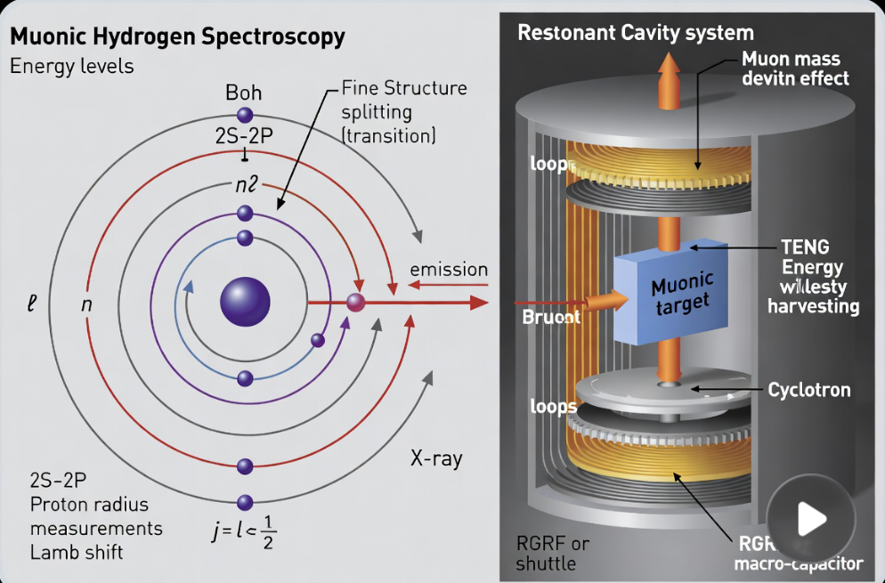

# Muonic hydrogen: physics vs concept art
*License CC0. The source is a SuperGrok "Imagine" screenshot from 12 Oct 2026. The original is archived at `grok-archive/screenshots/2026-10-12_muonic_hydrogen.png`, and the cropped image is below. The crop still carries the video play-button overlay.*

## Grounded physics

**Muonic hydrogen.** A proton orbited by a negative muon, which is about 207 times heavier than the electron.
- The Bohr radius is about 200 times smaller, so the 2S level is far more sensitive to the proton's finite size.
- The 2S–2P Lamb shift moves by about 2%.

**The proton radius puzzle.**
- **2010 (Grounded):** R. Pohl et al., "The size of the proton," *Nature* 466, 213–216 (2010), doi 10.1038/nature09250.
  - Measured a muonic Lamb shift of 49,881.88(76) GHz, giving rₚ = 0.84184(67) fm.
  - That is 5σ below the CODATA value of 0.8768(69) fm.
- **2013 (Grounded):** A. Antognini et al., "Proton structure from the measurement of 2S–2P transition frequencies of muonic hydrogen," *Science* 339, 417–420 (2013), doi 10.1126/science.1230016.
  - Charge radius rE = 0.84087(39) fm, 7σ from CODATA 2010.
  - Also the Zemach radius rZ = 1.082(37) fm and the magnetic radius rM = 0.87(6) fm.
- **2019, electronic hydrogen (Grounded):** N. Bezginov et al., "A measurement of the atomic hydrogen Lamb shift and the proton charge radius," *Science* 365, 1007–1012 (2019), doi 10.1126/science.aau7807.
  - Found rₚ = 0.833(10) fm, which agrees with the muonic value.
  - The puzzle is now largely read as a problem with the older electronic data, not new physics.

**Muon-catalyzed fusion (μCF).**
- **How it works:** in cold, dense D–T, a muon replaces the electron and forms a dtμ molecule. Fusion follows quickly, and the muon is usually freed to repeat the cycle.
- **Yields:**
  - About 150 fusions per muon: S. E. Jones, "Muon-catalysed fusion revisited," *Nature* 321, 127–133 (1986), doi 10.1038/321127a0.
  - The measured figure is 150 ± 4 (stat) ± 20 (syst): Jones et al., *Phys. Rev. Lett.* 56, 588 (1986).
- **The limit is α-sticking.** The muon sticks to the helium nucleus with probability ~0.35% (measured at high density) to ~0.9% (the older calculated value), which ends its chain.
- **Review:** W. H. Breunlich, P. Kammel, J. S. Cohen & M. Leon, "Muon-catalyzed fusion," *Annu. Rev. Nucl. Part. Sci.* 39, 311–356 (1989).
- **Never reached breakeven.** Making one muon costs roughly several GeV of accelerator energy, against ~17.6 MeV × ~150 ≈ 2.6 GeV of fusion yield per muon, before any conversion losses.
- **Muon production needs accelerators.** Pions are produced and decay into muons, for example at PSI (Paul Scherrer Institute), where the Pohl and Antognini experiments ran.

## Concept art: Speculative / decorative

**What the image shows:**
- **Left panel:** a Bohr-style orbit sketch labeled "2S–2P", "Fine Structure splitting (transition)", "emission", "X-ray", "Proton radius measurements / Lamb shift".
  - It is decorative, not a correct level diagram. "Boh", "n2" and "j = l < ½" are garbled.
- **Right panel:** a "Restonant Cavity system" (sic). It shows a central **muonic target**, "loops" (coils), "TENG Energy w/lesty harvesting" (garbled), a **cyclotron** disk, an "RGRF or shuttle" label, and an **RGRF macro-capacitor**.

**Garbled labels, recorded as seen:** "Restonant", "Muon mass devitn effect", "Bruont" (on the input beam arrow; possibly "Brunt", meaning unknown), "w/lesty". Their intended meanings are **[Channing to supply]**.

**Reality check:**
- A cyclotron cannot sit inside a small cavity and supply useful muon flux. Muon sources are facility-scale.
- TENG (triboelectric) harvesting delivers about µW–mW and is irrelevant to the energy budget.
- Muonic atoms live about 2 µs (the muon lifetime), so nothing is stored.
- **Label: Speculative.** There is no physical pathway to energy gain.

## Grok-suggested follow-ups (from the screenshot)
1. **"Explore Lamb shift proton radius"**: covered above (Grounded).
2. **"Investigate muon catalyzed fusion cycles"**: covered above (Grounded; no breakeven).
3. **"Clarify helium two isotope definition"**: **ambiguous.** It could mean He-3 vs He-4 (see `helium_octave_table.md`), or muonic helium (μHe⁺, whose Lamb shift has been measured for the helium nuclear radius). **[Channing to supply which.]**
