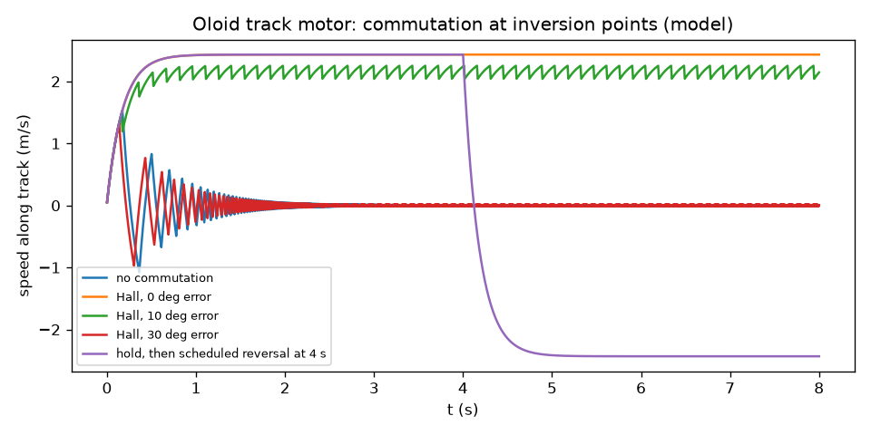
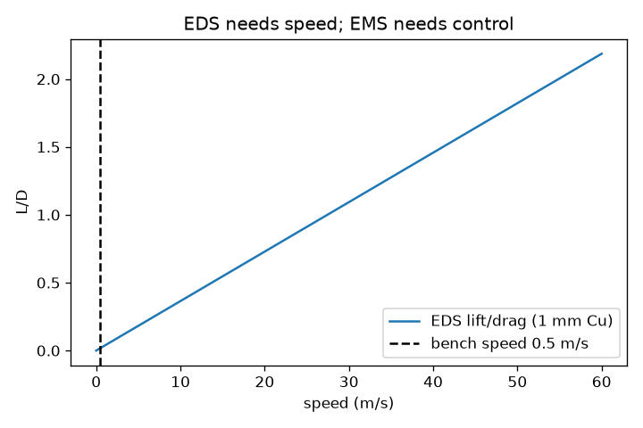

# Oloid on a magnetic track: the spine as a switched stator (companion to the oloid spine drive) (2026-10-24)

*License: CC0-1.0. Labels: **Grounded**, **Plausible-untested**, **Speculative**, **Symbolic**. All numbers are **model outputs** of [`sims/oloid_magnetic_track_motor_sim.py`](../sims/oloid_magnetic_track_motor_sim.py) ([output](../sims/oloid_magnetic_track_motor_sim_output.txt)) for assumed bench parameters, not measurements. Unknowns are [Channing to supply].*

Channing: "It would ride the spine and be a magnetic track. But a frame may also work or an outside magnetic control system that switches which would end up being a motor, right?"

**Yes (Grounded).** An outside switched magnetic system makes it an electronically commutated motor along a track, like a brushless DC or switched-reluctance machine. It is the same family as maglev linear synchronous motors. With the current in the spine coils, the oloid needs no wires or brushes, and the switching electronics handle the field reversal at each inversion.

Parent doc: [oloid_spine_lorentz_drive.md](oloid_spine_lorentz_drive.md). Related: [halbach_litz_drag_reduction.md](halbach_litz_drag_reduction.md), [halbach_rotor_control_vs_perturbation_sections.md](halbach_rotor_control_vs_perturbation_sections.md), [halbach_switched_arc_materials_check.md](halbach_switched_arc_materials_check.md).

**Assumed:** r = 0.10 m, oloid 0.5 kg, 50 turns per coil, 0.5 Ω/phase, 2 A, 5 mm gap, 0.5 m/s, PM gap field 0.4 T, 3-phase copper loss 3 W. Track length and shape, coil count, drive frequency, oloid size and material: [Channing to supply].

## 1. Mover types (spine = stator)

| Mover | F (N) | N/A | N/W | Efficiency at 0.5 m/s | Label |
|---|---|---|---|---|---|
| (A) PM on the oloid, 60° arcs | 2.29 | 1.15 | 0.76 | 27 % | Plausible-untested (BLDC physics Grounded) |
| (A) PM on the oloid, 45° arcs | 2.34 | 1.17 | 0.78 | 27 % | Plausible-untested |
| (B) Passive Al shell, 1 mm (induction) | 0.001 | 0.001 | ~0 | ~0 % (slip 0.32) | Grounded physics; weak with coreless coils |
| (C) Soft-iron reluctance | 0.014 | 0.007 | 0.007 | 0.4 % | Grounded physics; weak with coreless coils |

- **(A) wins clearly** at bench scale, because the magnets supply the field for free. 60° vs 45° costs only ~2 % of force; fewer, cheaper parts at 60°.
- **(B) and (C) are limited here by the coreless coil field (12.6 mT).** An iron-backed stator at ~0.3 T would raise (B) roughly 570× (rough B² scaling). Induction always loses the slip fraction in the shell, and the oloid's changing contact geometry makes its gap uneven. **Plausible-untested** as a wireless option.
- Low efficiencies are because 0.5 m/s is slow relative to copper loss; they rise with speed and with more turns or copper.

## 2. Commutation tied to the inversion points

Model: the mover's magnet polarity relative to the track flips every half rolling cycle (§1 of the parent doc). 3 V drive, friction 0.2 N·s/m, 8 s:

| Control | Final speed | Energy in → Cu / friction / KE | Label |
|---|---|---|---|
| No commutation | ~0 (stalls; drive averages out) | 143 J, nearly all heat | Grounded |
| Hall sensor, 0° error | +2.43 m/s | 13.1 J → 2.5 / 9.2 / 1.5 | model |
| Hall sensor, 10° error | +2.15 m/s | 40.6 J → 32.2 / 7.2 / 1.2 | model |
| Hall sensor, 30° error | stalls from a slow start (trapped in the wrong-sign window) | 143 J heat | model |
| Polarity hold, then scheduled reversal at 4 s | −2.43 m/s (reverses on command) | 19.0 J → 8.8 / 8.7 / 1.5 | model |

- This is the Rikitake polarity-hold and scheduled-reversal result applied as **control**, not as a dynamo (**Grounded** control practice).
- Sensorless back-EMF commutation works once moving; it needs a Hall or open-loop start, which is the kickstart again. **Grounded** (standard BLDC practice).
- The rolling phase is not uniform along the track, so commutation must follow measured position, not a fixed clock. **Plausible-untested.**

## 3. Contactless ride: guidance and levitation

- **Earnshaw (Grounded):** static magnets alone cannot levitate stably. Options are motion-induced EDS, active EMS, or diamagnetic or superconducting materials.
- **EDS (Grounded physics):** over a 1 mm Cu sheet the characteristic speed is w ≈ 27 m/s, and L/D = v/w. At a bench speed of 0.5 m/s, L/D ≈ 0.02 with almost no lift. **EDS lift is not viable at oloid speeds**; it would need tens of m/s. A rotating Halbach rotor (see the litz drag and rotor-control docs) gets slip speed from spin instead.
- **EMS attraction (Plausible-untested):** about 62 mT over two 16 cm² poles holds the 4.9 N oloid. That is easy in field terms, but it needs closed-loop gap control, and the oloid's staggering, wobbling contact makes the control harder.
- **Verdict:** use the track for propulsion and guidance first, and keep mechanical contact for support. Full levitation only with active EMS. **Plausible-untested.**

## 4. Frame vs magnetic track

| | Mechanical frame / bearing | Magnetic track (stator) |
|---|---|---|
| Friction | Rolling and bearing friction, wear | Contactless propulsion; support still mechanical unless EMS |
| Complexity | Low | Coils, drivers, sensors, control |
| Cost (bench) | Low | Higher (drivers + magnets) |
| Field reversal | Needs brushes if the current rides on the oloid | Handled by switching electronics |
| Label | Grounded | Grounded (motor family) / Plausible-untested (oloid version) |

**Verdict:** a frame is cheapest for a first demonstrator. A switched track is the cleaner path and handles reversal without wires on the oloid. The hybrid is a frame for support with a track for drive.

## 5. Energy ledger (Grounded)

Every run closes: E_in = copper + friction + kinetic, with residuals ≤ 0.04 J from integration (table above). No over-unity: the track motor converts electrical input to motion and heat, never more.

## 6. Oloid centre-of-mass height: resolved

Dirnböck & Stachel, "The Development of the Oloid", *J. Geometry and Graphics* 1(2), 1997 (verified, https://www.geometrie.tuwien.ac.at/stachel/jgg0113.pdf), eq. (25): h = r(2 + cos t)/(2√(2(1 + cos t))), t ∈ (−2π/3, 2π/3). This gives h_min = r√2/2 ≈ 0.7071 r (t = 0) and h_max = 3r/4 (t → ±2π/3), so Δh ≈ 0.0429 r. That matches this repo's sim and English Wikipedia. The HITS page (and Russian Wikipedia) give h_max = r√2/2 and h_min = 3√3 r/8 ≈ 0.6495 r. That is inconsistent with eq. (25), which never goes below r/√2, so it looks like an error there. The irregular oloid (centre distance r√2) has constant COM height per HITS, a different solid. **Grounded.**
