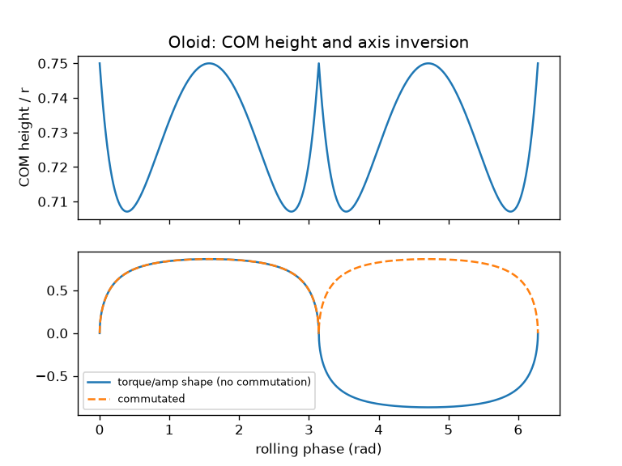
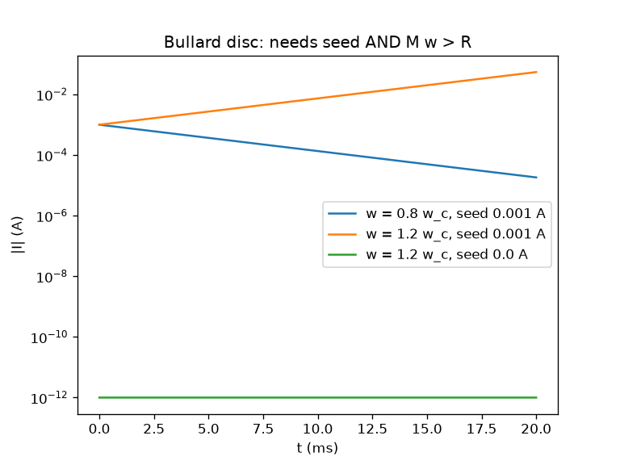
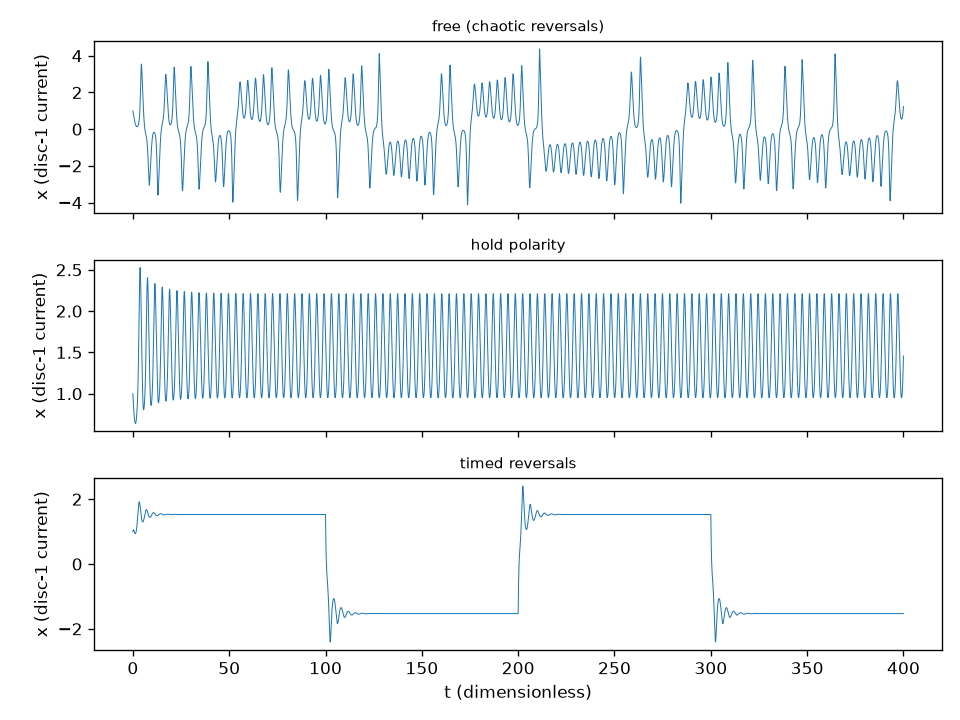

# Oloid on an outer spine with a radial Lorentz drive: kinematics, commutation, kickstart and field reversal (2026-10-24)

*License: CC0-1.0. Labels: **Grounded**, **Plausible-untested**, **Speculative**, **Symbolic**. All numbers are **model outputs** of [`sims/oloid_spine_lorentz_sim.py`](../sims/oloid_spine_lorentz_sim.py) ([output](../sims/oloid_spine_lorentz_sim_output.txt)) for assumed bench parameters, not measurements. Unchecked items are [to verify]; gaps are [Channing to supply].*

Channing: "With the right outer spine though it would make sense, right?" and "Hmm, ok let’s walk this path it would be the same way we us the Lorentz force but outward and inward vs gapped junctions which would also generate an EM field it may need a kickstart. And we would have to think about the field reversing."

- **Related:** [shifting_phase_order_review.md §A4](shifting_phase_order_review.md) (perturbation sections), [halbach_rotor_control_vs_perturbation_sections.md](halbach_rotor_control_vs_perturbation_sections.md), [halbach_switched_arc_materials_check.md](halbach_switched_arc_materials_check.md) (switched arcs = commutation hardware), [plasma_shielding_patents_review.md](plasma_shielding_patents_review.md) (perturbed/switched fields).
- **Ground rule (Grounded):** gravity alone gives zero net work around a closed rolling loop. Every joule in this model comes from the supply; the spine is the input path.

## 0. Summary

| Item | Model result | Label |
|---|---|---|
| Oloid COM height (r = 0.10 m) | 0.7071 r to 0.7500 r (4.3 % of r swing) | Grounded (geometry) |
| Axis / loop-normal inversion | Sign flips twice per rolling cycle | Grounded |
| (a) No commutation | ≈ 0 mN·m mean torque | Grounded (symmetry) |
| (b) Commutated at inversions | 23.5 mN·m at 10 A, 5 W → 2.36 mN·m/A, 4.71 mN·m/W | Plausible-untested |
| (c) Gapped-junction baseline | 0.60 mN·m → 0.06 mN·m/A, 0.12 mN·m/W | Plausible-untested |
| Motional EMF at 1 cycle/s | rms ≈ 35 mV (spikes at inversions) | Grounded (physics) / model-dependent |
| Kickstart (Bullard disc) | Needs seed **and** Mω > R; ω_c = R/M = 5000 rad/s (~800 rev/s) for the assumed disc | Grounded |
| Rikitake two-disc | 36 irregular reversals free-running; 0 with polarity-hold feedback; 3 on a timed schedule | Grounded (math) / Plausible (geodynamo analogy) |
| 60° vs 45° spine arcs | 95.5 % vs 97.4 % field; both align with inversions; worst-case capture 74 % vs 83 % | Grounded / model |
| Energy ledger (20 s, 0.5 V) | In 77.4 J = Joule 60.9 + friction 10.6 + KE 5.9 (residual −0.004 J) | Grounded: no over-unity |

## 1. Oloid kinematics (Grounded)

The oloid (Paul Schatz, 1929) is the convex hull of two perpendicular circles of radius r whose centres are r apart. It rolls on a developable surface, touching the ground along a ruling segment. The sim uses a contact-plane approach: the ground plane must touch both circles at once (equal support functions). With contact angle t on circle 1, this gives c² = 1/(2−2cos t), u_z² = (1−2cos t)/(2−2cos t), t ∈ [π/3, 5π/3], and COM height H = r c (1 − cos t/2). It is checked numerically against brute-force sampled circles. Closed-form rolling parametrisation: Dirnböck & Stachel, *J. Geometry and Graphics* 1(2) (1997), verified.

- **Model output:** H_min = r/√2 (0.0707 m) and H_max = 3r/4 (0.075 m), a 4.3 % of r swing. **Resolved:** this matches Dirnböck & Stachel (1997) eq. (25); the 3√3 r/8 minimum quoted on the HITS page is inconsistent with it. See [oloid_magnetic_track_motor.md §6](oloid_magnetic_track_motor.md).
- **Inversion:** the normal of circle 1 changes vertical sign twice per cycle (the two u_z branches). A loop or band riding on circle 1 therefore sees the spine field reverse relative to itself every half-cycle. This is the "field reversing" Channing anticipated, and it is purely geometric.

## 2. Radial Lorentz drive: three schemes

Assumed: a band on circle 1 (area A = πr²), spine field B = 0.10 T, I = 10 A, R = 0.05 Ω (P = 5 W). Torque τ = I·A·B·g(θ), where g is the flipping projection. "Outward and inward" means the I L × B force on the band is radial; its moment about the roll is what drives.

- **(a) No commutation:** g averages to zero over a cycle, so there is no net drive. **Grounded.**
- **(b) Commutated switching at the inversion points** (switched Halbach arcs or brushes): 2.36 mN·m/A, 4.71 mN·m/W. **Plausible-untested.**
- **(c) Gapped-junction perturbation sections** (20 mm active length, 30 % duty, lever r): 0.06 mN·m/A, 0.12 mN·m/W. **Plausible-untested.** (b) wins by ~40× here mainly because a full loop has far more conductor in the field than a short gap. This is a geometry assumption, not a law.

## 3. Motional EMF and drag (Grounded physics)

EMF = −dΦ/dt with Φ = A B g(θ). At 1 cycle/s: rms ≈ 35 mV, median ≈ 3 mV, with spikes at the inversions where du_z/dt is singular in this parametrisation (real contact smooths them [to verify]). With the band shorted, the induced current produces drag (Lenz): the "generated EM field" always opposes the motion that makes it. In the energy run, back-EMF is what caps the speed at ~11 cycles/s.

## 4. Kickstart: self-excited dynamo (Grounded)

From rest at an inversion point g = 0, so the motor has a dead point and needs a mechanical or electrical kick (the sim kicks to 0.3 cycles/s). For a self-generated field, the Bullard homopolar disc gives L dI/dt = (Mω − R) I:
- Zero seed stays at zero for any ω; a seed field or current is required.
- Growth requires Mω > R. For an optimistic bench disc (M = 0.2 µH, R = 1 mΩ), ω_c = 5000 rad/s (~800 rev/s). That is far above an oloid's rolling rate, so **a self-exciting oloid is Speculative at bench scale**; an external field (permanent magnets in the spine) is the realistic route.

## 5. Field reversal: Rikitake two-disc dynamo

Rikitake system ẋ = −μx + zy, ẏ = −μy + (z−A)x, ż = 1 − xy (μ = 1, A = 2):
- Free run: 36 irregular polarity reversals in t = 400. **Grounded** (math); the geodynamo analogy is **Plausible**.
- Control: polarity-hold feedback gives 0 reversals, and a scheduled target gives 3 reversals at the chosen times. Commutation or a control loop can hold polarity or time the reversals deliberately. **Plausible-untested** in hardware.

## 6. Energy ledger (Grounded)

Commutated 0.5 V supply, J = 2.5e-3 kg·m², loss c = 2e-4 N·m·s, 20 s: E_in 77.4 J = Joule 60.9 J + friction 10.6 J + kinetic 5.9 J (residual −0.004 J from integration). About 14 % of the input does useful work against friction. Input ≥ output + losses at every step: **no over-unity.**

## 6b. 60° spine arc option and a nitinol role

Channing: "A 60 degree magnetic arc might come in handy and it something we had discussed before but with nitinol". Prior notes: [fuller_tensegrity_vortex_node_review.md §4](fuller_tensegrity_vortex_node_review.md), [kinetic_sculpture_linkage_review.md §5](kinetic_sculpture_linkage_review.md), [nitinol_buga_resonant_node_review.md](nitinol_buga_resonant_node_review.md), and for the 45° arc, [halbach_switched_arc_materials_check.md](halbach_switched_arc_materials_check.md).

| Item | 60° arcs (M = 6, six tile a ring) | 45° arcs (M = 8) | Label |
|---|---|---|---|
| Fundamental field vs ideal Halbach, sin(π/M)/(π/M) | 95.5 % | 97.4 % | Grounded |
| Lowest harmonics | 5th, 7th (more ripple) | 7th, 9th | Grounded |
| Arc boundaries on the two inversions per cycle (0°, 180°) | Yes (180/60 = 3 arcs per half-cycle) | Yes (180/45 = 4) | Grounded (geometry) |
| Commutation capture if boundaries are offset 5° / 15° | 97.9 % / 89.9 % | 97.9 % / 89.9 % | model output |
| Worst-case offset | 74.4 % (at 30°) | 82.5 % (at 22.5°) | model output |
| Parts count / switches per cycle | 6 (cheaper, fewer switches) | 8 | Plausible-untested |

Reading: both align with the oloid's half-cycle inversion when phased correctly. 60° trades ~2 % of field and more ripple for fewer parts, and it is more sensitive to phasing errors. Because the rolling phase is not uniform in time, the real boundaries must be set from the measured inversion points [Channing to supply spine geometry]. 60° is hexagonal symmetry, not φ: **Symbolic** as anything beyond geometry.

**Nitinol role (Plausible-untested):** NiTi springs or actuators as (i) the kickstart past the dead point, or (ii) a way to reposition or retract arc segments to change phasing. They must be heated by an **AC coil** or resistive current. A static magnet gives dB/dt = 0 and no heating (the earlier correction). Model: a kick to 0.3 cycles/s needs 4.4 mJ of kinetic energy; at an assumed 1–5 % heat-to-work efficiency [to verify], that is 0.09–0.44 J of heating per kick. Nitinol **amplifies force, not energy** (Grounded, consistent with the earlier reviews).

**Follow-up:** the spine as a switched stator (magnetic track motor, levitation, frame vs track): [oloid_magnetic_track_motor.md](oloid_magnetic_track_motor.md).

## 7. Unknowns and next steps

- Spine geometry (rail, frame, or cage; contact or non-contact) [Channing to supply].
- Field source (permanent-magnet Halbach arcs, coils, Tesla-coil drive) [Channing to supply].
- Whether the current rides on the oloid (needs brushes or slip rings) or on the spine (moving-magnet oloid) [Channing to supply].
- What the drive is for (demonstrator, mixer/pump like Schatz's, or craft attitude) [Channing to supply]. Any claim of propulsion or gravity effects is **Speculative**; the oloid's symbolism is **Symbolic**.

- **See also (2026-10-25):** [stator_review.md](stator_review.md): stator topologies, windings, losses, cogging and the track as an unrolled stator.
