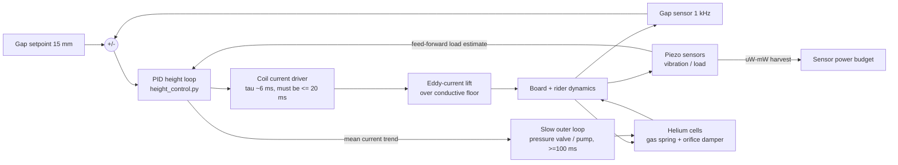

# Piezo + helium feedback loop (POL / Multi-Egg)

License: CC0 1.0. Evidence labels: **Grounded** / **Plausible-untested** / **Speculative**.

## Concept (confirmed by Channing)
- Piezo elements sense vibration and load, and also act as micro-actuators.
- Helium cells give a small lift plus pneumatic damping.
- A controller adjusts the cell pressure or the coil power.

**Archive mentions:**
- `rgrf_framework.md`, Multi-Egg pathway (10 Aug 2026): "radial fluid pathways, organized eddy currents, density gradients, **piezo + helium dual-purpose**, Lorentz controls".
- First-order geometry, 27 Aug 2026: 5 eggs, major axis ~0.185 m, arm ~0.485 m, outer ~0.58 m, mass penalty +6–13 kg.
- Force estimates, 30 Aug 2026: "helium ~0.02 N … gyro = torque not F_z … Not lift".

## Block diagram

## Realistic numbers
| Element | Number | Label |
|---|---|---|
| Helium buoyancy | (ρ_air − ρ_He)·V·g ≈ 1.03 kg/m³ × 2 L × 9.81 ≈ **0.02 N** (matches the archive). That is ~0.002 % of the ~1,000 N hover weight. | Grounded |
| Helium cell as gas spring | k ≈ γ·p·A²/V. For p = 1 bar, A = 0.01 m², V = 2 L, γ = 1.66: **k ≈ 8 kN/m**. This is comparable to (and adds to) the eddy-lift stiffness (~37 kN/m in `height_control.py`). An orifice gives tunable damping. | Grounded (physics); Plausible-untested as an add-on |
| PZT sensor output | V ≈ g₃₃·σ·t, with g₃₃ ~ 20–25 ×10⁻³ V·m/N (typical PZT datasheet values). 1 MPa on a 1 mm disc gives ~20–25 V open-circuit. | Grounded |
| Piezo sensing bandwidth | ~0.1 Hz (with a charge amplifier) up to well below the element's resonance (kHz–tens of kHz). That is easily fast enough for a loop needing τ ≤ 20 ms (≳ 50 Hz). | Grounded |
| Piezo actuation | Strain ~0.1 %: stacks give ~10–100 µm stroke. Useful for vibration cancellation, **not** for height (15 mm gap). | Grounded |
| Piezo energy harvesting | **µW–mW** from board vibration. Enough to power sensors or a radio, versus a ~10–17 kW hover load (≥ 10⁷× smaller). | Grounded |

## How it plugs into `height_control.py` (Resona-POL-Modular-Core)
- The existing loop is PID on gap error → coil current, with feed-forward of the nominal hover current. The current envelope lag is τ ≈ 6 ms, and the README notes the loop tolerates **τ = 20 ms but not 40 ms**.
- **Piezo load sensing** feeds forward the measured load step, adding ΔI = ΔF/(dF/dI) before the gap error grows. This should cut the settling time for the +10 kg step. Needs: sensor calibration (N/V), drift handling (piezo is AC-coupled; combine it with a slow strain gauge or the integral term).
- **Helium cell**:
  - Passive: an extra spring/damper term in `m z'' = …` (add −k_he·z − c_he·ż).
  - Active pressure control is a *slow outer loop* (valves and pumps ≥ 100 ms). It must not be in the fast path, which stays coil current with τ ≤ 20 ms.
- **Suggested code change** (not yet made): add `--he-k`, `--he-c` and `--piezo-ff-gain` options and rerun the load-step and floor-bump scenarios.

## Bench test
1. Mount a 1–2 kg test mass on a soft spring over a shaker. Fit a PZT disc under the mount and a 2 L helium (or air) bladder with an adjustable orifice in parallel.
2. Measure:
   - piezo V against applied force (calibration);
   - transmissibility and damping ratio against orifice size (helium vs. air);
   - harvested power into a matched load (expect µW–mW).
3. Pass/fail: the piezo signal leads the displacement-sensor signal on a load step, and the bladder raises ζ measurably. Buoyancy should be ~0.02 N (a null check).

## Labels summary
- Piezo sensing and feed-forward: **Grounded**.
- Helium as damping/spring: **Plausible-untested** for POL.
- Helium as lift: negligible.
- Piezo harvesting as power source: sensors only.
- "Dual-purpose lift" from either: **not supported**.
