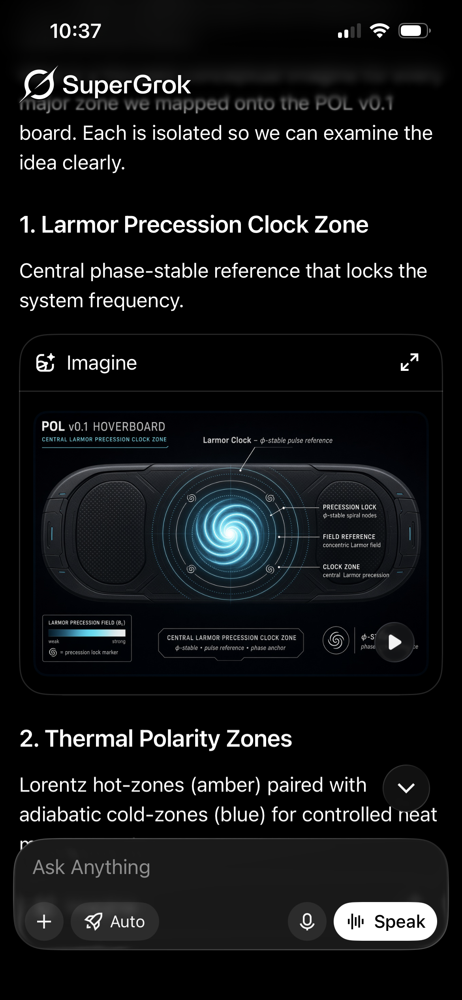
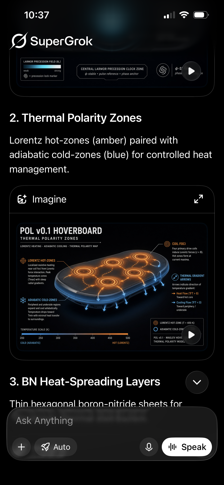
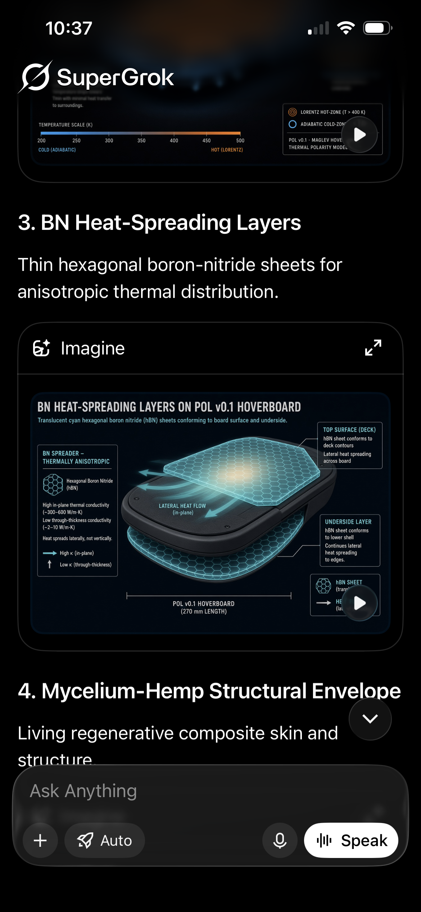
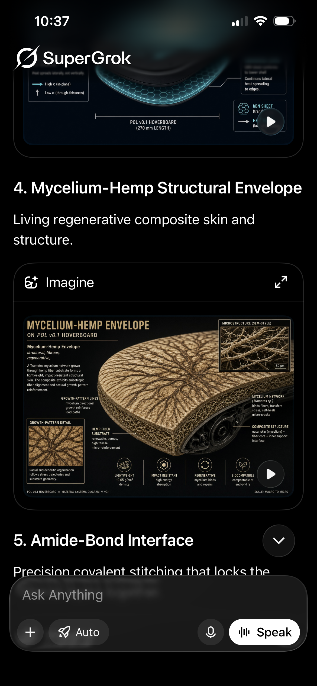
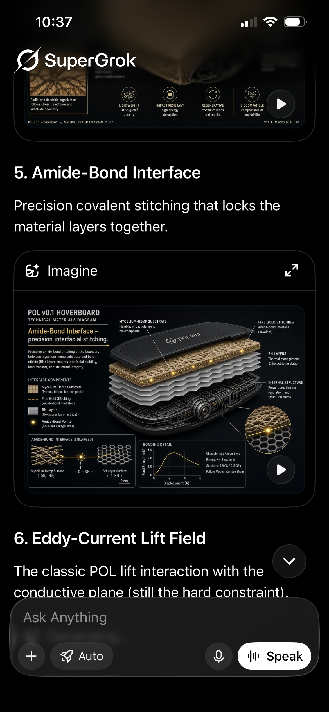
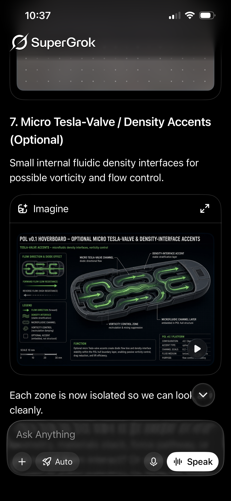

# POL v0.1 hoverboard: zone concept images (transcribed, labeled)
*License CC0. Source: six SuperGrok screenshots Channing sent on 2026-10-12, showing Grok Imagine images of each "zone" mapped onto the POL v0.1 board (archived as `images/2026-10-12_pol_zones_1..6.png`). Labels: **Grounded** / **Plausible-untested** / **Speculative** / **Symbolic**.*

> **Important:** these images are **AI-generated concept art, not engineering drawings.** The numbers and labels drawn in them were generated along with the art. They are not measurements, and each one is checked below. Force-flow rows are also in [DESIGN_FORCE_FLOW_MAP.md §11](DESIGN_FORCE_FLOW_MAP.md).

Intro text (as given): "…[imagery] for every major zone we mapped onto the POL v0.1 board. Each is isolated so we can examine the idea clearly."

## 1. Larmor Precession Clock Zone

**Caption:** "Central phase-stable reference that locks the system frequency."
**Image labels:**
- "Larmor Clock — φ-stable pulse reference"
- "PRECESSION LOCK: φ-stable spiral nodes"
- "FIELD REFERENCE: concentric Larmor field"
- "CLOCK ZONE: central Larmor precession"
- "LARMOR PRECESSION FIELD (B₀): weak … strong"
- "CENTRAL LARMOR PRECESSION CLOCK ZONE: φ-stable • pulse reference • phase anchor"

**Checks:**
- **Larmor precession is real (Grounded):** f = γB/2π for spins, and the cyclotron frequency ω_c = qB/m for charges.
- **A readable clock needs a spin ensemble:** a polarized sample plus pickup coil, NMR/magnetometer-style. A field region alone is not a clock. The "clock/phase anchor" role is **Plausible-untested**. Note that f depends on B, so the clock is only as stable as B.
- **"φ-stable":** **Speculative / Symbolic**. No mechanism links φ to frequency stability.

## 2. Thermal Polarity Zones

**Caption:** "Lorentz hot-zones (amber) paired with adiabatic cold-zones (blue) for controlled heat management."
**Image labels:**
- Subtitle: "LORENTZ HEATING · ADIABATIC COOLING · THERMAL POLARITY MAP"
- "LORENTZ HOT-ZONES: Localized resistive heating near coil foci from Lorentz force interaction. Peak temperature zones (Tmax) with steep radial gradients."
- "ADIABATIC COLD-ZONES: Peripheral and underside regions expand and cool adiabatically. Temperature drops toward Tmin with minimal heat transfer to surroundings."
- "COIL FOCI: Four primary drive coils induce Lorentz forces (J × B). Hot zones form at current maxima."
- "THERMAL GRADIENT ARROWS: Heat Flow (∇T > 0) toward hot core; Cooling Flow (∇T < 0) toward periphery / underside"
- Temperature scale 200–500 K, "COLD (ADIABATIC)" to "HOT (LORENTZ)"; legend "LORENTZ HOT-ZONE (T > 400 K)"

**Checks:**
- **Heating near the coils is Joule (I²R, J²/σ) heating, Grounded, not "Lorentz" heating.** The J×B force does mechanical work; it is the resistive loss that heats.
- **"T > 400 K" is a materials flag.** About 127 °C would char or degrade mycelium-hemp (zone 4) and is beyond the 120 °C the image itself claims for the interface (zone 5). It needs thermal isolation or a hot-zone limit.
- **"Adiabatic cold-zones" relabeled as *cooler periphery*.** A passive region cannot cool below ambient without a heat pump (e.g. Peltier or a refrigeration cycle). The blue zones are just regions far from the heat sources. A 200 K end of the scale is not reachable passively.
- **Arrow sign:** heat flows *down* the gradient (q = −k∇T), from the hot core outward.

## 3. BN Heat-Spreading Layers

**Caption:** "Thin hexagonal boron-nitride sheets for anisotropic thermal distribution."
**Image labels:**
- "Translucent cyan hexagonal boron nitride (hBN) sheets conforming to board surface and underside"
- "BN SPREADER – THERMALLY ANISOTROPIC: High in-plane thermal conductivity (~300–600 W/m·K); Low through-thickness conductivity (~2–10 W/m·K). Heat spreads laterally, not vertically."
- "TOP SURFACE (DECK): hBN sheet conforms to deck contours; lateral heat spreading across board"
- "UNDERSIDE LAYER: hBN sheet conforms to lower shell; continues lateral heat spreading to edges"
- "LATERAL HEAT FLOW (in-plane)"
- "POL v0.1 HOVERBOARD (270 mm LENGTH)"

**Checks:**
- **hBN anisotropy is Grounded.** Bulk hBN in-plane k is typically ~300–400 W/m·K. **Flag the upper end, ~600:** that applies to isotopically pure or few-layer material, not typical sheets. Practical hBN-filled films and composites are much lower. Through-plane ~2–10 W/m·K is in the right range.
- hBN is also an electrical insulator, so it does not add eddy paths. That is Grounded and useful near the coils.
- **"270 mm length":** an image label, not a confirmed design dimension **[Channing to confirm]**.

## 4. Mycelium-Hemp Structural Envelope

**Caption:** "Living regenerative composite skin and structure."
**Image labels:**
- "Mycelium-Hemp Envelope: structural, fibrous, regenerative. A Trametes mycelium network grown through hemp fiber substrate forms a lightweight, impact-resistant structural skin. The composite exhibits anisotropic fiber alignment and natural growth-pattern reinforcement."
- "GROWTH-PATTERN LINES: mycelium directional growth reinforces load paths"
- "HEMP FIBER SUBSTRATE: renewable, porous, high tensile micro-reinforcement"
- "MYCELIUM NETWORK (Trametes sp.): binds fibers, transfers stress, self-heals micro-cracks"
- "COMPOSITE STRUCTURE: outer skin (mycelium) + fiber core + inner support interface"
- "MICROSTRUCTURE (SEM-STYLE)" with a 50 μm scale bar
- Icons: "LIGHTWEIGHT ~0.65 g/cm³ density · IMPACT RESISTANT high energy absorption · REGENERATIVE mycelium binds and repairs · BIOCOMPATIBLE compostable at end-of-life"

**Checks:**
- **Density ~0.65 g/cm³ is plausible** for a pressed mycelium-hemp composite. Insulation grades are much lighter, ~0.06–0.26 g/cm³ ([mycelium_uses.md](mycelium_uses.md)). It is unmeasured for this board.
- **Mechanical use:** the literature recommends non- or semi-structural use ([mycelium_uses.md](mycelium_uses.md)), so "structural skin" is **Plausible-untested**.
- **"Self-heals / regenerative" only applies if the mycelium is living** (moist, fed, not heat-killed). Standard composites are heat-treated and inert. **Plausible-untested** for living skins; conflicts with the >400 K hot zones (zone 2).
- **Compostable: Grounded.** The "SEM-style" panel is art, not a micrograph.

## 5. Amide-Bond Interface

**Caption:** "Precision covalent stitching that locks the material layers together."
**Image labels:**
- "Amide-Bond Interface – precision interfacial stitching. Precision amide-bond stitching at the boundary between mycelium-hemp substrate and boron nitride (BN) layers ensures interfacial stability, load transfer, and structural integrity."
- "MYCELIUM-HEMP SUBSTRATE: flexible, impact-damping bio-composite"
- "FINE GOLD STITCHING: amide-bond interface (covalent)"
- "BN LAYERS: thermal management & dielectric insulation"
- "INTERNAL STRUCTURE: power core, thermal regulation, and structural frame"
- Interface panel: "Mycelium-Hemp Surface (–OH, –NH₂) … –C(=O)–NH– … BN Layer Surface (–B–NH–)", 5 nm scale
- "BONDING DETAIL": bond-strength vs displacement curve; "Characteristic Amide Bond; Energy ~4.8 eV/bond; Stable to 120°C | 2.5 GPa [partly legible]; Failure Mode: Interface Shear"

**Checks:**
- **Amide coupling chemistry is Grounded.** Chitin and chitosan in fungal walls carry –NH₂/acetamide groups, and cellulose/hemp carries –OH.
- **"~4.8 eV/bond" is unverified.** The C–N amide bond dissociation energy is roughly ~3–4 eV. In practice the interface fails at far weaker points (adhesion, matrix shear), as the image itself says.
- **BN surfaces lack native –NH₂ unless functionalized.** Amine- or hydroxyl-functionalized BN is Grounded (reported in the literature), so the bridge needs a functionalization step.
- **"Gold stitching" is art styling.** No gold is implied chemically.
- **"Stable to 120 °C / 2.5 GPa":** unverified image numbers. Status overall: **Plausible-untested**.

## 6. Eddy-Current Lift Field
**Caption:** "The classic POL lift interaction with the conductive plane (still the hard constraint)." (Image not captured in these screenshots; only the bottom edge appears at the top of screenshot 6.)

**Check:** **Grounded**, and still the hard constraint. Eddy-current lift on a conductive plane costs ~10–17 kW for 88 kg (~52 N/kW); plate loss is P/F ≥ ωδ ([lift_and_equilibrium_systems.md §9](lift_and_equilibrium_systems.md), [ANALYSIS_2026-10-12.md](ANALYSIS_2026-10-12.md)). It also feeds the zone-2 heat load.

## 7. Micro Tesla-Valve / Density Accents (Optional)

**Caption:** "Small internal fluidic density interfaces for possible vorticity and flow control."
**Image labels:**
- "OPTIONAL MICRO TESLA-VALVE & DENSITY-INTERFACE ACCENTS: microfluidic density interfaces, vorticity control"
- "FLOW DIRECTION & DIODE EFFECT: forward flow (low resistance), reverse flow (high resistance)"
- "MICRO TESLA-VALVE CHANNEL: diodic directional flow"
- "DENSITY-INTERFACE ACCENT: stable stratification layer"
- "VORTICITY CONTROL ZONE: recirculation & mixing suppression"
- "MICROFLUIDIC CHANNEL LAYER: embedded in POL hull structure"
- "FUNCTION: Optional micro Tesla-valve accents create diodic flow bias and density-interface stability within the POL hull boundary layer, enabling passive vorticity control, drag reduction, and lift efficiency."
- Scale bar 0–30 mm

Closing line (as given): "Each zone is now isolated so we can look [at each] cleanly."

**Checks:**
- **Tesla-valve diodicity is Grounded at moderate Re** (turns on near Re ≈ 200 and is boosted by pulsatile flow; Nguyen et al. 2021). At micro scale and low Re, diodicity is small. The zone is correctly labeled **Optional**.
- **Density interfaces / vorticity control:** **Plausible-untested**.
- **"Lift efficiency":** **Speculative**. Internal channels do not give lift (closed-system momentum).

## Side option (not original stack): basalt + hemp hybrid composites
From Channing's paste (summary):
- Basalt fibre gives strength and impact resistance; hemp gives its natural properties (renewable, light, insulating).
- Basalt fibres in a lime binder make a **fibre-reinforced lime composite, not hempcrete**.
- R&D on these hybrids is ongoing.
- Label: **Plausible-untested** for POL or housing.

Channing notes this is **"not the same"** as the previously saved "possible material stacks". The original stacks are **[Channing to supply from Grok]**.

## Missing pieces
- Zone 6 image (only its caption was captured).
- Confirmed board dimensions (the "270 mm" label).
- The original "possible material stacks" from Grok.
