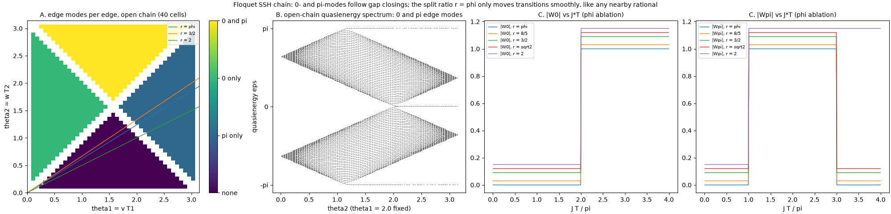

# "Shifting phase order" / Physics Pathways — critical review

Reviewed 2026-10-11. License: CC0 1.0. Sources: two Resona/Grok notes dated 11 Oct 2026, "POL/RGRF Physics Pathways, Laminar Precession Dynamics & Material Lists" and "Supporting Diagrams" (the 4 diagrams are in `images/`).

## 0. Important scope note
The source notes **do not mention** a re-entry plasma sheath, ferrofluid veins, a "double magnetic egg cavity", impedance sections, or the phrase "shifting phase order". What they actually contain:
- the eddy-lift core pathway;
- RGRF scaling;
- "Laminar Precession Dynamics" with "Multi-Egg"/"Egg-of-Columbus style rotors";
- four "Perturbation Sections";
- a materials BOM.

Section A reviews those pathways as written. Section B reviews the elements Channing described verbally:
- external field / plasma manipulation using the re-entry sheath as a guide;
- the double magnetic egg cavity;
- ferrofluid veins;
- impedance / perturbation sections.

Section B gives numbers for a ~10 m craft in re-entry plasma.

Tags:
- **GROUNDED**: a known phenomenon with a governing equation.
- **PLAUSIBLE-UNTESTED**: the physics allows it, but there is no demonstration in this form.
- **SPECULATIVE**: no known mechanism.

Where I name prior work, it is only work I am confident exists; nothing has been invented. Where I am unsure of a specific reference, I describe the field instead of citing it.

---

## A. Pathways as written in the drafts

### A1. Core pathway: coils → eddy currents → lift (POL v0.1)
Chain: battery/pedal → 13.56 MHz phi-spiral coil → AC B-field → eddy currents in Al/Cu floor → opposing field (Lenz) → lift. "Mycelium frame ... natural damping that helps stabilize the hover".

| Step | Tag | Notes |
|---|---|---|
| AC coil over conductor gives repulsive force | GROUNDED | Lenz / induction levitation (EDS maglev, levitation melting). Force per area ≈ B²/(2μ₀) for a thick plate. |
| Lift at the claimed ~520 W, "efficiencies in the high 80s to low 90s" | Not supported (see the hover-sim review in [Resona-POL-Modular-Core](https://github.com/channingchenry-sketch/Resona-POL-Modular-Core)) | Plate loss alone is P/F ≥ ωδ. At 13.56 MHz that is ~1.9 MW for 1030 N; at ~1 kHz it is ~16.7 kW. The "efficiency" is a wireless-link formula with no receiver coil. |
| Conductive floor is mandatory | GROUNDED | Correct, and stated honestly in the draft. |
| Mycelium frame damps hover oscillation | SPECULATIVE as a hover-stabiliser | Material damping inside the board cannot damp rigid-body heave relative to the floor. This needs active control (or eddy damping in a separate conductor). |

### A2. Scaling pathway (personal → planetary → cosmic)
| Step | Tag | Notes |
|---|---|---|
| Same EM foundation at larger scale over conductive tracks | PLAUSIBLE (engineering) | EDS maglev already exists at train scale. |
| φ / 3-6-9 scaling of size, frequency and power | SPECULATIVE | No physical scaling law. Lift ∝ area·B² and loss ∝ √f·area·B² are ignored (the RGRF scaler script multiplies by arbitrary level factors). |
| Plasma filaments as "rails", consciousness-geometry coupling, free-air operation | SPECULATIVE | The draft itself labels these as speculation, which is to its credit. |

### A3. Laminar precession base state (Multi-Egg rotors)
Chain: phi-spaced coils/rotors spin with 3-6-9 phasing → the axis precesses in a cone → the "laminar" organised mode → "lift assist and attitude control".

| Step | Tag | Notes |
|---|---|---|
| Spinning rotor under torque precesses | GROUNDED | Ω_p = τ/(Iω). |
| Fluid in a precessing container keeps a laminar "spin-over" mode below a threshold | GROUNDED (fluid dynamics) | Studied experimentally and theoretically (e.g. Kerswell; Lagrange, Meunier et al.). Control parameter is the Poincaré number Po = Ω_p/Ω. |
| Golden-ratio spacing "keeps the modes phase-locked" | SPECULATIVE, and likely backwards | φ is the "most irrational" ratio. In coupled-oscillator and KAM theory, irrational ratios *avoid* mode-locking. If φ does anything here it is to discourage locking, not create it. |
| Organised precession provides **lift assist** | SPECULATIVE (no mechanism) | Internal rotation or precession of a closed system cannot produce net external force (momentum conservation). Only torques are possible. The draft does say "Free-air residual forces remain very small". |
| Organised precession provides **attitude control** | GROUNDED | Control-moment gyros, as on spacecraft. |

### A4. Perturbation sections
1. **Height.** Chain: load step → h changes → the steep F(h) restores → damping → power/frequency modulation.
   - Steep F(h) restoring: GROUNDED.
   - Mycelium damping: SPECULATIVE (see A1).
   - Power modulation as feedback: GROUNDED (standard active control). The diagram's target ζ ≈ 0.7 is sensible but needs a sensor + controller; the current simulation gives ζ ≈ 0.024.
2. **Tilt.** Chain: lean → gyroscopic moment + differential coil power → corrective torque.
   - Gyroscopic resistance: GROUNDED. It resists *rate*, converting tilt into precession/nutation. On its own it does not produce a restoring stiffness toward level.
   - Differential coil power giving torque: GROUNDED (eddy force per coil).
   - "If laminar ... smooth; if turbulent mode coupling ... control lost": PLAUSIBLE-UNTESTED for an EM system. The analogy to fluid instability has no defined EM "turbulence" here.
3. **Lateral.** Chain: phase shift between coils → horizontal force.
   - GROUNDED: a travelling-wave field over a conductor is a linear induction motor, F_x ∝ slip.
   - "Boundary-layer style self-correcting EM layers": SPECULATIVE wording. Eddy-current drag does damp lateral motion over a plate (GROUNDED), but nothing "self-corrects".
4. **Mode / triadic resonance.** Chain: frequency ratio → spin-over mode parametrically excites secondary modes → detune to stay laminar.
   - Triadic resonance instability in precessing cylinders: GROUNDED (fluids).
   - Applying it to resonant coil arrays: PLAUSIBLE-UNTESTED. Parametric coupling between LC resonators is real (nonlinear circuits), but this system as specified is linear, so there is no triadic coupling to avoid unless magnetic cores or ferrofluids add nonlinearity.

### A5. Materials BOM
Mostly GROUNDED as stated:
- Al/Cu floor;
- 10 AWG/Litz wire;
- PP film capacitors;
- GaN/SiC Class-E driver.

Notes:
- **Inconsistency:** this BOM's coil (~8 turns, r₀ 0.30 m, 45–55 µH) differs from `resonance_calc.py` (389 µH, 30.7 m of wire).
- **Mycelium–graphene diamagnetic levitation:** "millimeter scale only" is honestly hedged. Diamagnetic levitation needs B·∇B on the order of 10³ T²/m for graphite.

---

## B. Channing's verbal pathways: external field / plasma manipulation

Assumed setting:

| Parameter | Value |
|---|---|
| Craft length | L ≈ 10 m |
| Velocity | u ≈ 7 km/s |
| Altitude | ~50–80 km; neutral density n_n ~1e21–1e23 m⁻³; mass density ρ ~5e-5 to 5e-3 kg/m³ |
| Electron density | n_e = 1e17–1e19 m⁻³ |
| Temperature | T_e ≈ 1 eV |

Collision estimates use σ_en ≈ 1e-19 m², σ_in ≈ 5e-19 m². These are order-of-magnitude only (order-of-magnitude script estimates).

### B1. Re-entry plasma sheath as a "guide": basic plasma scales
- **Debye length** λ_D = √(ε₀T_e/(n_e e²)):
  - 23 µm at 1e17 m⁻³;
  - 7.4 µm at 1e18 m⁻³;
  - 2.4 µm at 1e19 m⁻³.
  
  **GROUNDED.** The electrostatic sheath on the wall is only microns to tens of microns thick. The "sheath" in "re-entry plasma sheath" usually means the whole ionised shock layer (cm to tens of cm), which is quasi-neutral.
- **Plasma frequency** f_pe = 8.98√n_e Hz:
  - 2.8 GHz at 1e17 m⁻³;
  - 28 GHz at 1e19 m⁻³.
  
  This is why S/X-band links black out. **GROUNDED.**
- **"Using the sheath as a guide/waveguide"**:
  - Guiding signals along a plasma boundary (surface waves): PLAUSIBLE-UNTESTED for this use.
  - Guiding the *craft*: SPECULATIVE.

### B2. Magnetic manipulation of the shock-layer flow (MHD flow control / "magnetic window")
Chain: onboard magnet (B) → u×B drives current j in the conducting shock layer → j×B force decelerates the flow and moves the shock off the body → less heating and more drag; or, separately, B makes the plasma transparent to RF.

**MHD drag/heat-flux control: GROUNDED.**
- Proposed by Resler & Sears and Bush (late 1950s).
- Studied numerically and experimentally since. To my knowledge this includes arc-jet/wind-tunnel tests, including at DLR, and Japanese flight-oriented studies. Exact papers should be checked before citing.

Key parameters:

| Quantity | Formula | Value |
|---|---|---|
| Electron–neutral collision frequency | ν_en = n_n σ v_th | ~7e7–7e9 s⁻¹ |
| Electrical conductivity | σ_e = n_e e²/(m_e ν_en) | ~0.4 to 4,000 S/m across the range |
| Electron Hall parameter | β_e = ω_ce/ν_en | — |
| B for β_e = 1 | ν_en m_e/e | ≈ 0.4 mT (80 km) / 4 mT (~65 km) / 40 mT (~45 km) |
| B for ion Hall parameter β_i = 1 (ion slip) | — | ≈ 0.2 T / 1.7 T / 17 T |

So for any useful B (0.1–1 T), electrons are strongly magnetised (β_e ~ 10–3000).

**Magnetic interaction parameter** (Stuart number) Q = σ_e B² L/(ρu):

| Case | Q |
|---|---|
| n_e = 1e19, ~65 km, B = 1 T | ~10³ |
| n_e = 1e19, ~65 km, B = 0.1 T | ~10 |
| n_e = 1e17, ~65 km, B = 1 T | ~10 |
| n_e = 1e17, ~45 km, B = 0.1 T | ~10⁻³ |

Q ≳ 1 means the field significantly reshapes the flow.

**Hall-effect caveat (GROUNDED, and critical):**
- If the Hall current cannot circulate freely, the effective conductivity drops by 1/(1+β_e²) and Q collapses by 10³–10⁶.
- An insulating wall blocks the meridional Hall current; electrodes or body geometry that let it close restore part of it.
- Whether the effect is useful depends on electrode/geometry design, not on field strength alone. This is the real engineering question.

**Energy cost:**
- Stored field energy is B²/2μ₀: ~4 kJ/m³ at 0.1 T, ~400 kJ/m³ at 1 T.
- A 1 T field over a few m³ in front of a 10 m nose means MJ-class stored energy.
- Resistive copper magnets need on the order of 0.1–1 MW continuous. Superconducting magnets are near-zero power but carry cryogenic mass.
- The flow does work on the field (the MHD generator effect), so some power can in principle be extracted. That is GROUNDED (MHD energy bypass concepts), but not "free".

**Magnetic window for blackout: GROUNDED in principle.**
- For f_signal < f_ce = 28 GHz/T × B, waves propagate in the whistler (R-wave) mode through overdense plasma.
- 1.5 GHz (GPS) needs B ≳ 0.06 T at the antenna.
- To bring 1e19 m⁻³ plasma fully below cutoff you need B ≳ 1 T near the antenna.
- Collisions (ν ~ 10⁸–10⁹ s⁻¹ ≪ 2πf) are acceptable.
- Static-field and E×B-layer blackout-mitigation schemes have been analysed in the literature. **Verified 2026-10-15:** M. Kim, M. Keidar & I. D. Boyd, "Analysis of an electromagnetic mitigation scheme for reentry telemetry through plasma," *J. Spacecr. Rockets* 45(6), 1223–1229 (2008), doi:10.2514/1.37395. Verified MHD flow-control sources (Resler & Sears 1958; Kranc et al. 1969; Fujino et al.; Macheret et al. 2004; magnetoshell) are in [tungsten_bismuth_core.md §7b-reentry](tungsten_bismuth_core.md#7b-reentry-re-entry-as-a-control-method-that-we-create-2026-10-15).

**E×B / Hall drift: GROUNDED.**
- v_E = E/B. Crossed electrodes plus a magnet near the antenna can push electrons out and locally deplete n_e (the E×B blackout-mitigation concept).
- Energy cost: ion current × sheath voltage. Power is kW-class per m² of window for 1e18–1e19 m⁻³ plasma (rough estimate).

**Magnetic mirror confinement of the shock layer** (field strengthening toward the coils reflects particles with v⊥/v > 1/√R): **GROUNDED** as a confinement principle. At these collision frequencies (ν ≫ bounce frequency) mirror trapping is mostly destroyed, so it is **PLAUSIBLE-UNTESTED** for re-entry and probably weak.

### B3. Double magnetic egg cavity with laminar precession
Chain: two nested egg-shaped field cavities → circulating plasma/fluid precesses laminarly → organised flow → lift / steering / stability.

| Step | Tag | Notes |
|---|---|---|
| Ellipsoidal cavities supporting laminar precessional flow | GROUNDED | Precession-driven flow in spheroids (geodynamo analogue experiments). |
| Larmor precession of charged particles / magnetic moments | GROUNDED | ω_L = γB for spins; ω_c = qB/m for charges (28 GHz/T for electrons). This is microscopic gyration, not macroscopic flow precession. Equating them is a category slip. |
| Rotating plasma in E×B in a closed cavity | GROUNDED | Plasma centrifuges, rotating-plasma devices. |
| Internal organised precession gives net lift or thrust | SPECULATIVE (no mechanism) | Closed-system momentum conservation applies (A3). |
| Internal precession reshapes the *external* re-entry flow | SPECULATIVE beyond the fringe B-field itself | Only the field that leaks outside matters, i.e. B2. |

### B4. Ferrofluid veins (magnetoviscous / impedance sections)
Chain: field across ferrofluid channels → viscosity or magnetisation changes → tunable damping, impedance or pumping.

| Step | Tag | Notes |
|---|---|---|
| Magnetoviscous effect | GROUNDED | Viscosity rises in a field (Rosensweig; Shliomis rotational viscosity; Odenbach's measurements). Effect is ~10–100 % for commercial ferrofluids at 10–100 mT; larger for chain-forming fluids. |
| "Negative viscosity" in AC/rotating fields | GROUNDED | Shliomis & Morozov theory; Bacri et al. experiments, mid-1990s. Small effect, lab scale. |
| Ferrofluid spin-up / pumping in rotating fields | GROUNDED | Rosensweig, Zahn et al. |
| Ferrofluid as a tunable damper (vibration absorbers, MR/ferrofluid dampers) | GROUNDED | Commercial MR dampers. |
| Ferrofluid veins as tunable *magnetic* impedance (shaping B with μ_r ~ 1.5–5) | GROUNDED but weak | Low permeability; also losses at 13.56 MHz (Néel/Brownian relaxation heating = magnetic hyperthermia, GROUNDED). Ferrofluid at MHz will heat. |
| Ferrofluid veins coupling to the external re-entry plasma | SPECULATIVE | It is shielded inside the structure; it affects only the near-field B distribution. |
| Temperature | — | Ferrofluids lose magnetisation near the Curie point and the carrier boils. The structure must stay ≪ 150–200 °C. Re-entry needs thermal isolation. |

---

## C. Strongest grounded pathway
**MHD shock-layer control plus a magnetic/E×B communications window, using an onboard ~0.1–1 T magnet.** It has:
- real physics;
- decades of literature;
- Q ≳ 1 achievable at 1e18–1e19 m⁻³ and 60–70 km;
- clear failure modes: Hall effect, magnet mass/power, low n_e at high altitude, the thermal environment.

For the personal-scale POL, the strongest grounded extension is perturbation sections 1–3 with an active controller: power modulation for height and phase-shifted coils for lateral force. The precession and φ elements add nothing physical yet.

## D. Bench experiments (small, cheap, decisive)

1. **Magnetic window / E×B depletion in a lab plasma.**
   - Setup: a low-pressure RF or DC glow discharge (n_e ~1e16–1e17 m⁻³, f_pe ≈ 1–3 GHz) in a glass tube. Transmit 2.45 GHz (or a sweep) through it with horn antennas.
   - Measure attenuation with and without a 0.1–0.3 T NdFeB magnet assembly (f_ce = 2.8–8 GHz) at the antenna. Optionally add biased electrodes for E×B depletion and use a Langmuir probe for n_e.
   - Prediction: transmission recovers once f_ce > f_signal in R-wave orientation.
   - This directly tests the "sheath as a guide/window" idea at bench scale.
2. **MHD flow deflection in a conducting flow.**
   - Setup: a salt-water or Galinstan flow channel (or a small plasma torch/jet) past a blunt body with an internal NdFeB magnet.
   - Measure shock/standoff or wake change, and drag on a load cell, versus B. Compute Q = σB²L/(ρu) for each run and check that the effect scales with Q.
   - Add segmented vs. insulating walls to see the Hall-current role (needs a plasma jet; brine has negligible Hall effect).
3. **Ferrofluid "vein" precession cell.**
   - Setup: a transparent spheroidal (egg) cavity of ferrofluid on a precessing turntable. Add Helmholtz coils for static or rotating fields (0–50 mT) and tracer particles or ultrasound Doppler velocimetry.
   - Measure the spin-over mode amplitude and the laminar→unstable threshold (Poincaré number) versus field, i.e. whether the magnetoviscous effect shifts the transition.
   - Also put the whole cell on a scale or load cell to confirm zero net vertical force from internal precession. That is a good, honest null test of the "lift assist" claim.

Cheaper option for A4.3: two phase-shifted coils over an Al plate, with a load cell measuring lateral force versus phase. This is a 1-day LIM-style test.

## E. Boyer repulsive Casimir as a parallel to shifting phase order (2026-10-15)
**Archived paste (verbatim, LaTeX as written).** Pasted by Channing 2026-10-15. Source: Grok (per Channing, 2026-10-15).

```text
Yes — that particular detail in the Boyer configuration sits close to the kind of language we have been using.
In the ideal Boyer case (perfect conductor facing perfect magnetic conductor across vacuum), a monochromatic wave that completes one round trip acquires a \pi phase shift (r_\varepsilon \bar{r}_\mu = -1). It only returns to its original state after a second loop. The ordinary Casimir cavity (two perfect conductors) returns the wave with the same phase after one loop. Later analyses note that this difference in the scattering statistics is what flips the sign of the force: the Boyer cavity behaves Fermi–Dirac-like in its spectral distribution of scattering, while the Casimir cavity behaves Bose–Einstein-like.
That is a clean, calculable instance of a boundary-condition-induced phase shift that reorders the allowed modes and reverses the force. It is not a free parameter we can dial at will, and it remains confined to the ideal or near-ideal magnetodielectric limit, but the mechanism itself — a discrete phase shift that changes the ordering of the modes — is precisely the sort of structure that has appeared in our resonance and phase-order discussions.
The match is structural rather than operational. It does not hand us a practical vacuum-repulsion engine, nor does it scale the force beyond the nanoscale. What it does is show that a \pi-shift boundary condition is already sufficient, inside established macroscopic quantum electrodynamics, to reverse a Casimir force. That keeps the language of shifting phase order grounded in something that has been calculated and is still being refined for real materials.
We are marking this as a parallel to our shifting phase order language.
```

**Checks (2026-10-15)**
- **Boyer's result: Grounded (calculated, ideal limit).** T. H. Boyer, "Van der Waals forces and zero-point energy for dielectric and permeable materials," *Phys. Rev. A* 9, 2078–2084 (1974), doi:10.1103/PhysRevA.9.2078. Findings:
  - two perfectly conducting plates attract (Casimir), and so do two infinitely permeable plates, with the same force;
  - one perfect conductor facing one infinitely permeable plate **repels** with F = (7/8) π²ħcA / (240 d⁴), **7/8 of the Casimir magnitude**;
  - the derivation uses E↔B duality, linking to [tesla_davinci_threads.md §3b](tesla_davinci_threads.md#3b-electricmagnetic-as-a-complementary-pair).
- **The π-phase picture: Grounded, standard reading.** The round-trip factor is r₁r₂e^{2ikd}. A perfect electric conductor (r = −1 for the tangential E field) facing a perfect magnetic conductor (r = +1) gives r₁r₂ = −1, a π shift per round trip. The cavity modes are then shifted by half a mode spacing relative to the conductor–conductor cavity: (n + ½)π/d instead of nπ/d. The 1D string analog (alike vs unlike Dirichlet/Neumann ends: attraction vs repulsion) is worked out in T. H. Boyer, "Casimir forces and boundary conditions in one dimension: attraction, repulsion, Planck spectrum, and entropy," *Am. J. Phys.* 71, 990–998 (2003). The page range is **[source to verify]**; the paper itself was found.
- **The Fermi–Dirac vs Bose–Einstein interpretation ("later analyses"): verified.** I. Brevik, P. Parashar & K. V. Shajesh, "Casimir force for magnetodielectric media," *Phys. Rev. A* 98, 032509 (2018), doi:10.1103/PhysRevA.98.032509. They observe that "the spectral distribution of scattering in a Boyer cavity is that of Fermi-Dirac type, while … in a Casimir cavity is that of Bose-Einstein type", and conclude that this statistics difference governs the sign. See also J. S. Høye & I. Brevik, "Repulsive Casimir force," *Phys. Rev. A* 98, 022503 (2018). This is a **spectral analogy**: photons stay bosons.
- **Real materials: the obstacles.**
  - O. Kenneth, I. Klich, A. Mann & M. Revzen, "Repulsive Casimir forces," *Phys. Rev. Lett.* 89, 033001 (2002), doi:10.1103/PhysRevLett.89.033001, proposed repulsion with strongly magnetic materials.
  - D. Iannuzzi & F. Capasso, "Comment on 'Repulsive Casimir Forces'," *Phys. Rev. Lett.* 91, 029101 (2003), doi:10.1103/PhysRevLett.91.029101, showed that for real materials between parallel plates in vacuum at micron and submicron separations the force stays **attractive**, because natural magnetic response dies out at the relevant (optical/IR) frequencies. Kenneth et al. replied in *PRL* 91, 029102 (2003).
  - F. S. S. Rosa, D. A. R. Dalvit & P. W. Milonni, "Casimir-Lifshitz theory and metamaterials," *Phys. Rev. Lett.* 100, 183602 (2008), doi:10.1103/PhysRevLett.100.183602: in metamaterials, repulsion is fragile. Magnetic dissipation and even a small Drude (metallic) background restore attraction.
- **The experimentally demonstrated repulsion is different.** J. N. Munday, F. Capasso & V. A. Parsegian, "Measured long-range repulsive Casimir–Lifshitz forces," *Nature* 457, 170–173 (2009), doi:10.1038/nature07610. A gold sphere and a silica plate **immersed in a fluid** (bromobenzene) repel, because ε_gold > ε_fluid > ε_silica across the relevant frequencies. That is dielectric ordering through a medium, not the vacuum Boyer conductor/permeable case.
- The paste's own caveats are correct: not a free parameter, confined to the ideal magnetodielectric limit, no engine, nanoscale only.

**Labels**
| Claim | Label |
|---|---|
| Boyer repulsion, 7/8 of Casimir (perfect conductor vs perfect permeable plate) | Grounded (calculated, ideal limit) |
| Boundary-condition π phase shift reorders the modes and reverses the force; Fermi/Bose-like spectral statistics | Grounded within macroscopic QED (Brevik–Parashar–Shajesh 2018) |
| Repulsion with real magnetic materials in vacuum | Not achieved; disputed (Iannuzzi–Capasso 2003; Rosa–Dalvit–Milonni 2008) |
| Fluid-mediated Casimir–Lifshitz repulsion | Grounded (measured, Munday et al. 2009) |
| Parallel to RGRF "shifting phase order" | **Symbolic / structural parallel**, as Channing states |
| Practical vacuum-repulsion engine or lift | Not supported |

**Related, measured:** the Casimir **torque** between birefringent bodies (∝ sin 2θ; Somers et al. 2018, *Nature* 564, 386) is in [tesla_davinci_threads.md §3d.1a](tesla_davinci_threads.md#3d1a-macroscopic-birefringence).

**Cross-links:** the Casimir and DCE checks in [em_topo L5b §3](em_topological_gravity_review.md#3-a-resonance-chamber-tuned-to-the-casimir-plates-frequency); E↔B duality in [tesla_davinci_threads.md §3b](tesla_davinci_threads.md#3b-electricmagnetic-as-a-complementary-pair); analogies as structural references in [method_phi_and_natural_craft.md](method_phi_and_natural_craft.md#analogies-and-natural-reference-mechanisms).

## F. Floquet (periodically driven) topological phases (2026-10-15)
Channing asked (verbatim): "can we explore floquet periodically driven topological phases?"

**What it is (Grounded).**
- **Floquet theorem.** For a Hamiltonian periodic in time, H(t + T) = H(t), the one-period evolution operator U(T) (the Floquet operator) has eigenvalues e^{−iεT}. The quasienergy ε is defined only modulo 2π/T, so it lives in a **quasienergy Brillouin zone**, just as crystal momentum does in space. That periodicity is what allows a gap at ε = π/T as well as at ε = 0. (Standard textbook result; G. Floquet 1883 for periodic ODEs; Shirley 1965 and Sambe 1973 for quantum systems. These classic references were not re-checked here.)
- **Theory milestones.**
  - T. Oka & H. Aoki, "Photovoltaic Hall effect in graphene," *Phys. Rev. B* 79, 081406(R) (2009), doi:10.1103/PhysRevB.79.081406. Circularly polarized light opens a gap in graphene and gives a Hall response without a magnetic field.
  - T. Kitagawa, E. Berg, M. Rudner & E. Demler, "Topological characterization of periodically driven quantum systems," *Phys. Rev. B* 82, 235114 (2010), doi:10.1103/PhysRevB.82.235114. Floquet operators fall into homotopy classes, and one phase has chiral edge modes with a trivial bulk.
  - N. H. Lindner, G. Refael & V. Galitski, "Floquet topological insulator in semiconductor quantum wells," *Nat. Phys.* 7, 490–495 (2011), doi:10.1038/nphys1926. Microwave driving turns a trivial quantum well topological.
  - M. S. Rudner, N. H. Lindner, E. Berg & M. Levin, "Anomalous edge states and the bulk-edge correspondence for periodically driven two-dimensional systems," *Phys. Rev. X* 3, 031005 (2013), doi:10.1103/PhysRevX.3.031005. Chiral edge states can exist when **every bulk Chern number is zero**, and a new winding-number invariant is needed.
- **Experiments.**
  - M. C. Rechtsman et al., "Photonic Floquet topological insulators," *Nature* 496, 196–200 (2013), doi:10.1038/nature12066. Helical waveguides, where the propagation direction plays the role of time.
  - Y. H. Wang, H. Steinberg, P. Jarillo-Herrero & N. Gedik, "Observation of Floquet-Bloch states on the surface of a topological insulator," *Science* 342, 453–457 (2013), doi:10.1126/science.1239834. Time-resolved ARPES on Bi₂Se₃.
  - G. Jotzu et al., "Experimental realization of the topological Haldane model with ultracold fermions," *Nature* 515, 237–240 (2014), doi:10.1038/nature13915. A circularly shaken honeycomb optical lattice.
  - J. W. McIver et al., "Light-induced anomalous Hall effect in graphene," *Nat. Phys.* 16, 38–41 (2020), doi:10.1038/s41567-019-0698-y. A plateau of ~1.8 ± 0.4 e²/h under femtosecond circularly polarized pulses. The effect is transient.
- **π-modes and time crystals.**
  - V. Khemani, A. Lazarides, R. Moessner & S. L. Sondhi, "Phase structure of driven quantum systems," *Phys. Rev. Lett.* 116, 250401 (2016), doi:10.1103/PhysRevLett.116.250401.
  - D. V. Else, B. Bauer & C. Nayak, "Floquet time crystals," *Phys. Rev. Lett.* 117, 090402 (2016), doi:10.1103/PhysRevLett.117.090402.
  - J. Zhang et al., "Observation of a discrete time crystal," *Nature* 543, 217–220 (2017), doi:10.1038/nature21413 (trapped ions).
  - S. Choi et al., "Observation of discrete time-crystalline order in a disordered dipolar many-body system," *Nature* 543, 221–225 (2017), doi:10.1038/nature21426 (NV centres).
  - A π-quasienergy gap or π-pair lets a system respond at **twice the drive period** (a subharmonic). In the interacting, localized case this becomes a discrete time crystal.
- **Caveat: heating and prethermalization (Grounded).** A generic interacting system driven periodically absorbs energy and heats toward an infinite-temperature state (L. D'Alessio & M. Rigol, *Phys. Rev. X* 4, 041048 (2014), doi:10.1103/PhysRevX.4.041048). At high drive frequency the heating is exponentially slow, giving a long **prethermal** window where Floquet phases are usable (D. A. Abanin, W. De Roeck & F. Huveneers, "Exponentially slow heating in periodically driven many-body systems," *Phys. Rev. Lett.* 115, 256803 (2015), doi:10.1103/PhysRevLett.115.256803). Many-body localization or dissipation is otherwise needed. Every real Floquet phase is therefore a timing-and-loss engineering problem, not a free lunch.

**Link to §E (Symbolic / structural parallel).** In §E the Boyer cavity returns a wave with a π phase after one round trip, which shifts the mode ladder by half a spacing and flips the force sign. In a Floquet system the π quasienergy gap means a mode picks up a phase of π per drive period, so it returns to itself only after two periods. Both are "a discrete π phase per loop reorders the modes". The physics is different: one is a static boundary condition in macroscopic QED, the other is time-periodic driving of a lattice. Label: **Symbolic / structural parallel.**

**Classical and plasma Floquet / topological waves.**
- **Classical Floquet TIs (Grounded).** Photonic (Rechtsman 2013 above) and acoustic: R. Fleury, A. B. Khanikaev & A. Alù, "Floquet topological insulators for sound," *Nat. Commun.* 7, 11744 (2016), doi:10.1038/ncomms11744. Time-modulated acoustic resonators give one-way, topologically protected edge transport. Mechanical topological metamaterials are reviewed in e.g. *Nat. Rev. Phys.* "Topological phases in acoustic and mechanical systems" (2019) [authors to verify]. Topology is a **wave** property, so it carries over to classical oscillators.
- **Topological plasma waves (Grounded, static, not Floquet).** J. B. Parker, J. B. Marston, S. M. Tobias & Z. Zhu, "Topological gaseous plasmon polariton in realistic plasma," *Phys. Rev. Lett.* 124, 195001 (2020), doi:10.1103/PhysRevLett.124.195001. A magnetized plasma–vacuum interface carries a topologically protected edge wave. The magnetic field breaks time reversal, not a drive.
- **Driven (Floquet) plasma topology.** I did not find an established experimental literature on it. Treat it as **Speculative** (an open research direction).

**RGRF ties (Plausible-untested).**
- A periodically driven field or plasma drive could open or select **edge/boundary modes** of the craft sheath: a drive-tuned 0/π gap that confines wave energy to the sheath boundary. It links to the sheath in [§7b-reentry](tungsten_bismuth_core.md#7b-reentry-re-entry-as-a-control-method-that-we-create-2026-10-15), Alfvén timing in [§7b-alfven](tungsten_bismuth_core.md#7b-alfven-alfvén-waves-the-external-ion-flow-coupling-2026-10-15) / [§7b-alfven.1](tungsten_bismuth_core.md#7b-alfven1-schumann-resonance-as-a-coupling-guide), and frequency hopping in [tesla_davinci_threads.md §3e.1](tesla_davinci_threads.md#3e1-plasma-particle-tracing-and-bluetooth-packet-transmission-reference-dynamics). The magnetized-plasma edge wave of Parker et al. 2020 is the grounded starting point. A *driven* version is untested.
- The heating caveat applies directly: a driven sheath absorbs drive power. This sits with the damping rule R-damp in [tesla_davinci_threads.md §1a](tesla_davinci_threads.md#1a-mechanical-oscillator-earthquake-machine).

**Sim: `sims/floquet_ssh_pi_modes.py` (Reconstructed, textbook model).** The model is a two-step driven SSH chain, U = e^{−iθ₂H_w} e^{−iθ₁H_v} with θ₁ = vT₁ and θ₂ = wT₂. It uses an open chain of 40 cells and the bulk invariants W₀ and W_π from the two chiral-symmetric time frames (J. K. Asbóth, B. Tarasinski & P. Delplace, "Chiral symmetry and bulk-boundary correspondence in periodically driven one-dimensional systems," *Phys. Rev. B* 90, 125143 (2014), doi:10.1103/PhysRevB.90.125143). numpy/matplotlib, ~20 s. Plot: [`docs/images/floquet_ssh_pi_modes.png`](images/floquet_ssh_pi_modes.png).



Results:
- **Bulk-boundary correspondence reproduced.** |W₀| and |W_π| equal the number of 0- and π-edge modes per edge at **100%** of 41×41 grid points away from the gap-closing lines.
- **The four phases appear** in panel A:
  - θ₁ = 0.5, θ₂ = 1.0: one 0-mode (static-SSH-like);
  - θ₁ = 1.0, θ₂ = 0.5: none;
  - θ₁ = 2.6, θ₂ = 1.0: **one π-mode only**, an intrinsically driven phase with no static analog;
  - θ₁ = 2.0, θ₂ = 2.6: both 0- and π-modes.
  Gaps close only on θ₁ ± θ₂ = mπ, matching the analytic cos ε = cos θ₁ cos θ₂ − sin θ₁ sin θ₂ cos k.
- **φ ablation (equal hoppings, total period T split T₁/T₂ = r, scan JT ∈ (0, 4π)):**

| r | frac W₀≠0 | frac W_π≠0 | frac both | mean gap at 0 | mean gap at π | transitions (JT/π) |
|---|---|---|---|---|---|---|
| φ | 0.500 | 0.500 | 0.250 | 1.015 | 1.102 | 1, 2, 3 |
| 8/5 | 0.500 | 0.500 | 0.250 | 1.002 | 1.122 | 1, 2, 3 |
| 5/3 | 0.500 | 0.500 | 0.250 | 1.048 | 1.047 | 1, 2, 3 |
| 3/2 | 0.500 | 0.500 | 0.250 | 0.917 | 1.230 | 1, 2, 3 |
| √2 | 0.500 | 0.500 | 0.250 | 0.825 | 1.317 | 1, 2, 3 |
| 2 | 0.500 | 0.750 | 0.500 | 1.179 | 0.915 | 1, 2 |

  (r = 1 sits exactly on the θ₁ = θ₂ gap-closing line, which is critical, so it is excluded.)
- **Honest verdict: φ does not matter.** The phase sequence for r = φ is identical to that for 8/5, 5/3, 3/2 and √2. The gap sizes vary smoothly with r, and φ falls between its Fibonacci neighbours 8/5 and 5/3, as any interpolation would. Only r = 2 differs, because its path reaches the θ₁ − θ₂ = π line inside the scan. Topology is set by which gap-closing lines are crossed, not by the arithmetic nature of r. This matches the earlier toys (see [method_phi_and_natural_craft.md](method_phi_and_natural_craft.md)).

**Labels (§F)**
| Claim | Label |
|---|---|
| Floquet theorem, quasienergy zone, 0/π gaps | Grounded |
| Floquet TIs, anomalous Floquet edge states (theory) | Grounded |
| Photonic / Floquet-Bloch / cold-atom / graphene experiments | Grounded (measured; graphene effect transient) |
| Discrete time crystals (π-pairing, subharmonic response) | Grounded (measured 2017) |
| Heating; prethermal window at high frequency | Grounded |
| Acoustic Floquet TI (Fleury et al. 2016) | Grounded |
| Topological edge wave in magnetized plasma (Parker et al. 2020) | Grounded (theory, static) |
| Floquet-driven plasma topology | Speculative |
| Floquet π gap ↔ Boyer π round-trip phase (§E) | Symbolic / structural parallel |
| Driven sheath selecting edge/boundary modes for an RGRF craft | Plausible-untested |
| φ step-split giving a topological advantage | Not supported (sim: no effect beyond smooth r-dependence) |
| Driven SSH sim reproduces W₀/W_π ↔ edge modes | Grounded (reproduced textbook result) |

**Follow-up (2026-10-18, share #89).** Floquet generators, the Floquet–Magnus expansion and a 4th-order Magnus integrator on the Mathieu equation are reviewed and rerun in [magnus_floquet_inertial_copv_review.md §B](magnus_floquet_inertial_copv_review.md#b-floquet-generators-and-floquetmagnus-msg-2). Results: order 3.99, det M = 1 to ~1e-16, a Mathieu stability chart, and the Kapitza high-frequency shift. **Grounded.** Any tie to shifting phase order is **Speculative**.

## G. Rotating electron systems and rotation-induced fields (reference) (2026-10-15)
**Archived paste (verbatim, line breaks and formatting as written).** Channing describes it as "from our prior notes and complements this exploration as a reference".

```text
1. Rotating ultracold / cold electron
columns
Penning-Malmberg + rotating wall. You set density by setting rotation rate (up toward the Brillouin limit). Cyclotron cooling fights the heating from the drive and residual gas. This is the closest thing to
"supercooled free electrons, spinning as a rigid body."
2. Landau / vortex free-electron beams
Relativistic electrons with definite orbital angular momentum, imaged rotating at Larmor vs cyclotron vs zero depending on
m. Supercooling is not the point here; coherence and mode purity are.
3. Rotation-induced fields
In a normal metal:
E~-K(M/e)wr
(lattice ions matter; K depends on elastic constants).
In a superconductor: the field tracks Cooper-pair mass, plus the London
• magnetic moment
This is from our prior notes and complements this exploration as a reference
```

**Correction note (2026-10-15).** The "wr" in the paste above is a copy error. Channing, verbatim: "Just a copy error it is w^2r". The corrected form is **E ≈ −K(M/e)ω²r**. The paste is left unchanged as archived.

**Second paste (London moment, verbatim LaTeX):**
```text
\mathbf{B} \approx -\frac{2m^{*}}{e^{*}}\boldsymbol{\omega}
```

**Checks (all Grounded unless marked)**
1. **Rotating-wall electron/ion columns.**
   - X.-P. Huang, F. Anderegg, E. M. Hollmann, C. F. Driscoll & T. M. O'Neil, "Steady-state confinement of non-neutral plasmas by rotating electric fields," *Phys. Rev. Lett.* 78, 875–878 (1997), doi:10.1103/PhysRevLett.78.875. Mg⁺ columns confined for weeks, with density raised by increasing the drive frequency, up to ~20% of the Brillouin limit with laser cooling.
   - F. Anderegg, E. M. Hollmann & C. F. Driscoll, "Rotating field confinement of pure electron plasmas using Trivelpiece-Gould modes," *Phys. Rev. Lett.* 81, 4875–4878 (1998), doi:10.1103/PhysRevLett.81.4875. 3×10⁹ electrons at 4 T, ×20 central compression. "Cyclotron radiation cooling keeps the temperature low", which is exactly the note's "cyclotron cooling fights the heating".
   - J. R. Danielson & C. M. Surko, *Phys. Rev. Lett.* 94, 035001 (2005), doi:10.1103/PhysRevLett.94.035001, and *Phys. Plasmas* 13, 055706 (2006), doi:10.1063/1.2179410 (the page number of the 2006 paper was not re-checked). This is the strong-drive regime: density rises until the E×B rotation frequency matches the drive, n > 10¹⁰ cm⁻³ at ~0.1 eV.
   - The **Brillouin limit** is n_B = ε₀B²/(2m_e), i.e. **4.86×10¹⁸ m⁻³ at 1 T** (computed). It is the Gaussian B²/(8πmc²) quoted by Huang et al.
   - **Cyclotron cooling:** T. M. O'Neil, "Cooling of a pure electron plasma by cyclotron radiation," *Phys. Fluids* 23, 725–731 (1980), doi:10.1063/1.863044.
   - **Rigid-rotor thermal equilibrium:** D. H. E. Dubin & T. M. O'Neil, "Trapped nonneutral plasmas, liquids, and crystals (the thermal equilibrium states)," *Rev. Mod. Phys.* 71, 87–172 (1999), doi:10.1103/RevModPhys.71.87.
   - The note's "spinning as a rigid body" is accurate.
2. **Landau / vortex electron beams.**
   - First vortex beams: M. Uchida & A. Tonomura, *Nature* 464, 737–739 (2010), doi:10.1038/nature08904, and J. Verbeeck, H. Tian & P. Schattschneider, *Nature* 467, 301–304 (2010), doi:10.1038/nature09366.
   - Theory in a magnetic field: K. Y. Bliokh, P. Schattschneider, J. Verbeeck & F. Nori, "Electron vortex beams in a magnetic field: a new twist on Landau levels and Aharonov-Bohm states," *Phys. Rev. X* 2, 041011 (2012), doi:10.1103/PhysRevX.2.041011.
   - Imaging: P. Schattschneider et al., "Imaging the dynamics of free-electron Landau states," *Nat. Commun.* 5, 4586 (2014), doi:10.1038/ncomms5586. Landau modes with different azimuthal number m rotate at **zero, Larmor or cyclotron** frequency (~100 GHz in a TEM), unlike the uniform classical cyclotron rotation.
   - The note matches. Small precision: these are TEM beams (~200 keV), which are mildly relativistic.
3. **Rotation-induced fields in metals.**
   - **Transient (Stewart–Tolman).** R. C. Tolman & T. D. Stewart, "The electromotive force produced by the acceleration of metals," *Phys. Rev.* 8, 97–116 (1916), doi:10.1103/PhysRev.8.97. An EMF appears when a spinning coil is braked, from carrier inertia, with a measured carrier e/m close to the electron's.
   - **Steady field in an accelerated metal.** Electron inertia alone gives E ≈ m_e a/e (L. I. Schiff & M. V. Barnhill, "Gravitation-induced electric field near a metal," *Phys. Rev.* 151, 1067–1071 (1966), doi:10.1103/PhysRev.151.1067). Including lattice compression gives a field of order **M a/e**, with a coefficient set by the elastic constants (A. J. Dessler, F. C. Michel, H. E. Rorschach & G. T. Trammell, "Gravitationally induced electric fields in conductors," *Phys. Rev.* 168, 737 (1968), doi:10.1103/PhysRev.168.737).
   - The note's corrected form, E ≈ −K(M/e)ω²r with M the ion mass, "lattice ions matter" and "K depends on elastic constants", matches the DMRT lattice picture, with the acceleration taken as centripetal.
   - **Flags:**
     - **Resolved:** "wr" was a copy error for ω²r (Channing, see the correction note). Dimensional check: (M/e)ω²r has units kg·C⁻¹·m·s⁻² = N/C = V/m, an electric field, as required. For scale (computed, copper, ω = 1000 rad/s, r = 0.1 m, so a = 10⁵ m/s²), M a/e ≈ 6.6×10⁻² V/m × K, against the electron-only (Schiff–Barnhill) m_e a/e ≈ 5.7×10⁻⁷ V/m.
     - The DMRT papers treat gravity. Applying them to rotation by substituting a = ω²r is the standard equivalence, but I did not find a paper stating exactly this rotating form **[source to verify]**.
4. **London moment (superconductor).**
   - A rotating superconductor generates a uniform interior field **B = −(2m*/e*) ω**, Channing's pasted form. In SI with Cooper pairs (m* = 2m_e, e* = −2e) this gives |B| = 2m_e ω/e = **1.137×10⁻¹¹ T per rad/s** (computed), parallel to ω. (The minus sign in the paste goes with a signed carrier charge e* = −2e.)
   - **Anomaly:** J. Tate, B. Cabrera, S. B. Felch & J. T. Anderson, "Precise determination of the Cooper-pair mass," *Phys. Rev. Lett.* 62, 845 (1989), doi:10.1103/PhysRevLett.62.845. Measured on rotating niobium: m*/2m_e = 1.000084(21), against a theoretical expectation of 0.999992. That is a small, still-discussed excess, so the measured m* differs slightly from 2m_e.
   - **Gravity Probe B** read out its niobium-coated quartz gyroscope spins through the London moment with SQUIDs (GP-B mission documentation: "London Moment Readout of the Gyroscope", Stanford GP-B papers site).
   - The note's "field tracks Cooper-pair mass, plus the London magnetic moment" is correct.

**Synthesis (Grok, per Channing; verbatim, LaTeX as written)**
```text
All three examples are controlled, laboratory-scale realizations of charged systems whose rotation produces a discrete, mode-dependent phase structure: a single rigid-body frequency in the Penning plasma, three distinct rotational frequencies (0, \Omega, 2\Omega) in the Landau/vortex beams, and a boundary-condition-determined field response in the metal/superconductor cases. The ordering is set by angular momentum, magnetic field, and boundary conditions—the same ingredients that appear in the Boyer cavity (where a \pi phase shift after one loop flips the force sign) and in the topological cases (where a change in Chern number can reverse a Casimir force).
They remain conceptual parallels. The forces and fields are real and calculable, yet they stay confined to high magnetic fields, vacuum or low-pressure environments, and microscopic-to-millimeter scales. Nothing in the present data indicates a pathway to macroscopic vacuum lift or regenerative infrastructure. They do, however, supply additional clean illustrations of how a discrete phase or mode ordering, once imposed, can organize the response of a charged fluid or beam.
```

**Checks on the synthesis**
- **"(0, Ω, 2Ω)" is consistent** with Bliokh et al. 2012 and Schattschneider et al. 2014 if Ω is read as the **Larmor** frequency, since the cyclotron frequency is 2× Larmor (ω_c = eB/m, ω_L = eB/2m). The paper's three classes are 0, ω_L and ω_c = 2ω_L.
- **Chern-number Casimir reversal: verified as theory.**
  - P. Rodriguez-Lopez & A. G. Grushin, "Repulsive Casimir effect with Chern insulators," *Phys. Rev. Lett.* 112, 056804 (2014), doi:10.1103/PhysRevLett.112.056804. In vacuum, the long-distance force between two Chern-insulator plates is repulsive when their Chern numbers have opposite signs and attractive when equal. Flipping one plate reverses it.
  - Earlier: A. G. Grushin & A. Cortijo, "Tunable Casimir repulsion with three-dimensional topological insulators," *Phys. Rev. Lett.* 106, 020403 (2011), doi:10.1103/PhysRevLett.106.020403.
  - Caveat: later work, "The quest for Casimir repulsion between Chern-Simons surfaces," *Phys. Rev. B* 97, 165432 (2018), doi:10.1103/PhysRevB.97.165432 **[authors to verify]**, finds that repulsion needs conditions that simple models do not meet.
  - Not measured to date as far as I found.
- The synthesis's own caveats (high fields, vacuum, micro-to-mm scales, no macroscopic lift) are correct and agree with §E and §F.

**RGRF ties (Plausible-untested)**
- **Rotating sheath / plasma columns.** Rotating-wall drive sets density by rotation rate, a grounded, lab-proven knob. A rotating-field drive on the craft sheath as a density/shape control is Plausible-untested. Note the regime: a single-species plasma, high B, ultra-high vacuum. A quasi-neutral sheath in air is a different system (see [§7b-reentry](tungsten_bismuth_core.md#7b-reentry-re-entry-as-a-control-method-that-we-create-2026-10-15)).
- **OAM modes as mode-purity references.** Landau/vortex states are a clean benchmark for "rotation sets discrete mode frequencies". They are reference dynamics in the sense of [tesla_davinci_threads.md §3e.1](tesla_davinci_threads.md#3e1-plasma-particle-tracing-and-bluetooth-packet-transmission-reference-dynamics), alongside the toroidal flows of [§3e](tesla_davinci_threads.md#3e-toroidal-flows-and-vortices).
- **Rotation-induced fields** are tiny (London: ~10⁻⁹ T at 100 rad/s). They are useful as diagnostics or readouts (GP-B), not as force sources.

**Labels (§G)**
| Claim | Label |
|---|---|
| Rotating-wall density control up to a fraction of the Brillouin limit; cyclotron cooling | Grounded |
| Landau/vortex beams rotating at 0, Larmor, cyclotron vs m | Grounded (imaged 2014) |
| Stewart–Tolman transient EMF; steady field ~ M a/e with elastic-constant coefficient | Grounded (gravity form); rotating form **[source to verify]**; corrected form E ≈ −K(M/e)ω²r (copy error "wr" fixed per Channing) |
| London moment B = 2m_eω/e ≈ 1.14×10⁻¹¹ T/(rad/s); Tate 1989 m* excess | Grounded |
| Chern-number Casimir reversal | Grounded as theory; unmeasured |
| Parallels between rotation-ordered modes, Boyer π phase (§E) and Floquet π gap (§F) | **Symbolic / structural parallel** |
| Macroscopic lift from any of these | Not supported (agrees with Grok's own caveat) |
| Rotating-field sheath density control; OAM modes as mode-purity references | Plausible-untested |

**Cross-links:** §E (Boyer π phase), §F (Floquet π gap); [tesla_davinci_threads.md §3e](tesla_davinci_threads.md#3e-toroidal-flows-and-vortices) and [§3e.1](tesla_davinci_threads.md#3e1-plasma-particle-tracing-and-bluetooth-packet-transmission-reference-dynamics) (toroidal flows, particle tracing / Boris sim).

## H. Rabbit-hole chain: helium opacity, black holes, Pais effect, GEM, fractal spacetime, cathodoluminescence, imprinting, sonoluminescence (2026-10-15)
> Channing (verbatim, 2026-10-15):
> 1. "We looked at heliums opaque features and black holes shortly after but there’s a gap in my notes"
> 2. "We went down a rabbit hole and bounced around from Pais effect in gravitoelectromagnetism in fractal spacetime to cathodoluminescence and imprinting techniques to Sonoluminescence."

This section is a map of the chain as recalled. Each stop gets a short grounded note and a label. The original threads are **[Channing to supply]**.

### H1. Helium's opaque features and black holes
The original thread is **[Channing to supply]**; there is a gap in his notes. Candidate meanings, all Grounded physics:
- **Helium opacity and the κ-mechanism.** Classical Cepheids pulsate because the **He II partial-ionization zone** (T ≈ 4×10⁴ K) raises the opacity on compression and traps heat, acting as a valve. Eddington proposed the valve idea, Zhevakin identified He⁺, and J. P. Cox's 1960s models confirmed it (see e.g. Cox's review "Theory of Cepheid pulsation: excitation mechanisms," doi:10.1017/S0252921100109248; the exact citation details were not re-checked).
- **He II reionization by quasars at z ~ 3.** Intergalactic He⁺ is opaque to >54.4 eV photons until quasars ionize it, around z ≈ 3. This is seen as He II Lyα (304 Å) absorption troughs in far-UV quasar spectra (e.g. HST/COS work by Worseck and colleagues; the specific paper was **[source to verify]**).
- **Superfluid-helium analog horizons.** G. E. Volovik, *The Universe in a Helium Droplet* (Oxford, 2003), and "Black-hole horizon and metric singularity at the brane separating two sliding superfluids," *JETP Lett.* 76, 240 (2002), doi:10.1134/1.1520613. Flowing ³He supports effective metrics with horizons for its quasiparticles. These are analog gravity, not real black holes.

### H2. Pais effect
- **The patents (verified).** Salvatore Cezar Pais, **US 10,144,532 B2**, "Craft using an inertial mass reduction device," granted 4 Dec 2018 (filed 28 Apr 2016, application 15/141,270), assigned to the US Navy. The claim: microwave emitters vibrate a charged resonant-cavity wall "in an accelerated mode" to create a "local polarized vacuum" that reduces inertial mass. Related Pais filings (e.g. a room-temperature superconductor and a plasma compression fusion device) exist; their numbers were not re-checked.
- **The Navy record (reported neutrally).** Navy FOIA documents and reporting by The War Zone (2021) show the following:
  - The patent was pushed through after internal review.
  - NAWCAD ran a "High Energy Electromagnetic Field Generator" spin test in Sept 2019: 46 runs, a charged spindle up to ~100,000 rpm.
  - No anomalous effect was observed. NAWCAD stated the Pais effect could not be proven, and that no further work followed.
- **Physics status.** There is no peer-reviewed theory or demonstration. A patent grant does not test physics. Label: **Speculative / unsupported** (one null test on record).

### H3. Gravitoelectromagnetism (GEM)
- **Grounded.** In the weak-field limit, general relativity can be written in a Maxwell-like form. The "gravitomagnetic" part is frame dragging by rotating mass.
  - Gravity Probe B measured frame dragging of **−37.2 ± 7.2 mas/yr** against GR's −39.2, and the geodetic effect of −6601.8 ± 18.3 against −6606.1 (C. W. F. Everitt et al., *Phys. Rev. Lett.* 106, 221101 (2011), doi:10.1103/PhysRevLett.106.221101).
  - LAGEOS/LAGEOS II laser ranging confirmed the Lense–Thirring effect at ~10% level (I. Ciufolini & E. C. Pavlis, *Nature* 431, 958–960 (2004)).
- **Tajmar's gravitomagnetic London moment claims: unconfirmed.** M. Tajmar et al., "Experimental detection of the gravitomagnetic London moment," arXiv:gr-qc/0603033 (2006), claimed signals near rotating superconductors ~10¹⁸–10²⁰ times above GR.
  - A ring-laser gyroscope test with rotating lead (R. D. Graham et al., *Physica C*, 2008) saw nothing, at least 21× below the claimed level.
  - Later Tajmar-group work attributed the anomalies to helium-boil-off acoustic noise. A related "fractal space-time" gravitomagnetism preprint (de Matos & Tajmar, gr-qc/0408001) was withdrawn by its authors.
  - The ordinary (electromagnetic) London moment in §G is real.

### H4. Fractal spacetime
- L. Nottale, *Fractal Space-Time and Microphysics: Towards a Theory of Scale Relativity* (World Scientific, 1993), doi:10.1142/1579.
- G. Calcagni, "Fractal universe and quantum gravity," *Phys. Rev. Lett.* 104, 251301 (2010), doi:10.1103/PhysRevLett.104.251301. A field theory whose spacetime has Hausdorff dimension 2 in the ultraviolet and 4 in the infrared.
- Running "spectral dimension" toward ~2 at short scales appears in several quantum-gravity approaches.
- Label: **Speculative** (no observational confirmation). "Pais effect in GEM in fractal spacetime" as a combined mechanism has no literature. It is **Speculative / Symbolic**.

### H5. Cathodoluminescence (Grounded)
- An electron beam (SEM-CL) excites luminescence from defects and trace activators (Ti, Al, rare earths). The images reveal growth **zoning**, sector zoning, healed fractures and alteration in quartz, zircon, calcite and feldspar, which are invisible in ordinary light.
- Standard reference: M. Pagel, V. Barbin, P. Blanc & D. Ohnenstetter (eds.), *Cathodoluminescence in Geosciences* (Springer, 2000), doi:10.1007/978-3-662-04086-7.
- RGRF use (**Plausible-untested**): CL as a cheap diagnostic of crystal quality and defects for any mineral or crystal element (quartz Q in L5b, ulexite in [tesla_davinci_threads.md §3d.1](tesla_davinci_threads.md#3d1-ulexite-and-the-faraday-effect-2026-10-15)).

### H6. Imprinting techniques
Which imprinting was meant: **[Channing to clarify]**. Candidates:
- **Nanoimprint lithography.** S. Y. Chou, P. R. Krauss & P. J. Renstrom, "Imprint lithography with 25-nanometer resolution," *Science* 272, 85–87 (1996), doi:10.1126/science.272.5258.85. A mold presses a pattern into resist; this is now a manufacturing method.
- **Molecular imprinting.** A polymer is cast around a template molecule, leaving shape-selective cavities. This is a classic Wulff-era technique from the 1970s (originating citation **[source to verify]**).
- Either fits the CL thread as fabrication or patterning of surfaces and metamaterials (e.g. imprinted spacers like those in the Casimir-torque cells of §3d.1a).

### H7. Sonoluminescence (Grounded)
- **Single-bubble sonoluminescence (SBSL).** Discovered by D. F. Gaitan (thesis, U. Mississippi, 1990; D. F. Gaitan & L. A. Crum, *J. Acoust. Soc. Am.* 87, S141 (1990); D. F. Gaitan, L. A. Crum, C. C. Church & R. A. Roy, *J. Acoust. Soc. Am.* 91, 3166 (1992)). An acoustically trapped bubble collapses each cycle and emits a ps–ns UV flash.
- Review: M. P. Brenner, S. Hilgenfeldt & D. Lohse, "Single-bubble sonoluminescence," *Rev. Mod. Phys.* 74, 425 (2002), doi:10.1103/RevModPhys.74.425. The evidence favours adiabatic heating, partial ionization and thermal bremsstrahlung, not shocks.
- **Bubble fusion: discredited.** R. P. Taleyarkhan et al., *Science* 295, 1868 (2002), reported neutrons and tritium from deuterated-acetone cavitation. It was not independently reproduced. In 2008 a Purdue panel found research misconduct (falsely presenting confirmations as independent, and improper authorship). Label: **Not supported**.
- **Links:** acoustic energy focusing and Z-pinch analogs in [tungsten_bismuth_core.md §3a sonic pinching](tungsten_bismuth_core.md#3a-sonic-pinching-grok-excerpt--lost-sim-description-2026-10-15); mantis-shrimp strike cavitation (Patek et al. 2004). The light-emitting "shrimpoluminescence" was reported for the related **snapping** shrimp (D. Lohse, B. Schmitz & M. Versluis, "Snapping shrimp make flashing bubbles," *Nature* 413, 477 (2001); citation from memory, **[to verify]**) in [method_phi_and_natural_craft.md](method_phi_and_natural_craft.md#analogies-and-natural-reference-mechanisms).

### H8. The chain as a whole
The stops share a theme: **energy focused by confinement or a boundary**. Opacity valves trap heat. Horizons trap waves. Frame dragging comes from rotating mass. Cavitation collapse focuses sound into light. Each stop is grounded or not on its own, and the chain itself is **Symbolic** (method: inspiration labelled, claims tested).

**Labels (§H)**
| Claim | Label |
|---|---|
| Helium κ-mechanism; He II reionization; superfluid analog horizons | Grounded (candidate meanings; original thread [Channing to supply]) |
| Pais "inertial mass reduction" (US 10,144,532) | Speculative / unsupported (NAWCAD 2019 null test) |
| Frame dragging / GEM (GP-B 2011, LAGEOS 2004) | Grounded (measured) |
| Tajmar gravitomagnetic London moment | Unconfirmed (null by ring laser 2008; attributed to artifacts) |
| Fractal spacetime (Nottale; Calcagni) | Speculative |
| Pais effect × GEM × fractal spacetime as one mechanism | Speculative / Symbolic |
| Cathodoluminescence imaging of mineral zoning | Grounded |
| CL as a crystal-quality diagnostic for RGRF elements | Plausible-untested |
| Imprinting (nanoimprint or molecular) | Grounded techniques; which one [Channing to clarify] |
| Single-bubble sonoluminescence | Grounded |
| Bubble (sono)fusion (Taleyarkhan 2002) | Not supported (misconduct finding 2008) |
| The rabbit-hole chain as a unifying idea | Symbolic |

### H9. Exploratory topic index (Channing: probably just exploratory)
> Channing (verbatim, 2026-10-15): "Not sure I can just say the chain of events it look like an extensive rabbit hole we went into pi flux pinning multi field equilibrium, poynting flux, ultrasonic waves and negentropy, Lorentz force in reverse equilibrium, uranates, Gödel Einstein Euler Lovelace memrisistors and RF bypass, micro modular reactors. It was probably just exploratory."

This is an index only: one line of grounded context per topic. What was actually explored under each heading is **[Channing to supply]**, except where the Specifics column names a source found on 2026-10-17 (shares #65–#66, `0704dbb8` and `6547c372`). "pi flux pinning" is resolved by Channing's follow-up (verbatim, 2026-10-15): "I think pi was a standout for nodal inquiry. Because after that we looked at electrostatic tensor and nodal spin. We also explored Miller-setter field and Viktor Schaubergers natural water works". So **π** (nodal inquiry) and **flux pinning** are separate rows, and the four topics from the follow-up are added at the end of the table.

| Topic | Grounded context (one line) | Label | Anchor citation | Specifics |
|---|---|---|---|---|
| π (nodal inquiry) | Per Channing, π "was a standout for nodal inquiry". At a node of a standing wave the amplitude is zero, and the phase jumps by π across it. Nodal lines and surfaces are where neighbouring regions oscillate in antiphase, as in Chladni plate patterns, string/membrane modes and cavity modes. A π flux (Φ₀/2, Aharonov–Bohm phase π) and π-flux lattices are the same "π across a boundary" motif. This parallels §E (Boyer π round trip) and §F (Floquet π gap). | Grounded (wave physics); the parallel to §E/§F is Symbolic | E. F. F. Chladni, *Entdeckungen über die Theorie des Klanges* (Leipzig, 1787); Y. Aharonov & D. Bohm, *Phys. Rev.* 115, 485 (1959) (classic citations, not re-checked) | **Found source:** Grok share `0704dbb8` "Pi Flux Pinning Multi-Field Equilibrium" ([review](pi_flux_pinning_multifield_review.md), [archive](grok_archive/2026-10-17_pi_flux_pinning_multi_field_equilibrium.md)). There π is **statistical** (Buffon P = 2L/(πD), Gaussian √(2π), Bloch-sphere solid angle; Grounded), not the nodal phase motif reconstructed here. A nodal turn, if one existed, is [Channing to supply] |
| Flux pinning | In type-II superconductors, Abrikosov vortices (each carrying h/2e) pinned on defects lock a magnet's position, giving stable "quantum locking" levitation. It is a known exception to Earnshaw (see [lift_and_equilibrium_systems.md §1a](lift_and_equilibrium_systems.md)). | Grounded | E. H. Brandt, "The flux-line lattice in superconductors," *Rep. Prog. Phys.* 58, 1465 (1995), doi:10.1088/0034-4885/58/11/003 | **Found source:** share `0704dbb8` msgs 2–8 ([review §B–§C](pi_flux_pinning_multifield_review.md)). Meissner vs pinning (Grounded); a ferrofluid "pinning analog" from chains and Rosensweig spikes (Plausible-untested; Grok itself says it is not quantum pinning); "zero-power hold" only with permanent magnets |
| Multi-field equilibrium | Plasma/field equilibrium: force balance J×B = ∇p. Axisymmetric toroidal equilibria satisfy the Grad–Shafranov equation, and force-free fields (J ∥ B, ∇×B = αB) need no pressure (see the tokamak notes in [tungsten_bismuth_core.md §7b-dyn](tungsten_bismuth_core.md)). | Grounded | H. Grad & H. Rubin (1958, Proc. 2nd UN Conf. Geneva) and V. D. Shafranov (1958, *JETP*). The classic origin; exact volume/pages **[to verify]** | **Found source (2026-10-17):** [share #66 archive](grok_archive/2026-10-17_mhd_force_balance_poynting_flux_uranates.md), reviewed in [poynting_vortex_force_balance_review.md §B](poynting_vortex_force_balance_review.md#b-share-66-055440d2-mhd-force-balance-poynting-flux-restructuring-uranates): the centrifugal + gas pressure + magnetic pressure/tension balance that sets a rotating core radius (Grok's sign on the B_θ² term corrected there). Anything beyond: [Channing to supply]<br>**Also:** share `0704dbb8` msgs 2–4, 14 ([review](pi_flux_pinning_multifield_review.md)). Used as "a stationary point of the total free energy" across magnetic, fluid, acoustic and elastic terms, with spin/circulation locking, Goldstone modes and bifurcation (Grounded framing). A hybrid hold of ferrofluid + eddy drag + piezo + wool (Plausible-untested; adds no lift) |
| Poynting flux | Electromagnetic energy flow S = E×H (= E×B/μ₀ in vacuum). Alfvén-wave Poynting flux carries energy along field lines, e.g. the Io–Jupiter Alfvén wings and auroral power ([§7b-alfven](tungsten_bismuth_core.md#7b-alfven-alfvén-waves-the-external-ion-flow-coupling-2026-10-15)). | Grounded | J. H. Poynting, "On the transfer of energy in the electromagnetic field," *Phil. Trans. R. Soc.* 175, 343 (1884) | **Found source (2026-10-17):** [share #66 archive](grok_archive/2026-10-17_mhd_force_balance_poynting_flux_uranates.md), reviewed in [poynting_vortex_force_balance_review.md §B](poynting_vortex_force_balance_review.md#b-share-66-055440d2-mhd-force-balance-poynting-flux-restructuring-uranates) (Poynting flux in a mass-loaded boundary layer, σ), following share #65 ([archive](grok_archive/2026-10-17_poyntings_theorem_electric_universe.md), [§A](poynting_vortex_force_balance_review.md#a-share-65-0e4fc6cb-poyntings-theorem-in-electric-universe)). Anything beyond: [Channing to supply] |
| Ultrasonic waves and negentropy | Schrödinger: life "feeds on negative entropy". Brillouin: information as negentropy, at a cost ≥ k ln 2 per bit. Acoustic levitation and acoustic tweezers *order* particles into patterns, a local entropy decrease paid for by external work (the transducer) and exported as heat. | Plausible framing (thermodynamically consistent); anything beyond (net order without work, "negentropy engine") is Speculative | E. Schrödinger, *What Is Life?* (Cambridge UP, 1944); L. Brillouin, *J. Appl. Phys.* 24, 1152 (1953), doi:10.1063/1.1721463; A. Ozcelik et al., "Acoustic tweezers for the life sciences," *Nat. Methods* 15, 1021 (2018) | **Found source (2026-10-17):** [share #69 archive](grok_archive/2026-10-17_ultrasonic_waves_water_harmonics_negentropy.md), reviewed in [meyer_butterfly_ultrasonic_review.md §B](meyer_butterfly_ultrasonic_review.md#b-share-69-dcf6e870-ultrasonic-waves-water-harmonics-and-negentropy): standing waves at the 3rd/4th harmonics, KZK harmonics, Faraday waves, and negentropy as driven, exported-entropy order (permanent structured water not supported). Anything beyond: [Channing to supply] |
| Lorentz force in reverse equilibrium | Meaning (found 2026-10-17, share `6547c372` msg 1–2): Channing asked "Is it possible for the Lorenz force to appear when there is reversed equilibrium?", i.e. after the settled polarities (magnetic, thermal, precession, vortex sense) are reversed. Grok: yes; f = J×B just flips sign, and a polarity flip moves a bistable cell to its mirror attractor (Grounded). Earlier candidates: (a) force balance J×B = ∇p, where the Lorentz force *holds* a plasma in equilibrium (as in multi-field equilibrium above); (b) the inverse problem of designing currents for a target field or force; (c) motor/generator reversibility, the same F = q(E + v×B) run backwards. | Grounded (each candidate) | J. P. Freidberg, *Ideal MHD* (Cambridge UP, 2014), already used for the tokamak notes | **Found source:** Grok share `6547c372` "Lorentz Force in Reversed Equilibrium" ([review §A](lorentz_larmor_boron_nitride_review.md), [archive](grok_archive/2026-10-17_lorentz_force_reversed_equilibrium.md)). Closest to candidate (c) (sign reversal of the same law); not (a) or (b)<br>Earlier candidate: **Candidate source (2026-10-17):** [share #66 archive](grok_archive/2026-10-17_mhd_force_balance_poynting_flux_uranates.md), reviewed in [poynting_vortex_force_balance_review.md §B](poynting_vortex_force_balance_review.md#b-share-66-055440d2-mhd-force-balance-poynting-flux-restructuring-uranates). The phrase "reverse equilibrium" does not appear; its radial J×B force balance matches candidate (a). [Channing to supply] |
| Uranates | Compounds of U(VI) with oxygen, e.g. sodium or ammonium diuranate. Uranium ore concentrate ("yellowcake") is typically a uranate or U₃O₈ intermediate in the fuel cycle. Mentioned for chemistry context only. | Grounded (chemistry); no RGRF use | IAEA uranium-production / ore-concentrate references (specific document **[to verify]**) | **Found source (2026-10-17):** [share #66 archive](grok_archive/2026-10-17_mhd_force_balance_poynting_flux_uranates.md), reviewed in [poynting_vortex_force_balance_review.md §B](poynting_vortex_force_balance_review.md#b-share-66-055440d2-mhd-force-balance-poynting-flux-restructuring-uranates): Na/K uranates and carnotite as chemistry only, and why chemistry cannot neutralise radioactivity. Anything beyond: [Channing to supply] |
| Gödel, Einstein, Euler, Lovelace | The thread probably runs through computation and rotation:<br>• Gödel's rotating-universe solution with closed timelike curves.<br>• Einstein: general relativity, and the Einstein–de Haas effect, where rotation comes from magnetization (linking §G).<br>• Euler: rigid-body rotation equations and fluid equations.<br>• Lovelace: the first published algorithm (Note G, Bernoulli numbers, for Babbage's Analytical Engine). | Symbolic / historical thread (the physics in each is Grounded) | K. Gödel, *Rev. Mod. Phys.* 21, 447 (1949); A. Einstein & W. J. de Haas, *Verh. Dtsch. Phys. Ges.* 17, 152 (1915); A. A. Lovelace, translator's notes to Menabrea, *Taylor's Scientific Memoirs* 3, 666 (1843) (classic citations, not re-checked) | [Channing to supply] |
| Memristors | The fourth passive circuit element, linking charge and flux, with a pinched-hysteresis I–V. Realised in TiO₂ cross-point devices, and now used in neuromorphic and in-memory computing. | Grounded | L. O. Chua, *IEEE Trans. Circuit Theory* 18, 507 (1971), doi:10.1109/TCT.1971.1083337; D. B. Strukov, G. S. Snider, D. R. Stewart & R. S. Williams, "The missing memristor found," *Nature* 453, 80–83 (2008), doi:10.1038/nature06932 | [Channing to supply] |
| RF bypass | Bypass/decoupling capacitors shunt RF to ground at the supply pins, and RF chokes block RF from DC lines. It is standard EMC practice, and relevant to any RGRF drive electronics running RF near sensors. | Grounded (engineering) | H. W. Ott, *Electromagnetic Compatibility Engineering* (Wiley, 2009) (standard text, not re-checked) | [Channing to supply] |
| Micro modular reactors | Transportable reactors of roughly 1–20 MWe. Examples: DOE's microreactor program and the DOME test bed at INL; Westinghouse eVinci (heat-pipe, TRISO fuel; criticality testing completed Sept 2026); DoD SCO Project Pele (BWXT, ~1.5 MWe, slated for INL testing from 2027). High-level only. | Grounded (programmes exist; deployment pending) | US DOE Office of Nuclear Energy, "Westinghouse eVinci microreactor achieves criticality milestone" (energy.gov, 2026); BWXT Project Pele programme page | [Channing to supply] |
| Electrostatic tensor | The Maxwell stress tensor T_ij = ε₀(E_iE_j − ½δ_ijE²) (plus the magnetic part) gives field forces as surface tractions. An isotropic stress has zero divergence, so it gives no net force without a gradient. Already reviewed in [em_topological_gravity_review.md L4](em_topological_gravity_review.md) (isotropic electrostatic tensor in the ISM) and its later "isotropic stress can translate" check. | Grounded | J. D. Jackson, *Classical Electrodynamics*, 3rd ed. (Wiley, 1999), §6.7 (standard text; section number not re-checked) | [Channing to supply] |
| Nodal spin | Meaning **[Channing to clarify]**. Candidates: (a) circulation/spin around nodal lines, since a wave's phase winds by 2πm around a phase singularity (an optical or acoustic vortex core); (b) spin/angular-momentum density concentrated near nodes and vortex cores (links §G, Landau/vortex beams). Wave dislocations are lines of zero amplitude with indeterminate phase. | Grounded (candidates) | J. F. Nye & M. V. Berry, "Dislocations in wave trains," *Proc. R. Soc. A* 336, 165–190 (1974), doi:10.1098/rspa.1974.0012 | [Channing to supply] |
| "Miller-setter field" → Setterfield–Miller zero-point field framework | **Resolved.** Channing (verbatim, 2026-10-15): "Douglas Miller and Barry Setterfield". The match is the **Setterfield–Miller ZPF framework**: a 2026 technical report by Douglas Miller, posted on his company's website and not peer-reviewed. It extends stochastic electrodynamics (SED) and Setterfield's zero-point-energy (ZPE) cosmology into "quantum metric engineering", claiming an engineerable vacuum energy density, variable c and h, propellantless propulsion and vacuum-catalysed aneutronic fusion.<br>**Setterfield's background:**<br>• *c-decay*. T. Norman & B. Setterfield, *The Atomic Constants, Light, and Time* (Flinders University School of Mathematical Sciences technical report, Aug 1987) fitted a declining trend to 163 historical c measurements. Reanalysis found no significant decay (e.g. G. Aardsma, Institute for Creation Research article, 1988). Since 1983, c has been fixed by the SI definition of the metre.<br>• *ZPE / plasma cosmology*. B. Setterfield, "Reviewing the zero point energy," *J. Vectorial Relativity* 2(3), 1–28 (2007), a small, non-mainstream journal. Also B. J. & H. J. Setterfield, *Cosmology and the Zero Point Energy* (Natural Philosophy Alliance monograph, 2013). Setterfield's other works are mostly self-published or non-peer-reviewed.<br>**SED link:** SED itself is a real minority research programme (T. H. Boyer of §E is a principal author). It conflicts with QM in some tested cases. The SED basis does not make the framework's engineering claims tested.<sup>†</sup> | **Speculative / unsupported** (framework and c-decay); SED as a programme: minority, contested | Setterfield 2007 (*J. Vectorial Relativity*); Setterfield & Setterfield 2013 (NPA monograph); Norman & Setterfield 1987 report; SED vs QM: e.g. *Phys. Rev. A* 62, 042108 (2000) | [Channing to supply] (which parts of the framework were explored) |
| Viktor Schauberger's natural water works | Schauberger (1885–1958) was an Austrian forester. He observed vortex flow in streams, and how trout hold station in fast, cold water. He built timber log flumes that used meandering, cooled, vortex-guided water to float logs. That history is documented, though mostly through advocates. His later "implosion" machines (e.g. the "repulsine") and claims of free energy or levitation have no peer-reviewed confirmation. The legitimate physics is vortex hydrodynamics (see [§3e toroidal flows and vortices](tesla_davinci_threads.md#3e-toroidal-flows-and-vortices) and [Leonardo's water studies, §2](tesla_davinci_threads.md#2-leonardo-da-vinci)). | Flume and river observations: Grounded-ish history; vortex flow physics: Grounded; implosion / repulsine energy claims: Speculative / unsupported | C. Coats, *Living Energies: An Exposition of Concepts Related to the Theories of Viktor Schauberger* (Gateway, 1996), ISBN 0946551979. An advocate source; no peer-reviewed confirmation of the energy claims exists | [Channing to supply] |

**Grok synthesis: Setterfield–Miller resonance with RGRF threads** (verbatim, from the shared conversation archived at [grok_archive/2026-10-15_exploring_miller_setterfield.md](grok_archive/2026-10-15_exploring_miller_setterfield.md))

```text
It resonates with several threads we already carry:
•  Plasma filaments and ley-line / docking-station logic in RGRF — Setterfield’s plasma + rising ZPE picture gives one concrete (if contested) mechanism for rapid electromagnetic organization of large-scale structure.
•  Resonant systems and vacuum interaction — the idea that carefully structured boundaries or oscillating systems can locally organize or densify the ZPE is adjacent to Tesla-style resonance and the kind of coil/geometry thinking we use in POL v0.1.
•  Regeneration and open-source framing — treating the vacuum as a tunable medium rather than an extractable battery aligns with “meet halfway, leave breadcrumbs, non-imposition.”
•  Speculative but labeled: useful for Blueprint sections or Entanglements narrative texture (vacuum as living medium, resonant craft that “sail” rather than push against a reaction mass), provided we keep the proven-physics / informed-speculation distinction clear.
```

*Labels for the synthesis:*
- **Filament organization by a rising ZPE: Speculative / contested.** It depends on Setterfield's variable-ZPE cosmology. Observed filaments are explained by standard structure formation (see L5b/L5d in em_topo).
- **Local ZPE "structuring" by boundaries: Grounded only as Casimir mode restructuring** (§E; also the Casimir torque in [tesla_davinci_threads.md §3d.1a](tesla_davinci_threads.md#3d1a-macroscopic-birefringence)). Boundaries reshape vacuum modes and produce forces and torques, with **no net energy extraction** over a closed cycle. "Densification" for thrust is **Speculative**.
- **Vacuum as a tunable medium, not a battery: Symbolic / ethic framing.** It is consistent with energy conservation, but it is not a mechanism.
- **Craft that "sail":** magsails and E-sails (sailing on solar-wind plasma) are **Grounded** concepts (em_topo L5b/L5c). A ZPF "sail" is **Speculative**.

<sup>†</sup> An earlier candidate, Dayton C. Miller's 1920s–30s ether-drift experiments (*Rev. Mod. Phys.* 5, 203 (1933)), was dropped once Channing named Douglas Miller and Barry Setterfield.

Channing's own assessment, "probably just exploratory", is recorded as the status for the whole index. None of these topics is a committed RGRF design element.

## I. "Foundation" statements from the Miller–Setterfield conversation (2026-10-15)
Source: [grok_archive/2026-10-15_exploring_miller_setterfield.md](grok_archive/2026-10-15_exploring_miller_setterfield.md) (Grok, shared by Channing). Channing declared this cluster part of the foundation (verbatim, in the conversation): "This is part of our foundation and we can say as much in our framework as well as shifting phase order." Each statement is recorded below with its label. "Foundation" here means **design language**: the physics label shows how much of each statement is established.

| Statement | What it means (from the text) | Label | Anchor |
|---|---|---|---|
| Faraday prism and redshift | The Faraday effect rotates polarisation (β = VBL). It is non-reciprocal, and in plasma it scales as λ². Grok itself says it "is not a primary cosmological redshift engine". **Agreed:** Faraday rotation changes polarisation, not photon energy, so it is not a redshift mechanism. Its grounded role is as a diagnostic and coupling channel between light and structured magnetic fields. | Faraday effect **Grounded**; Faraday rotation as a cosmological redshift **Not supported** (agrees with Grok) | [tesla_davinci_threads.md §3d](tesla_davinci_threads.md#3d-faradays-work) and [§3d.1 (ulexite)](tesla_davinci_threads.md#3d1-ulexite-and-the-faraday-effect-2026-10-15) |
| Interference filtering | Wavelength selection by constructive/destructive superposition: thin films, etalons, Fabry–Pérot cavities, photonic crystals. Mode-selective coupling in resonators is the same principle. | **Grounded**. Grok's RGRF extension ("phi-spiral or fractal boundaries that preferentially couple to specific harmonics") is **Plausible-untested** for geometry-selected modes and **Speculative** for any φ advantage (see §F and the method note) | C. Fabry & A. Pérot, *Ann. Chim. Phys.* 16, 115 (1899) (classic, not re-checked); any optics text, e.g. Hecht, *Optics* |
| Phase locking | Coupled oscillators lock to a constant relative phase within a locking range. Examples: Huygens's pendulum clocks (1665), injection-locked lasers and oscillators, phase-locked loops. Locked magnetic islands (locked tearing modes) in tokamaks are real. | **Grounded** | R. Adler, "A study of locking phenomena in oscillators," *Proc. IRE* 34, 351–357 (1946), doi:10.1109/JRPROC.1946.229930; M. Bennett, M. F. Schatz, H. Rockwood & K. Wiesenfeld, "Huygens's clocks," *Proc. R. Soc. A* 458, 563–579 (2002), doi:10.1098/rspa.2001.0888 |
| "Phase order can be shifted" (shifting phase order) | Grok: "the locked relationship itself is a controllable variable". In a PLL or injection-locked system the locked phase offset is set by detuning and by an adjustable reference, so it can be shifted on purpose. | **Grounded** as engineering (adjustable lock phase). As the RGRF framework principle it is **Symbolic / structural** (links §E, §F) | Adler 1946 (locked phase vs detuning) |
| Toroidal circulation | Toroidal and poloidal circulations on nested surfaces (tokamaks, spheromaks, vortex rings), with closed paths without ends. | **Grounded**. Corrections to Grok's text: (a) "topological protection and long coherence times" holds for persistent supercurrents (flux quantisation), not generally for plasmas, which need active stabilisation; (b) Tesla-coil secondaries are solenoids, and only the top-load is toroidal | [tesla_davinci_threads.md §3e](tesla_davinci_threads.md#3e-toroidal-flows-and-vortices); tokamak notes in tungsten_bismuth_core.md §7b-dyn |
| Harmonic recursion | Defined in the text: a fundamental generates integer and rational multiples through nonlinear coupling, and "the output spectrum of one stage becomes the input spectrum of the next, scaled". Cascaded harmonic generation (frequency multipliers, cascaded second-harmonic generation) is Grounded. **Correction:** a single-tone nonlinearity produces only integer harmonics n·f. Ratios like 2/φ need a second, independent drive frequency (mixing gives n·f₁ + m·f₂). The extension "personal coil ↔ planetary node ↔ cosmic filament share one template" is a scaling metaphor. | Cascaded harmonics: **Grounded**; φ "harmonics": not harmonics (two-tone mixing only); cross-scale recursion: **Symbolic** | Any nonlinear-optics or RF text (e.g. R. W. Boyd, *Nonlinear Optics*) |
| Non-local octaves | Grok gives two readings. (a) "Modest": phase relationships shared across separated resonators phase-locked through a common field or weak coupling. (b) "Stronger": coherence without a mediating local interaction. | Octave and harmonic relations: **Grounded**. Reading (a) is ordinary coupled-oscillator locking: **Grounded**, but it is *local* coupling, so "non-local" is a misnomer. Reading (b): **Speculative / Symbolic**; not established, and Grok itself says it "still needs experimental breadcrumbs" | Adler 1946; Bennett et al. 2002 |

**Checks on Grok's specific claims in the conversation**
- **"c falls as roughly 1/ρ_ZPE, while h and particle masses rise such that hc and mc² stay effectively invariant."** This is a fair summary of Setterfield's position as he states it (not re-checked against the 2013 monograph text). It is **not supported physics**. The speed of light has been fixed by definition since 1983. Laboratory clock comparisons and the Oklo natural reactor tightly constrain any drift of the dimensionless fine-structure constant (e.g. Rosenband et al., *Science* 319, 1808 (2008), α̇/α at the 10⁻¹⁷/yr level; **[to verify]**). Label: **Speculative / unsupported**.
- **"Non-linear thrust in the milli-Newton range under modest input power" (Miller).** This is a model prediction in a non-peer-reviewed report, with no measurement reported. **Unverifiable; Speculative.** Any test would need the standard thrust-stand controls (thermal, EM-interaction and vibration artifacts) that sank earlier propellantless claims.
- **Haisch–Rueda–Puthoff (inertia from the ZPF).** The citation exists: B. Haisch, A. Rueda & H. E. Puthoff, "Inertia as a zero-point-field Lorentz force," *Phys. Rev. A* 49, 678–694 (1994), doi:10.1103/PhysRevA.49.678. It is a peer-reviewed proposal but not an accepted account of inertia: **Speculative / minority**.
- **SED as a minority literature.** Correct (Boyer and de la Peña & Cetto are principal authors). It conflicts with QM in some tested cases (e.g. *Phys. Rev. A* 62, 042108 (2000)).
- **"Faraday's 1845 experiment … heavy flint glass."** **Correction:** Faraday's 1845 sample was his heavy **lead borate (silicated borate of lead)** glass, not flint. This agrees with §3d in tesla_davinci_threads.md.
- **Locked tearing modes in tokamaks.** **Grounded** in substance (locked modes are a known disruption precursor); no specific paper was given.
- **"[75 sources]" and "[73 sources]".** Grok's linked source lists were **not captured**, so they are unverifiable. The only named source is the Zero-Point Field Technologies site (Setterfield–Miller report).

**Labels (§I)**
| Claim | Label |
|---|---|
| Faraday effect as magneto-optical coupling / diagnostic | Grounded |
| Faraday rotation as cosmological redshift | Not supported (agrees with Grok) |
| Interference filtering; phase locking; toroidal circulation | Grounded |
| Adjustable lock phase ("phase order can be shifted") | Grounded (engineering); framework principle Symbolic / structural |
| Cascaded harmonic generation | Grounded |
| φ-ratio "harmonics" from a single fundamental | Not supported (needs two-tone mixing) |
| Cross-scale "harmonic recursion" template | Symbolic |
| Non-local octaves beyond mediated coupling | Speculative / Symbolic |
| c ∝ 1/ρ_ZPE (Setterfield) | Speculative / unsupported |
| Milli-newton ZPF thrust (Miller) | Unverifiable; Speculative |
