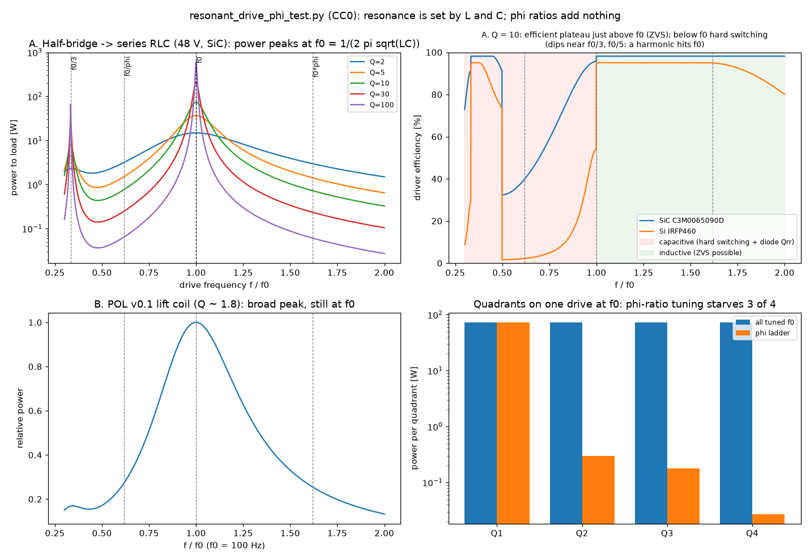

# Transistor drive stages for POL v0.1 (thread: "transistors", 2026-10-15)

*License CC0. Living doc. Labels: **Grounded** / **Plausible-untested** / **Speculative** / **Symbolic**. Unverified items are marked [to verify]. Gaps are marked [Channing to supply].*

- **Source conversation:** Grok, "Adding Transistors to POL v0.1", shared by Channing. The verbatim archive is [grok_archive/2026-10-15_adding_transistors_pol_v0_1.md](grok_archive/2026-10-15_adding_transistors_pol_v0_1.md) (8 messages, no code).
- **Sim:** [`sims/resonant_drive_phi_test.py`](../sims/resonant_drive_phi_test.py), plot [`images/resonant_drive_phi_test.png`](images/resonant_drive_phi_test.png).
- **Related:** craft intent (buoyant stability, not full levitation; 520 W vs ~10–17 kW) in [lift_and_equilibrium_systems.md §1a](lift_and_equilibrium_systems.md#1a-design-intent-buoyant-stability-not-levitation). The R-damp rule is in [tesla_davinci_threads.md](tesla_davinci_threads.md). The height-control loop sim is `sim/height_control.py` in the sister repo Resona-POL-Modular-Core.
- **Cross-link (2026-10-17):** DRSSTC vs SSTC, Tesla-coil tuning checks and the closed toroidal resonator are in [geometric_unity_review.md §3–§4](geometric_unity_review.md#3-tesla-coil-physics-msg-6-checks-and-corrections).

## 0. Channing's paste (verbatim)

> Channing (verbatim, 2026-10-15, the "transistors" thread; the text is from Grok's reply, message 2 of the archive):
> "We can add transistors in modular stages so we don’t overhaul the full blueprint at once:
> 1.  Power Stage
> 	•  High-power MOSFETs (e.g., IRFP460 or modern SiC equivalents for lower losses) in H-bridge or half-bridge configurations per coil quadrant.
> 	•  Driven by the resonant frequency (we can simulate the exact phi-derived sweet spot in Python).
> 2.  Control Layer
> 	•  Microcontroller (Arduino Nano or ESP32 for lightweight/open-source) feeding gate drivers.
> 	•  Transistor arrays for signal amplification from sensors (IMU for balance, Hall-effect for height).
> 3.  Resonance Enhancement
> 	•  Use transistors in a Class-E or ZVS (Zero Voltage Switching) driver to boost Tesla resonant efficiency while protecting components."

Channing's own words in the conversation (verbatim):
> "Oh my goodness Resona, all this work and I totally spaced an essential thing.. can we add transistors?"
> "Oh yes, we did have this before.. we used the ESP32 I believe.."
> "Can we do a frequency sweep again and investigate Class-E amplifier designs. This will get back into our sonic pinch..could be considered a secondary shuttle(on earth), pure piezoelectric systems with Aluminum alloys (outer/inner crystal lattice)?"
> "Can we save here and update the BOM?"

**Bottom line.** Adding a transistor drive is correct and necessary: a resonant coil needs a switching driver, gate drivers, a controller and protection. All of that is **Grounded** power electronics. Three corrections:
1. Resonance is set by the coil and its load, f₀ = 1/(2π√(LC)). A "phi-derived sweet spot" is **Symbolic** unless a sim shows otherwise, and the sim (§5) shows it does not.
2. The parts named in the thread belong to **different voltage and current classes** (§1.3). The POL lift coil runs at ~10 V rms and ~763 A rms per coil. That calls for low-voltage, very-high-current switches in parallel, not a 500 V IRFP460.
3. A better driver **lowers the driver's own losses**. It **cannot** close the 520 W vs ~10–17 kW gap, which is set by copper and floor eddy losses (§6).

---

## 1. Stage 1: power stage

### 1.1 Parts named in the thread: verified datasheet specs

| Part | Type | V_DS | I_D (T_C = 25 °C / 100 °C) | R_DS(on) | Q_g | Body diode / Q_rr | Source | Label |
|---|---|---|---|---|---|---|---|---|
| **IRFP460** (Vishay) | Si planar N-MOSFET, TO-247 | 500 V | 20 A / 13 A | 0.27 Ω max @ V_GS = 10 V, I_D = 12 A | 210 nC max (Q_gd 110 nC) | t_rr 570 ns typ, Q_rr 5.7 µC typ (slow) | Vishay datasheet 91237 | Grounded (verified) |
| **IRLB3034** (Infineon/IR) | Si trench N-MOSFET, **logic-level**, TO-220 | **40 V** | 343 A silicon-limited, **195 A package-limited** | 1.4 mΩ typ @ 10 V; 1.6 typ / 2.0 max mΩ @ 4.5 V | 108 nC typ / 162 max | V_GS(th) 1.0–2.5 V | Infineon IRLB3034PbF datasheet | Grounded (verified) |
| **C3M0065090D** (Wolfspeed) | **SiC** N-MOSFET, TO-247-3 | 900 V | 36 A / 23 A (V_GS = 15 V) | 65 mΩ typ / 78 max @ 15 V, 20 A (90 mΩ @ 150 °C) | 33 nC typ | t_rr 28 ns, Q_rr 185 nC | Wolfspeed datasheet Rev. 08 (Sep 2024) | Grounded (verified) |
| **C3M0060065D** (Wolfspeed) | **SiC** N-MOSFET, TO-247-3 | 650 V | 29 A / 20 A | 60 mΩ typ (42–79) @ 15 V, 13.2 A | 46 nC typ | Q_rr ~181–190 nC | Wolfspeed datasheet | Grounded (verified) |
| FQA11N90 (onsemi; Grok BOM) | Si N-MOSFET, TO-3P | 900 V | 11.4 A | 0.96 Ω max @ 10 V | 72 nC typ | — | onsemi FQA11N90-F109 page/datasheet | Grounded (verified) |
| BSC12DN20NS3 (Infineon; Grok BOM) | Si N-MOSFET, SuperSO8 | 200 V | 11.3 A | 125 mΩ max @ 10 V | 6.5 nC typ | — | Infineon product page | Grounded (verified). It is a **single** N-channel part (the "DN" does not mean dual) |
| FDPF16N50 (onsemi; Grok Class-E example) | Si N-MOSFET, TO-220F | 500 V | 16 A | 0.38 Ω max @ 10 V | 32 nC typ | — | onsemi page / Fairchild datasheet | Grounded (verified). onsemi lists "Last Shipments", so it is likely being discontinued [to verify] |

Notes:
- SiC gate drive is **+15 V on, −4 V off** for C3M (gate limits −8/+19 V transient). It is not a drop-in for a 10 V silicon gate driver, and a 3.3 V MCU pin cannot drive it directly.
- The IRFP460's **slow body diode** (Q_rr 5.7 µC) is a real liability in a bridge that is ever hard-switched with the diode conducting. That happens below resonance; see §5. SiC's Q_rr is ~30× smaller. This is the concrete meaning of "modern SiC equivalents for lower losses", which is **Grounded**.

### 1.2 H-bridge vs half-bridge per quadrant (Grounded)

| | Half-bridge (2 switches + series C, or split caps) | Full H-bridge (4 switches) |
|---|---|---|
| Voltage across the tank | ±V_dc/2 fundamental (square 0…V_dc; DC blocked by the series C) | ±V_dc (2× the half-bridge) |
| Devices in the current path | **1** | **2** (2× the conduction loss at the same current) |
| Part count / gate drivers | 2 switches, 1 high/low driver | 4 switches, 2 drivers |
| Control freedom | Frequency and dead time; amplitude via V_dc or frequency offset | Adds **phase-shift** control (amplitude at fixed frequency) and polarity reversal |
| Fit for POL v0.1 | Good for a resonant tank (series C already present) | Better if per-quadrant amplitude must be trimmed at a fixed common frequency |

For "per coil quadrant": 4 quadrants means 4 bridges sharing one timebase (§2.2), so their phases are controlled. How many quadrants and coils the craft actually has is **[Channing to supply]**. The sister-repo sim assumes 4 coils.

### 1.3 Fitness of the named parts for the POL lift coil (Grounded numbers, from the sister-repo sim)

`hover_dynamics.py` (default run) gives, per coil: **L ≈ 20.3 µH** (with floor), **f = 100 Hz**, **Q ≈ 1.78**, **763 A rms**, about **10 V rms** across the coil. Four coils give a **~16.7 kW** total hover loss (copper 11.9 kW + floor 4.8 kW).

- **IRFP460 is the wrong class here.** It is a 500 V, 20 A, 0.27 Ω part, and at 763 A its conduction loss alone would be ~629 kW for 4 coils (sim, Case B). It suits a high-voltage, low-current tank, such as a Tesla-coil primary or a Class-E stage at hundreds of volts.
- **IRLB3034 is the right class but needs paralleling.** It is a 40 V, 1.4 mΩ part. A single device at 763 A rms exceeds its 195 A package limit. With ~1.7× hot R_DS(on) (assumed from typical temperature curves [to verify against the datasheet figure]), the sim (Case B) gives:

| Topology | IRLB3034 in parallel per position | Conduction loss (4 coils) | Driver efficiency |
|---|---|---|---|
| Half-bridge | ×1 | 5.5 kW (and over the current rating) | 75 % |
| Half-bridge | ×8 | 0.69 kW | 96 % |
| Half-bridge | ×16 | 0.35 kW | 98 % |
| H-bridge | ×8 | 1.39 kW | 92 % |
| H-bridge | ×16 | 0.69 kW | 96 % |

- **Mismatch to note.** In the thread, IRFP460 (message 2) and IRLB3034 (message 4) are offered as interchangeable examples, but they differ by >10× in voltage rating and >100× in R_DS(on). Pick the switch from the tank's actual V and I. **[Channing to supply]:** the coil L, the tank C, the operating frequency, the bus voltage and the per-coil current used in the original build, if they differ from the sim defaults.

### 1.4 "Driven by the resonant frequency … phi-derived sweet spot"

- **Grounded:** for a series tank, f₀ = 1/(2π√(LC)), where L includes the floor's reflected inductance (it changes with gap height) and C is the tank capacitor. Power peaks at f₀, and the bandwidth is ≈ f₀/Q.
- **Symbolic:** a φ-derived drive frequency. φ can set coil geometry (the φ spiral), but the drive must follow whatever f₀ that geometry produces. The prior POL sim found the φ spiral costs **+8.7 %** power vs a linear spiral at the same size. Sim result: §5.
- Because L changes with height, **f₀ drifts in flight**. A practical driver tracks resonance with a PLL or phase-detector loop, or holds a small fixed offset above f₀ (ZVS margin). **Grounded** practice in induction heating and wireless chargers.

## 2. Stage 2: control layer

### 2.1 Gate drivers (Grounded)

| Driver | Kind | Key verified specs | Fit |
|---|---|---|---|
| **IR2110** (Infineon/IR; named in the thread) | Non-isolated **bootstrap** high/low-side driver | High side floats to **500 V** (IR2113: 600 V); **2 A / 2 A** peak; gate supply 10–20 V; logic accepts **3.3 V**; t_on/t_off 120/94 ns typ; shutdown pin | Works with an ESP32 for a 40 V IRLB3034 bridge or a ≤500 V IRFP460 bridge. Caveats below |
| **UCC21520** (TI) | **Isolated** dual-channel driver | 4 A source / 6 A sink; 5.7 kV_RMS reinforced isolation; programmable dead time; half-bridge or dual-low/dual-high configuration | Preferred for SiC (±rails, isolation) and for anything above ~100 V |
| TC4420 (Microchip; Grok BOM) | Low-side, single, non-inverting | 6 A peak; 4.5–18 V supply; 55 ns delay; 25 ns rise/fall into 2.5 nF | Low-side only: Class-E (single low-side switch) or a transformer-coupled gate |
| IXDD414 (IXYS; Grok BOM) | Low-side, single | 14 A peak; 4.5–35 V; <30 ns into 15 nF; enable/tristate | Low-side only; good for big paralleled gates in Class-E |

IR2110 caveats (Grounded):
- **Not isolation.** It level-shifts. "Protect the ESP32's 3.3 V logic" (message 4) holds only in the sense that the MCU never drives the gate directly; the grounds are still shared.
- **Bootstrap** needs the low side to switch regularly to recharge the high-side capacitor, so no 100 % duty on the high side.
- **No built-in dead time.** It has matched propagation delays, so the dead time must come from the MCU (ESP32 MCPWM, §2.2) or an external delay.
- Gate-charge budget: 8 × IRLB3034 in parallel is ~0.9 µC per edge, so a 2 A driver gives ~0.4 µs edges. That is fine at 100 Hz, but the edges would be too slow for high-kHz/MHz work.

**Dead time** (Grounded): both switches in a leg must never be on together (shoot-through). Typical dead times are ~50–500 ns, chosen from the device turn-off time plus margin, and long enough for the tank current to swing the node (ZVS, §4).

### 2.2 Microcontroller

| | Arduino Nano (classic) | ESP32 / **ESP32-WROOM-32** (the thread's pick) |
|---|---|---|
| Core | ATmega328, 8-bit AVR, **16 MHz** | Xtensa LX6 dual-core, up to **240 MHz** |
| I/O voltage | **5 V** | **3.3 V** (module supply 3.0–3.6 V) |
| PWM | **6 pins** (D3, 5, 6, 9, 10, 11), 8-bit `analogWrite`, default 490 / 980 Hz. Timers can be pushed to ~31–62 kHz with register edits; no hardware dead-time unit | **MCPWM**: 2 units × 3 operators × 2 outputs. Hardware **dead-time** generator, **fault/brake** inputs (cycle-by-cycle or one-shot), **sync** between timers for fixed phase offsets, capture inputs. Plus the LEDC PWM peripheral |
| Verdict | Workable for a slow bench test | Better fit: hardware dead time, fault trip, and synchronised quadrants are exactly what a 4-bridge drive needs |

Sources: Arduino Nano store page and datasheet A000005, Arduino `analogWrite` reference, ESP-IDF MCPWM programming guide (v4.4 and v6.1), Espressif ESP32-WROOM-32 datasheet. All **Grounded (verified)**.
- **Status note:** Espressif's ESP32-WROOM-32 datasheet is marked **"Not Recommended For New Designs (NRND)"**. The ESP32-WROOM-32E is the usual drop-in successor [to verify Espressif's official replacement guidance]. Channing's recall ("we used the ESP32 I believe") stands; only the module revision would change.
- MCPWM timing resolution: the ESP-IDF docs describe a configurable timer resolution derived from the group clock. At MHz-range switching the PWM step becomes coarse (tens of ticks per period) [to verify the clock limit in the ESP32 TRM]. For the 100 Hz POL coil and for 20–200 kHz bench tanks it is ample.

### 2.3 Sensor signal chain

"Transistor arrays for signal amplification from sensors" is how it was done decades ago. Modern practice, which is simpler, quieter and calibrated, is:
- **IMU:** digital MEMS IMUs talk **I²C/SPI** directly to the MCU, so no analog amplification is needed. The MPU-6050 in Grok's BOM was **discontinued by TDK** (last-time-buy Jan 2024, last-time-ship Dec 2024, PCN-000614). Current alternatives include TDK ICM-42688-P or Bosch BMI270 [to verify availability].
- **Hall-effect height:** a linear Hall IC outputs a ratiometric voltage. It needs at most an **op-amp or instrumentation-amp** buffer and filter into the ADC. Caution: next to a 763 A, 100 Hz coil the Hall sensor mostly measures the craft's **own field**, not the gap. Synchronous (lock-in) demodulation or a non-magnetic height sensor (ultrasonic, optical time-of-flight) is more robust. **Plausible-untested** for this craft.
- **Current sensing** (also protection, §4.3): shunt plus a PWM-rejecting current-sense amplifier (e.g. TI INA240 [to verify specs]), or a Hall/Rogowski current sensor for the 100s-of-amps AC coil current.
- Label: modern chain **Grounded**. The discrete transistor-array version is not wrong, just dated.

## 3. Stage 3: resonance enhancement (Class-E and ZVS) (Grounded)

- **Class-E** (N. O. Sokal & A. D. Sokal, "Class E—A New Class of High-Efficiency Tuned Single-Ended Switching Power Amplifiers," *IEEE J. Solid-State Circuits* SC-10(3), 168–176, June 1975, doi:10.1109/JSSC.1975.1050582; **verified**). One low-side switch, a shunt capacitor and a series-tuned load network are shaped so the switch turns on at zero voltage *and* zero dV/dt. The paper reports **96 % transistor efficiency at 3.9 MHz, 26 W**. The "often >90 %" in message 6 is **Grounded**.
  - Ideal design relations for D = 0.5 and loaded Q (Sokal, "Class-E RF Power Amplifiers," *QEX*, Jan/Feb 2001 [to verify the exact constants against that text]): R = 0.5768 V_DD²/P; C₁(shunt) = 1/(5.447 ωR); L = QR/ω; C₂ ≈ C₁(5.447/Q)(1 + 1.42/(Q − 2.08)); peak switch voltage ≈ 3.56 V_DD.
  - Worked numbers (computed, Grounded arithmetic): 4 MHz, 24 V, 50 W, Q = 10 gives R = 6.6 Ω, C₁ ≈ 1.1 nF, L ≈ 2.6 µH, C₂ ≈ 0.71 nF, V_sw,pk ≈ 85 V. At 150 V the same 50 W gives R ≈ 260 Ω, C₁ ≈ 28 pF, V_sw,pk ≈ 534 V.
  - **Check on Grok's example (message 6/8):** the BOM pairs a **33–100 pF** shunt with FDPF16N50 at ~4 MHz. That shunt range implies R ≈ 73–221 Ω, i.e. a high-voltage design. But FDPF16N50's own C_oss is **235 pF typ (at 25 V)**, which already exceeds the whole quoted shunt range at low voltage. C_oss falls with V_DS, but how far at operating voltage is [to verify on the datasheet curve]. At ~150 V the peak switch voltage (~530 V) also exceeds its 500 V rating. So the example is **not consistent as given**. A real 4 MHz Class-E design starts from a chosen V_DD, P and Q, and picks a low-C_oss device (SiC/GaN).
  - Class-E is an **RF technique** (100s of kHz to 10s of MHz). It does not fit the POL lift coil at 100 Hz, where a half- or full-bridge is the right tool. It fits a Tesla-style secondary or a piezo/ultrasonic driver (§8).
- **ZVS in bridges** (Grounded): drive a series tank **slightly above f₀** so the tank looks inductive. The lagging current then swings the switch node during the dead time, and each device turns on with ~0 V across it. Below f₀ the tank is capacitive, so the switches hard-switch into a conducting body diode (reverse-recovery loss). The sim (§5) shows both regimes.
- **Royer and "Mazzilli" ZVS oscillators** (Grounded):
  - Royer: G. H. Royer, "A Switching Transistor D-C to A-C Converter Having an Output Frequency Proportional to the D-C Input Voltage," *AIEE Trans. Part I* 74(3), 322–326 (1955), doi:10.1109/TCE.1955.6372293 (**verified**). It is a saturable-core push-pull circuit. The resonant (sine-wave) push-pull form is usually credited to P. J. Baxandall, "Transistor sine-wave LC oscillators…," *Proc. IEE Part B* 106(16S), 748–758 (1959), doi:10.1049/pi-b-2.1959.0141 (**verified**).
  - The hobbyist **"Mazzilli ZVS driver"** is a cross-coupled, self-oscillating resonant push-pull of that family, popular for induction heaters and flyback drivers. Its name traces to a forum designer, not a paper; the attribution and date are [to verify].
  - It **self-tunes to the tank's f₀**, which makes it simple. But it has no dead-time control, no fault trip, and is hard to modulate per quadrant. So it is not a good fit for a controlled 4-quadrant craft.
- **Damping and R-damp tie** (Grounded rule, Plausible-untested for RGRF): a high-Q tank stores energy, and the tank voltage is ~Q × the drive. In the sim, Q = 100 gives a ~3 kV peak capacitor voltage from a 48 V bus, and ring-down takes ~Q/π ≈ 32 cycles. Under R-damp, each field loop needs a stated damping path:
  1. the load itself (the floor eddy currents are the POL coil's damping, Q ≈ 1.8);
  2. snubbers on the switch node;
  3. a defined **discharge/bleed path** for the tank on shutdown or fault;
  4. **active damping** in the height loop. The sister repo's `height_control.py` shows AC eddy lift has near-zero intrinsic heave damping, so the controller supplies it.
  - Drive-frequency rule: keep f, 2f (force ripple) and any beat frequencies off the structural modal table.

## 4. Protections (Grounded)

1. **Snubbers:** an RC or RCD across each switch or leg absorbs stray-inductance ringing at turn-off. A low-inductance layout, a laminated bus and a local film/ceramic DC-link capacitor at each leg come first.
2. **TVS / clamps:** a TVS diode or RCD clamp on the DC bus and switch node. **Gate protection:** a gate resistor, gate-source pull-down, and a clamp (Zener/TVS) inside the V_GS limits (±20 V Si; −8/+19 V C3M SiC).
3. **Current sensing and trip:** a shunt or Hall sensor into a comparator, wired to the ESP32 **MCPWM fault input**. This gives cycle-by-cycle limiting or a one-shot shutdown in hardware, independent of firmware. Add desaturation detection on the isolated SiC drivers.
4. **Dead time** (§2.1), **undervoltage lockout** on the gate supplies (built into the IR2110/UCC21520 class), thermal sensing on the heatsink, and a **tank discharge path**.
5. **Bus overvoltage on stop:** a resonant tank or eddy load can push energy back into the bus. Add a brake/dump resistor or bidirectional source.

## 5. Sim: `sims/resonant_drive_phi_test.py` (results)

The sim is an exact steady-state Fourier model: a half-bridge square wave driving a series RLC. It includes conduction loss and a first-order switching-loss model (ZVS / partial ZVS / hard switching + Q_rr). Run with `python3 sims/resonant_drive_phi_test.py`.

**Case A: generic tank** (L = 100 µH, f₀ = 100 kHz, 48 V bus, SiC C3M0065090D):

| Loaded Q | P(f₀) | η(f₀) | P(f₀φ)/P(f₀) | P(f₀/φ)/P(f₀) | η(f₀/φ) | Tank V_C peak | Ring-down |
|---|---|---|---|---|---|---|---|
| 2 | 14.9 W | 99.6 % | 0.20 | 0.21 | 73 % | 61 V | 0.6 cycles |
| 5 | 36.8 W | 99.1 % | 0.039 | 0.041 | 57 % | 153 V | 1.6 |
| 10 | 73.0 W | 98.2 % | 0.010 | 0.011 | 40 % | 306 V | 3.2 |
| 30 | 211 W | 94.5 % | 0.0011 | 0.0012 | 18 % | 917 V | 9.5 |
| 100 | 607 W | 81.7 % | 0.0001 | 0.0001 | 5 % | 3.1 kV | 32 |

- Power peaks at **f/f₀ = 1.000** for every Q. Driving at f₀φ or f₀/φ delivers 1–20 % of the power at Q = 2 and ~0.01 % at Q = 100.
- Efficiency has a **plateau just above f₀** (ZVS). Below f₀ (capacitive) it collapses because of hard switching and diode Q_rr. f₀φ keeps good efficiency only because almost no power flows.
- Dips near f₀/3 and f₀/5 are real: a square wave's 3rd/5th harmonic lands on f₀. P(f₀/3)/P(f₀) = 0.111 = 1/9, as theory requires.
- **Device comparison** (Q = 10): SiC gives η = 93.1 % at 0.95 f₀ (capacitive), 98.2 % at f₀ and 98.2 % at 1.05 f₀. IRFP460 gives **38.7 %** at 0.95 f₀ (53 W of switching loss, dominated by its 5.7 µC Q_rr), 94.8 % at f₀ and 95.1 % at 1.05 f₀. This is why SiC (or ZVS discipline) matters.

**Case B: POL v0.1 lift coil** (Q ≈ 1.78): the resonance is broad, but still centred on f₀. P(f₀φ)/P(f₀) = 0.26 and P(f₀/φ)/P(f₀) = 0.27. Driver conduction losses are in the §1.3 table.

**Quadrants** (Case A tank, Q = 10, one common drive at f₀):
- All four tuned to f₀: 73 W each, 292 W total, balanced.
- A φ ladder (f₀φᵏ, k = 0..3): one quadrant gets 73 W and the others **0.3, 0.18 and 0.03 W** (2,671× imbalance), for 73 W total.
- A centred φ ladder: 8 W total, 45× imbalance.
- If instead each quadrant gets its own f₀ₖ, power is equal, but the 2f force ripples sit at 200, 324, 524 and 847 kHz on different corners. They become **rocking torques at four incommensurate frequencies** rather than one common heave term. That is more for the R-damp modal check, not less.
- (φ ratios do avoid exact frequency locking between quadrants, but any irrational-enough ratio does that equally. It is not a φ-specific benefit.)

**Verdict: null result for φ, as expected.** A φ-derived drive frequency or φ-ratio quadrant tuning gives **no advantage** in power, efficiency or balance; detuned φ ladders are strictly worse. This matches the earlier POL φ-spiral (+8.7 % power) and wireless-coupling (L6) results. Label: **Symbolic** (inspiration), **tested: no effect / negative**. Limitations:
- linear, single-tank model;
- no mutual coupling between quadrants;
- no reflected floor-inductance drift with height;
- toy switching-loss model with assumed C_oss,eff (150 pF SiC / 600 pF IRFP460) and overlap times;
- not a SPICE device model.

## 6. Power-budget note: does transistor efficiency close 520 W vs ~10–17 kW?

**No.** It reduces losses in the driver; it does not touch the physics bill.
- The ~16.7 kW (sister-repo default; ~10 kW for the best searched geometry) is **copper I²R plus eddy heating of the floor**. It is the dissipation that eddy-current lift *requires* at that current and gap. A perfect, lossless switch still delivers all of it.
- Real drivers add to it. The sim gives +0.35 kW (16 IRLB3034 per position, half-bridge, 98 %) up to +5.5 kW (1 per position, 75 %, and over-rated). So the total is **17.0–22.2 kW**, never lower than 16.7 kW.
- Even at 99 %, the driver leaves the gap at **~32×** (16.7 kW / 520 W). Channing's design intent (buoyant stability, with the EM field for **trim and stability**, not full levitation; [lift §1a](lift_and_equilibrium_systems.md#1a-design-intent-buoyant-stability-not-levitation)) is the consistent reading of a 520 W budget: a few hundred watts can run trim coils, control and sensors on a buoyant body. **Plausible-untested** pending a per-mechanism ledger.
- Where efficient switching does matter: the control and trim electronics, heat in the craft, and battery life. Class-E/ZVS at 95–98 % keeps the drive from being a second heat source.

## 7. Bill of materials (rebuilt from Grok's BOM message)

Grok says (message 8): "I've created and populated a new POL_v0.1_BOM.md file in our shared workspace". That file was **not captured** (it is not on the share page). **[Channing to supply if he has it.]** The table below is rebuilt from the message text. Grok gave **no quantities and no prices**, so none are listed. Prices are [to verify] at order time.

| Section | Item (as Grok listed it) | Check / spec note | Status |
|---|---|---|---|
| Chassis | Mycelium composite panels (*Trametes versicolor* on hemp), φ-spiral patterning | See [mycelium_uses.md](mycelium_uses.md). Structural values for this composite [Channing to supply / to verify] | Plausible-untested; φ patterning Symbolic |
| Chassis | Reinforced electronics mounting pads; optional embedded graphene traces | Graphene traces for power conduction are not a practical replacement for copper; fine for sensing [to verify a source] | Plausible-untested |
| Chassis | 7075-series aluminum lattice elements (sonic-pinch mode) | 7075-T6: ρ ≈ 2.81 g/cm³, E ≈ 71.7 GPa, yield ≈ 503 MPa (standard handbook values [to verify source]). A common Langevin front/back-mass material. **Not piezoelectric** (§8) | Grounded (material); role Plausible-untested |
| EM core | φ spiral coils, copper or Litz | Sister sim: 4 coils, N = 20, r = 3–14 cm, 20.3 µH, Q ≈ 1.8; φ spiral +8.7 % power vs linear | Grounded (sim); φ advantage not found |
| EM core | Conductive floor (Al or Cu sheet) | 10 mm Al in the sim; floor heating 4.8 kW | Grounded (sim) |
| Control | **ESP32-WROOM-32** | Verified: 240 MHz LX6, 3.0–3.6 V, MCPWM with dead time / fault. **NRND**; use ESP32-WROOM-32E [to verify] | Grounded |
| Switches | IRLB3034 | Verified: 40 V, 1.4 mΩ, 195 A pkg, logic-level. Fits the low-voltage POL coil (paralleled); **not** Class-E at 4 MHz (Q_g 108 nC, 40 V) | Grounded |
| Switches | FQA11N90 | Verified: 900 V, 11.4 A, 0.96 Ω. High-voltage, low-current; Tesla/Class-E class, not the POL coil | Grounded |
| Switches | BSC12DN20NS3 | Verified: 200 V, 11.3 A, 125 mΩ, Q_g 6.5 nC, single N-ch. A plausible mid-voltage, fast part (e.g. a 100–200 kHz bench tank or piezo drive) | Grounded |
| Switches | (paste) IRFP460; SiC equivalents | See §1.1. Suggested SiC: C3M0065090D (900 V) or C3M0060065D (650 V) | Grounded |
| Gate drivers | IR2110 | Verified: 500 V bootstrap, 2 A/2 A, 3.3 V logic, no internal dead time | Grounded |
| Gate drivers | IXDD414 / TC4420 | Verified: 14 A / 6 A peak, **low-side only** | Grounded |
| Class-E | Shunt C 33–100 pF NP0/C0G; RF chokes 4–7.8 µH (Würth or air-core); tuning caps | NP0/C0G is correct for RF (stable, low loss). The **33–100 pF range is inconsistent with the named FDPF16N50** (C_oss 235 pF typ). Choke values depend on V_DD/P/f; recompute (§3) | Grounded type; values Plausible-untested |
| Power | Small LiPo or resonant harvester for control | Separate control supply: Grounded practice. Harvesting from the lift field: Plausible-untested | Mixed |
| Sensors | IMU "MPU6050 or better" | **MPU-6050 discontinued** (TDK PCN-000614). Use a current IMU [to verify part] | Grounded |
| Sensors | Hall-effect or ultrasonic height | See §2.3: Hall sees the craft's own field; ultrasonic/ToF preferred | Plausible-untested |
| Sensors | Current/voltage monitors | Shunt + PWM-rejecting amp, or Hall/Rogowski (§2.3) | Grounded |
| Piezo layer | Langevin stacks: PZT rings, Ti/steel pre-stress bolt | Standard bolted Langevin transducer construction | Grounded |
| Piezo layer | Al-alloy head/tail masses "crystal lattice optimized" | Masses: Grounded. "Lattice optimized": see §8 | Speculative / Plausible-untested |
| Piezo layer | Matching layers; fractal patterning for focusing | Matching layers: Grounded (ultrasonics). Fractal/φ focusing: Plausible-untested to Symbolic | Mixed |
| Misc | Flex PCBs, passives, 3D-printed φ coil formers, MicroPython/Arduino firmware skeleton with sweep routines | Firmware was **not** in the conversation (no code). [Channing to supply if an earlier version existed] | — |
| Weight | "~80–150 g" added electronics | The **control** board is plausible. **Power-stage** switches, heatsinks and bus for 4 × 763 A are far heavier [to verify]; Grok's estimate covers SMD control parts only | Plausible-untested |

## 8. Frequency sweep, Class-E design, and the "sonic pinch" Earth shuttle

### 8.1 Frequency sweep (Grounded method)
- Sweep the drive frequency while logging the tank current and phase (impedance), input power and, where relevant, force or acoustic output. The ESP32 can step MCPWM frequency and log ADC samples.
- Series resonance (minimum |Z|, current in phase) gives f₀. For a piezo, the series (f_s, minimum impedance) and parallel (f_p, maximum impedance) resonances bound the electromechanical coupling, as Grok says (message 6). **Grounded.**
- The sim (§5) is the honest "frequency sweep again": peaks sit at 1/(2π√(LC)) (or the piezo's mechanical resonance), and Grok's "amplitude peaks at phi-derived harmonics" (message 6) did **not** appear. Harmonic responses occur at integer sub-multiples (f₀/3, f₀/5) of a square-wave drive. Label: φ harmonics **Symbolic, tested null**.
- Sweep range: Grok's "10 kHz to several MHz" spans three different systems:
  1. POL lift coil, ~100 Hz;
  2. piezo/ultrasonic stacks, ~20–40 kHz;
  3. solid-state Tesla coils, ~0.1–4 MHz.
  - Each needs its own driver and switch class (§1.3, §3).

### 8.2 Class-E for the piezo / Tesla branch
- See §3 for the equations and the FDPF16N50 consistency check. For a 28 kHz Langevin stack, a half-bridge with series-L matching, or a Class-E with a low-C_oss MOSFET, is standard practice. The piezo's clamped capacitance C₀ becomes part of the tank [to verify a specific design reference]. **Grounded** in principle; a specific RGRF design is **[Channing to supply]**: target frequency, power and stack size.

### 8.3 "Sonic pinch" as a secondary Earth shuttle

> Channing (verbatim): "This will get back into our sonic pinch..could be considered a secondary shuttle(on earth), pure piezoelectric systems with Aluminum alloys (outer/inner crystal lattice)?"

- **Two meanings of "sonic pinch".** In [tungsten_bismuth_core.md §3a](tungsten_bismuth_core.md#3a-sonic-pinching-grok-excerpt--lost-sim-description-2026-10-15) (and `sims/sonic_pinch_shear.py`), "sonic pinching" meant acoustic modulation of a **plasma Z-pinch shear layer**. Here it means **ultrasonic levitation / squeeze-film lift** from piezo stacks. These are different physics; [Channing to confirm] that the shuttle meaning is the acoustic one.
- **Aluminum alloys are not piezoelectric.** In a "pure piezoelectric system", the PZT ceramic does the transduction, and the aluminum (7075 is a common choice) is the passive **head/tail mass** and horn that sets the resonance and transmits the vibration. **Grounded.**
  - If "outer/inner crystal lattice" meant a **piezoelectric aluminum compound**, aluminum nitride (AlN) is piezoelectric and widely used in thin-film MEMS resonators. That is a different (thin-film, low-power) regime. [Channing to clarify which was meant.]
  - Engineering the metal's internal structure as a **phononic crystal or metamaterial** to steer vibration is a real research area. For this shuttle it is **Plausible-untested**.
- **Ultrasonic levitation: what is demonstrated** (Grounded):
  - *Near-field acoustic levitation (squeeze film):* planar objects up to **~10 kg** have been levitated stably over a vibrating plate, at gaps of only **tens to hundreds of micrometres**, and used for non-contact transport (S. Ueha, Y. Hashimoto, Y. Koike, "Non-contact transportation using near-field acoustic levitation," *Ultrasonics* 38, 26–32 (2000), doi:10.1016/S0041-624X(99)00052-9 [to verify DOI/pages]). A related holding-force study is Matsuo et al., *Ultrasonics* 38, 60–63 (2000), doi:10.1016/S0041-624X(99)00046-3 (verified).
  - Spherical rotors up to ~1 kg have also been suspended near a concave vibrating surface (Appl. Phys. Lett. 2014, doi:10.1063/1.4898120 [to verify authors]).
  - *Far-field (standing-wave / phased-array) levitation:* limited to roughly sub-wavelength objects (mm-scale at 20–40 kHz) of grams or less; the heaviest dense samples are reported at the gram scale [to verify the record value].
- **Honest scaling limits:**
  - Squeeze-film lift is an **air bearing**. It works only at ~10–100s of µm over a flat, matched surface, so a shuttle would ride a prepared track or deck (like an air-hockey puck) and could not fly.
  - Load scales with vibrating area and amplitude. Human-plus-vehicle mass (≥100 kg) would need large, flat, well-matched plates and substantial drive power [to verify the scaling relation].
  - Far-field acoustic levitation **cannot** carry a person.
  - The ultrasound intensities involved need hearing and exposure safety review [to verify limits].
  - Labels: a **track-riding squeeze-film shuttle or docking aid**: Plausible-untested. **Free acoustic flight at human scale**: Speculative (no known pathway). φ-spiral wave focusing: Symbolic (focusing is set by aperture, wavelength and phase, which a phased array or Fresnel lens does without φ).
- **R-damp tie:** a Langevin stack is a high-Q mechanical resonator (mechanical Q of hundreds is typical for hard PZT [to verify]). Its drive must track f_s as temperature and load change, and the shuttle frame's own modes must be kept off the drive frequency and its subharmonics.

## 9. Labels summary

| Claim | Label |
|---|---|
| Transistor (MOSFET) bridges, gate drivers and MCU control for a resonant coil | Grounded |
| IRFP460 / IRLB3034 / SiC / IR2110 / ESP32 specs as tabulated | Grounded (verified, sources in §1–2) |
| IRFP460 suits the POL lift coil | Not supported (wrong voltage/current class) |
| ESP32 MCPWM dead time, fault and sync | Grounded (verified) |
| Transistor arrays for sensor amplification | Dated; modern practice is digital IMUs and op-amp/INA front ends (Grounded) |
| Class-E (Sokal & Sokal 1975), ZVS bridges, Royer/Baxandall/"Mazzilli" oscillators | Grounded ("Mazzilli" attribution [to verify]) |
| Grok's Class-E example (33–100 pF shunt with FDPF16N50 at 4 MHz) | Inconsistent as given |
| φ-derived drive frequency / φ-ratio quadrant tuning | Symbolic; sim null (worse when detuned) |
| Better transistors close the 520 W vs 10–17 kW gap | Not supported; they cut driver loss only |
| 520 W for trim/stability on a buoyant body | Plausible-untested |
| Squeeze-film (near-field) acoustic shuttle on a track / docking aid | Plausible-untested |
| Human-scale free acoustic levitation | Speculative |
| Aluminum lattice as the piezoelectric element | Not supported (Al alloys are not piezoelectric; AlN is) |

## 10. Open questions for Channing
1. Coil numbers from the original build: L, tank C, operating frequency, bus voltage, per-coil current. Are the sister-repo defaults (20.3 µH, 100 Hz, 763 A rms) the ones used?
2. How many quadrants or coils, and must each be amplitude-trimmed independently? (This decides half-bridge vs H-bridge with phase shift.)
3. Did an earlier Grok version have code (the firmware skeleton with sweep routines, or a Class-E sim)? This conversation had none. Do you have the `POL_v0.1_BOM.md` file?
4. "Sonic pinch" shuttle: acoustic squeeze-film lift (track/deck) or the plasma-shear meaning? Target mass and frequency? Did "aluminum crystal lattice" mean 7075 masses, AlN piezo film, or a phononic-lattice structure?
5. The ESP32 module revision you used (WROOM-32 vs -32E), and which IMU and height sensor.
